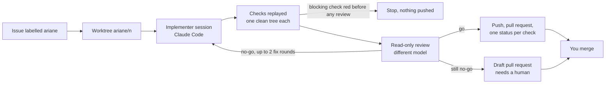

# Ariane

**Ariane is a local command-line orchestrator that takes a labelled GitHub issue to a reviewed
pull request with AI coding agents, while the human keeps deciding and merging.** A Claude Code
session implements the ticket; Ariane replays the checks itself, has the change reviewed by a
different model (on Claude Code, Codex, pi or opencode), measures the ticket and delivers one
branch and one pull request. The name comes from Ariadne's thread (*le fil d'Ariane*): you never
lose the thread of your own code.

It runs on Windows, macOS and Linux, from your own machine, with the agent CLIs and logins you
already have. Free software under the AGPL.

## Why Ariane exists, and what it has shown so far

**First, an exploration.** Ariane is its owner's own exploration of one question: what does an
engineering process look like when one developer drives many coding agents, and which of its
gates can be enforced by code rather than asked for in a prompt? That value is already there.
Since slice 2, Ariane's own tickets go through Ariane, and each ticket leaves a readable record
(`work/<n>/`: brief, journal, checks, reviews, `metrics.json`). The ideas it has tried out stand on
their own, with or without the tool:

- deterministic proof before opinion: the checks are replayed outside the agent's session, and
  each result is a commit status;
- an executable definition of done, given to the implementer and checked item by item by a
  reviewer on a different model, from another vendor if you choose;
- a measure per ticket (cost, rounds, first-pass verdict, human time, gates bypassed) as the basis
  for deciding how to use agents.

**Then, values still to be demonstrated.** None of the following is shown yet; each names what
would show it.

| Claimed value | What we know today | What would demonstrate it |
| --- | --- | --- |
| Faster or cheaper than an agent alone | **Not true for one person on a well-specified project.** On the [benchmark](docs/benchmark.md), Claude Code alone reached the same hidden acceptance, two to three times faster; Ariane cost less than Opus alone but more than Sonnet alone. Ariane is not pitched on speed. | Running the benchmark again after the fixes it called for; until then, the claim is dropped. |
| Trust for someone who merges many agents' pull requests | The checks are replayed and the review is independent; the review caught real defects before a human looked, but they did not change the benchmark's final result. | The benchmark's next lot: two people (or sessions) in parallel on one repository, where Ariane is expected to pay off. |
| Works on someone else's project | Almost every ticket so far ran on Ariane itself, in a Linux cloud sandbox. | Slice 4's gate: a second user installs Ariane on macOS and runs 10 tickets in shadow mode on their own project (below), compared on human time and gates bypassed. |
| Keeps the human understanding their own code | Not built: approvals before code, mastery checks and learnings are slices 5 to 8. | Those slices, measured with the same two numbers. |
| Fits teams under constraints (everything local, a reviewer from another vendor required by policy) | Built for it, never tested in such a team. | A team in that situation running the shadow mode. |

## What Ariane protects against, and what it does not

Ariane guards against an agent's **mistakes**, not against a hostile agent: everything runs as
your user, without an operating-system sandbox, until the security slice (slice 9).

- **No credentials for the agent.** Agents get an allow list of environment variables; the
  tracker token is removed from Ariane's own environment once read and only used for the tracker
  and the push. On Linux Ariane's process is not dumpable; on macOS, Windows and as root, a
  process of the same user may still read its memory (ADR 0017).
- **No push by the agent.** Agents hold no git credential and only Ariane pushes. A push guard
  stops the ticket if an agent touches git configuration, refs or hooks. In a cloud sandbox whose
  proxy supplies its own credentials, an agent's push is **detected after the session, not
  prevented** ([operations](docs/guide/operations.md#several-runs-on-one-repository-the-push-guard)).
- **No word taken for it.** Ariane replays the checks itself; the agent saying the tests pass
  counts for nothing. What the replay cannot run (a browser, a GPU) is declared and shown to the
  reviewer as untested, not verified ([checks](docs/guide/checks.md)).
- **No leftover processes, on Linux only.** A process an agent or a check leaves running is killed
  and stops the ticket; macOS and Windows have no such detection yet.
- **Basic redaction.** What Ariane posts and records is redacted against known values and common
  token formats; it is not a complete secret scanner, and the detail of a failure printed on the
  terminal is not redacted.

The residuals the owner accepted are written in the ADRs; those written as an item starting
with `- **Accepted residual.**` are also given to the reviewer.

## How a ticket runs



1. **The gate.** Ariane only runs an issue labelled `ariane` by a person with write access and not
   changed since; otherwise it exits 2 before creating anything.
2. **Isolation.** Branch `ariane/<n>` in a working tree beside the repository
   (`<repo>.ariane/worktrees/<n>`), the setup command, filtered environment, pushing blocked.
3. **Implementation.** A fresh Claude Code session, with the ticket as untrusted data and limits on
   cost, tokens, total time and idle time. Ariane commits, never the agent.
4. **Checks.** Each check of `ariane.toml` is replayed in its own clean tree at the commit. A red
   blocking check before any review stops the ticket.
5. **Review.** A read-only reviewer on a different model answers `go` or `no-go` against the ticket
   and the definition of done ([reviewers](docs/guide/reviewers.md)). A `no-go` gets up to two fix
   rounds.
6. **Delivery.** One push, one pull request (a draft if still `no-go`), one commit status per
   check, and the ticket's records in `work/<n>/`. You merge.

## Try it

Requirements: Python 3.11 or later, [uv](https://docs.astral.sh/uv/), git, and Claude Code
(`claude`) logged in. Use a fine-grained GitHub token limited to the one repository, with
**contents, pull requests and commit statuses: write; issues: read** (issues: write if you use
`ariane next --start`, which relabels the issue); no workflows, no administration. Shadow mode
only needs issues: read.

Put an `ariane.toml` at the root of the repository to work on. This one is enough to start:

```toml
[project]
base_branch = "main"
setup = ["uv", "sync"]

[tracker]
kind = "github"
repository = "your-account/your-repository"
token_env = "GH_TOKEN"

[agents.implementer]
runtime = "claude-code"
model = "claude-sonnet-5-5"
tools = ["Read", "Edit", "Write", "Glob", "Grep", "Bash"]
max_budget_usd = 5.0
timeout_minutes = 30

[agents.reviewer]
runtime = "claude-code"
model = "claude-opus-5-5"
tools = ["Read", "Glob", "Grep"]
max_budget_usd = 3.0
timeout_minutes = 20

[[checks]]
name = "tests"
command = ["uv", "run", "pytest", "-q"]
```

[`docs/ariane.example.toml`](docs/ariane.example.toml) comments every other key (definition of
done, documentation, selective checks, caches, sensitive paths, the queue), Ariane's own
[`ariane.toml`](ariane.toml) is a complete example, and the
[JSON Schema](docs/reference/ariane.toml.schema.json) lists them all.

PowerShell:

```powershell
uv tool install git+https://github.com/plaplanche/ariane
$env:GH_TOKEN = "<the token>"
ariane start 12
ariane status 12
ariane verify my-branch --issue 12
```

bash:

```bash
uv tool install git+https://github.com/plaplanche/ariane
export GH_TOKEN="<the token>"
ariane start 12
ariane status 12
ariane verify my-branch --issue 12
```

## Commands

Every command exits 0 on success, 1 when the work stopped or was refused (the last line says why
and what to do next), 2 on a usage or configuration error or an issue the gate refused; `start`, `update` and
`verify` exit 130 on Ctrl-C. Options are in the [command-line reference](docs/reference/cli.md); behaviour in
[operations](docs/guide/operations.md).

| Command | What it does |
| --- | --- |
| `ariane start <n>` | Runs the ticket of issue `n` up to its pull request; `--restart` starts a stopped ticket over, keeping its branch. Exit 1 also when the pull request is a draft that needs a human. |
| `ariane start --shadow <n>` | The same flow in a separate clone: nothing pushed, posted or written to your repository. |
| `ariane judge <n> accept\|reject --minutes N` | Records your verdict and time on a shadow ticket. |
| `ariane status <n>` | Shows a ticket's state, read from its folder. |
| `ariane verify <branch> [--issue N]` | Checks and reviews a branch finished by hand, then commits the records on it (never pushes). Exit 0 only on `go` with green blocking checks. |
| `ariane update <n>` | Merges the base branch into a delivered ticket's branch, replays, reviews, and pushes on `go`. |
| `ariane next [--start]` | Proposes the next ticket of the `ariane-next` queue that can start beside the running ones; `--start` starts it. Exit 1 when nothing can start. |
| `ariane report [--since YYYY-MM-DD]` | Cost, agent time, rounds, first-pass verdicts, human time, gates bypassed, shadow results, escapes. |

## Measure Ariane on your project (shadow mode)

This is the path for a second user on macOS (it works the same on Linux and Windows) who wants to know whether Ariane
does at least as well as their current process, on their own project. Shadow mode never pushes,
opens a pull request, sets a status, posts a comment or writes to your repository: it works in a
separate clone.

1. **Install Ariane** ([ADR 0021](docs/adr/0021-second-user-distribution-and-contributions.md)).
2. **Configure it.** Start from the minimal `ariane.toml` above, or download
   [`docs/ariane.example.toml`](docs/ariane.example.toml) as `ariane.toml` (commands below), and
   set `repository`, the checks and the agents.
3. **Label each ticket** `ariane`, by a person with write access, and again after any later edit
   or comment; otherwise `ariane start` refuses the ticket and exits 2 (ADR 0032).
4. **Per ticket**, fetch, run `ariane start --shadow <n>`, read the clone's `work/<n>/`
   (`<repo>.ariane/shadow/<n>/work/<n>/`), then record your verdict and the minutes you spent with
   `ariane judge <n> accept|reject --minutes N`.
5. **After the tickets**, run `ariane report`.

bash (macOS, Linux):

```bash
uv tool install git+https://github.com/plaplanche/ariane
export GH_TOKEN="<a token with read access to issues>"
curl -fsSL -o ariane.toml https://raw.githubusercontent.com/plaplanche/ariane/main/docs/ariane.example.toml   # then edit it
git fetch origin
ariane start --shadow 12
ariane judge 12 accept --minutes 20   # or reject
ariane report
```

PowerShell:

```powershell
uv tool install git+https://github.com/plaplanche/ariane
$env:GH_TOKEN = "<a token with read access to issues>"
Invoke-WebRequest https://raw.githubusercontent.com/plaplanche/ariane/main/docs/ariane.example.toml -OutFile ariane.toml   # then edit it
git fetch origin
ariane start --shadow 12
ariane judge 12 accept --minutes 20   # or reject
ariane report
```

**Pass criteria over 10 tickets:** no agent push or pull-request attempt, no write to real data,
no guard violation, Ariane's diff judged acceptable by you in at least 8, cost and duration
recorded. `ariane report` prints `shadow pass: yes|no` over the last 10 tickets (no attempt, no
violation, at least 8 accepted); cost, duration and real data are for you to check.

**Keep a short log of your current process** for the same tickets (your minutes per merged pull
request, and the steps skipped or gates bypassed). The comparison is on two numbers: human time
per merged pull request and the count of steps skipped or gates bypassed; Ariane's come from
`ariane report`, and the owner decides on them (spec, "Measuring Ariane").

## Status

Slices 1 to 3 are done: the ticket flow, dogfooding, and the vendor-neutral review with fix rounds
and `ariane verify`. Slice 4 (measurement and shadow mode) is built; its gate waits for the second
user's shadow run. Of slice 5, branch updates (`ariane update`) and a queue that honours `Needs #N`
(`ariane next`) are delivered; `ariane start` does not check dependencies yet. Approved briefs and
designs before the code, vertical slices, the per-ticket budget and the approve and revise
commands are not started, and depth by risk (C3) is partly built (selective checks, small
review). Slices 6 to 9 (stronger checks, mastery, learnings, security)
are not started. The roadmap is in [`docs/spec.md`](docs/spec.md).

## Documentation

- [`docs/spec.md`](docs/spec.md): vision, capabilities, non-functional requirements, roadmap and
  founding decisions.
- [`docs/guide/`](docs/guide/): [checks](docs/guide/checks.md) (selection, risk tiers, full
  replay, parallel checks, caches, `ARIANE_SLOT`, environment),
  [reviewers](docs/guide/reviewers.md) (what the review checks, isolation, Codex, pi, opencode),
  [operations](docs/guide/operations.md) (issue gate, restart, shadow, verify, update, next, push
  guard, report, logs).
- [`docs/architecture/`](docs/architecture/README.md): how Ariane works, in Mermaid diagrams from
  the system landscape to each module.
- [`docs/reference/`](docs/reference/cli.md) and [`docs/logs.md`](docs/logs.md): the command-line
  reference, the JSON Schema of `ariane.toml` and the catalogue of log types, generated by
  `scripts/generate_docs.py` (never edited by hand).
- [`docs/benchmark.md`](docs/benchmark.md): Ariane against Claude Code alone on a reference
  project.
- [`docs/adr/`](docs/adr/): architecture decision records, written as the implementation goes.

## Develop Ariane

From a clone, `uv sync` installs the development tools; the checks are listed in
[`CLAUDE.md`](CLAUDE.md) ("Checks"). `uv run pytest` runs the tests in parallel, one worker per
CPU (`pytest-xdist`, `-n auto`); `uv run pytest -n 0` runs them serially, for example to debug one
test with `pdb`. CI runs the checks with Python 3.13 on Windows, macOS and Linux, and with Python
3.11, the minimum, on Linux only ([ADR 0048](docs/adr/0048-parallel-tests-and-ci-matrix.md)). The
tests' git project is built once per worker and copied for each test
([ADR 0049](docs/adr/0049-template-project-and-windows-shards.md)). Windows CI runs the tests in
two shards, `uv run pytest --splits 2 --group 1` (or `2`) with `--splitting-algorithm
least_duration`, balanced from `.test_durations` (refresh it with
`uv run pytest --store-durations`); every other CI job runs the whole suite. The
`check-statuses.yml` workflow is specific to Ariane's own repository
([checks](docs/guide/checks.md#statuses-published-from-ci)).

## License

Ariane is free software under the [GNU Affero General Public License v3.0 only](LICENSE)
(`AGPL-3.0-only`): you may use, study, modify and share it, and anyone who offers a modified
Ariane to others, including as a network service, must publish their changes under the same
license. Other licensing terms can be arranged with the copyright holder
([ADR 0008](docs/adr/0008-license.md), [ADR 0021](docs/adr/0021-second-user-distribution-and-contributions.md)).
Fixes are sent as issues.
