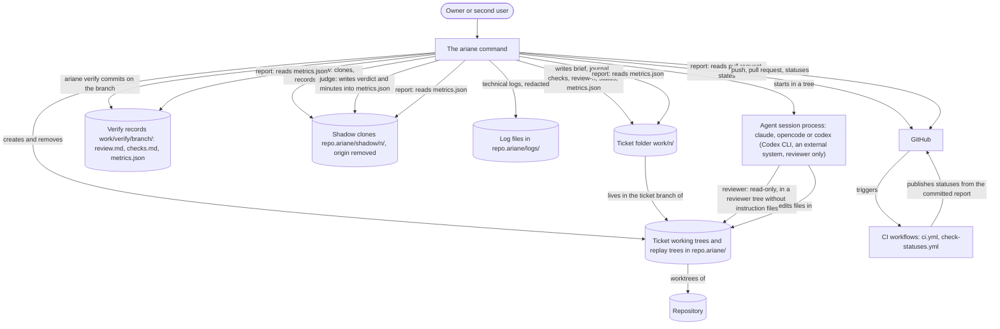

# Level 2: containers

What runs and what is stored.

- `ci.yml` runs the checks on Windows, macOS and Linux with Python 3.13, and on Linux with
  Python 3.11 too; the tests run in parallel (ADR 0005, ADR 0047).
- `check-statuses.yml` publishes the statuses from the committed report when Ariane cannot.
- The reviewer session is read-only: its tools are an allow list (`Read`, `Glob`, `Grep`). It reads a
  separate reviewer tree with no `CLAUDE.md`, `AGENTS.md` or `.claude/` (ADR 0031); Claude Code starts
  from an empty folder with `--restricted`. On opencode it ignores project configuration files. On Codex it runs `codex exec` in the read-only sandbox with the CLI's own login; Ariane never reads `~/.codex/auth.json`.
- The shadow clone is separate from the repository and has no remote: a shadow run cannot push (ADR 0036).
- The ticket folder (`brief.md`, `journal.md`, `checks.md`, `review-<n>.md`, `status.md`, `metrics.json`) is committed with the ticket and readable without Ariane.
