# Level 2: containers

What runs and what is stored.

```mermaid
flowchart TB
  user([Owner or second user])
  cmd[The ariane command]
  repo[(Repository)]
  trees[(Ticket working trees and replay trees in repo.ariane/)]
  folder[(Ticket folder work/n/)]
  verifyrec[(Verify records work/verify/branch/: review.md, checks.md, metrics.json)]
  shadowstore[(Shadow clones repo.ariane/shadow/n/, origin removed)]
  logs[(Log files in repo.ariane/logs/)]
  slotfiles[(Slot locks ~/.ariane/slots/k.lock, one per machine-wide run slot)]
  nextrec[(Proposals of ariane next: repo.ariane/next.md)]
  registry[(Run registry repo.ariane/runs/: live runs and ended.jsonl)]
  session["Agent session process: claude, opencode, codex or pi (Codex CLI and pi CLI: external systems, reviewer only)"]
  ci[CI workflows: ci.yml, check-statuses.yml]
  github[GitHub]
  user --> cmd
  cmd -->|creates and removes| trees
  trees -->|worktrees of| repo
  cmd -->|writes brief, journal, checks, review-n, status, metrics.json| folder
  folder -->|lives in the ticket branch of| trees
  cmd -->|starts in a tree| session
  cmd -->|ariane verify commits on the branch| verifyrec
  cmd -->|start --shadow: clones, records metrics.json| shadowstore
  cmd -->|judge: writes verdict and minutes into metrics.json| shadowstore
  cmd -->|report: reads metrics.json| folder
  cmd -->|report: reads metrics.json| verifyrec
  cmd -->|report: reads metrics.json| shadowstore
  cmd -->|report: reads pull request states| github
  cmd -->|technical logs, redacted| logs
  cmd -->|update: merges the base branch in the ticket's tree, records the round| folder
  cmd -->|start, update, verify: holds the lowest free slot, ARIANE_SLOT| slotfiles
  cmd -->|start: registers the run| registry
  cmd -->|next: reads the queue, needed issues; --start relabels| github
  cmd -->|next: reads the running tickets and the last run| registry
  cmd -->|next: tries a slot| slotfiles
  cmd -->|next: appends each proposal and start; holds next/.lock and the reservations next/n.json| nextrec
  cmd -->|next --start: starts ariane start n in the background, output in logs/n.out| logs
  session -->|reviewer: read-only, in a reviewer tree without instruction files| trees
  session -->|edits files in| trees
  cmd -->|push, pull request, statuses| github
  github -->|triggers| ci
  ci -->|publishes statuses from the committed report| github
```

- `ci.yml` runs the checks on Windows, macOS and Linux with Python 3.13, and on Linux with
  Python 3.11 too; the tests run in parallel (ADR 0005, ADR 0048).
- `check-statuses.yml` publishes the statuses from the committed report when Ariane cannot.
- The reviewer session is read-only: its tools are an allow list (`Read`, `Glob`, `Grep`). It reads a
  separate reviewer tree with no `CLAUDE.md`, `AGENTS.md` or `.claude/` (ADR 0031); Claude Code starts
  from an empty folder with `--restricted`. On opencode it ignores project configuration files. On Codex it runs `codex exec` in the read-only sandbox with the CLI's own login; Ariane never reads `~/.codex/auth.json`. On pi it runs `pi -p --mode json` with the read-only tools (`read`, `grep`, `find`, `ls`), no session file, extension, skill, prompt template, theme or context file, and offline; Ariane never reads pi's `auth.json`.
- Each `ariane start` (shadow included), `ariane update` and `ariane verify` holds one of 16 machine-wide slots, an operating-system lock on `~/.ariane/slots/<k>.lock` (outside every repository), until it ends; the project gets it as `ARIANE_SLOT` (ADR 0050).
- `ariane next` reads the queue (open issues labelled `ariane-next`), the run registry, the slots and the running tickets' branches, and appends every proposal to `<repo>.ariane/next.md`; only `ariane next --start`, run by the owner, starts a ticket, as a detached `ariane start <n>` whose output goes to `<repo>.ariane/logs/<n>.out`. Both hold the lock `<repo>.ariane/next/.lock`, which every registration of a run waits for, and `--start` reserves its ticket in `<repo>.ariane/next/<n>.json` until it registers (ADR 0059).
- The shadow clone is separate from the repository and has no remote: a shadow run cannot push (ADR 0036).
- The ticket folder (`brief.md`, `journal.md`, `checks.md`, `review-<n>.md`, `status.md`, `metrics.json`) is committed with the ticket and readable without Ariane.
