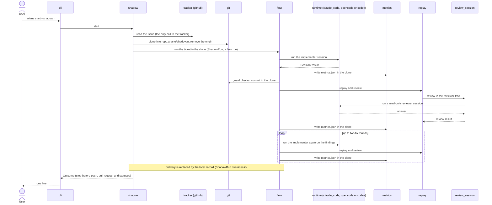
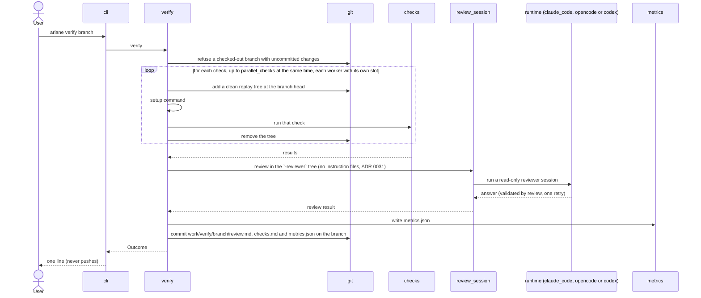
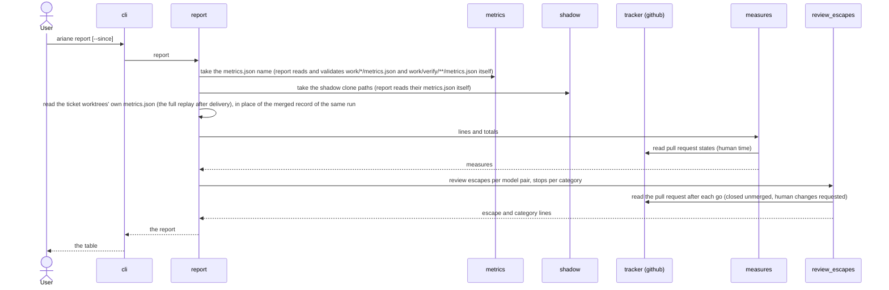
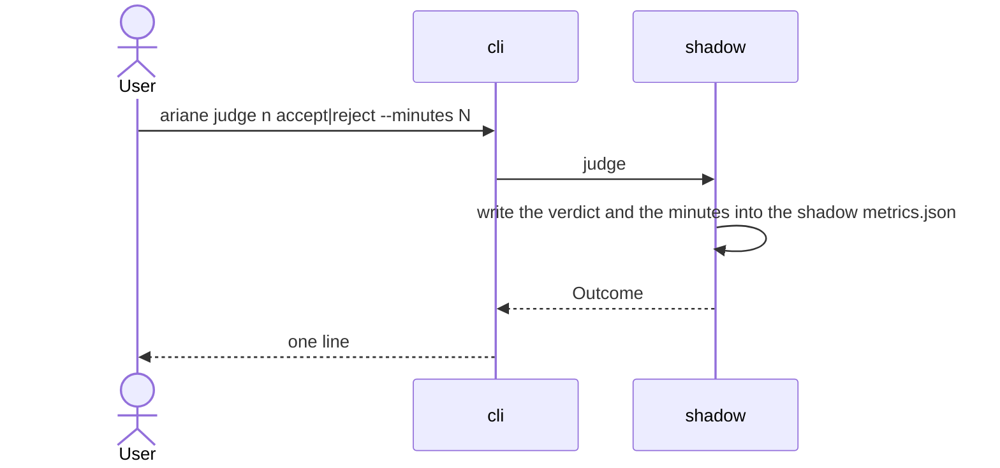

# Level 3: components

## Modules and their dependencies

An arrow goes from the importing module to the imported module; a dashed arrow is an import for
type checking only. Each module has a file in
[`modules/`](modules/).

```mermaid
flowchart TD
  __main__ --> cli
  checks --> config
  checks --> globs
  checks --> process
  checks --> risk
  checks --> stop
  checks --> ticket
  claude_code --> attempts
  claude_code --> process
  claude_code --> runtime
  cli --> claude_code
  cli --> codex
  cli --> config
  cli --> flow
  cli --> git
  cli --> github
  cli --> logs
  cli --> next_ticket
  cli --> opencode
  cli --> pi
  cli --> process
  cli --> report
  cli --> risk
  cli --> runtime
  cli --> shadow
  cli --> ticket
  cli --> tracker
  cli --> update
  cli --> verify
  codex --> process
  codex --> runtime
  config --> cache
  config --> config_schema
  config --> globs
  config --> risk
  context --> config
  context --> git
  context --> tracker
  delivery --> checks
  delivery --> git
  delivery --> process
  delivery --> redact
  delivery --> review
  delivery --> risk
  delivery --> stop
  delivery --> ticket
  delivery --> tracker
  flow --> checks
  flow --> config
  flow --> context
  flow --> delivery
  flow --> full_replay
  flow --> git
  flow --> logs
  flow --> metrics
  flow --> process
  flow --> redact
  flow --> replay
  flow --> restart
  flow --> review
  flow --> review_session
  flow --> risk
  flow --> runs
  flow --> runtime
  flow --> slots
  flow --> stop
  flow --> ticket
  flow --> tracker
  full_replay --> checks
  full_replay --> config
  full_replay --> delivery
  full_replay -.-> flow
  full_replay --> git
  full_replay --> redact
  full_replay --> replay
  full_replay --> risk
  full_replay --> stop
  full_replay --> ticket
  full_replay --> tracker
  git --> logs
  git --> pi
  git --> process
  git --> redact
  github --> logs
  github --> tracker
  logs --> redact
  measures --> tracker
  metrics --> attempts
  metrics --> runtime
  metrics --> stop
  metrics --> ticket
  metrics --> tracker
  next_ticket --> config
  next_ticket --> flow
  next_ticket --> git
  next_ticket --> globs
  next_ticket --> logs
  next_ticket --> metrics
  next_ticket --> process
  next_ticket --> runs
  next_ticket --> runtime
  next_ticket --> slots
  next_ticket --> stop
  next_ticket --> ticket
  next_ticket --> tracker
  opencode --> attempts
  opencode --> process
  opencode --> runtime
  pi --> config_schema
  pi --> process
  pi --> runtime
  process --> logs
  replay --> cache
  replay --> checks
  replay --> config
  replay --> context
  replay --> delivery
  replay -.-> flow
  replay --> git
  replay --> globs
  replay --> process
  replay --> restart
  replay --> review
  replay --> review_session
  replay --> risk
  replay --> slots
  replay --> stop
  replay --> ticket
  report --> measures
  report --> metrics
  report --> review_escapes
  report --> risk
  report --> shadow
  report --> ticket
  report --> tracker
  resolve --> checks
  resolve --> git
  resolve --> runtime
  resolve --> stop
  resolve --> ticket
  resolve -.-> update
  restart --> git
  restart --> metrics
  restart --> slots
  restart --> stop
  restart --> ticket
  review --> checks
  review --> config
  review --> context
  review --> git
  review --> risk
  review --> stop
  review --> ticket
  review --> tracker
  review_escapes --> stop
  review_escapes --> tracker
  review_session --> checks
  review_session --> config
  review_session --> git
  review_session --> metrics
  review_session --> review
  review_session --> risk
  review_session --> runtime
  review_session --> stop
  review_session --> ticket
  review_session --> tracker
  runs --> git
  runs --> process
  runs --> restart
  runs --> stop
  runtime --> attempts
  runtime --> config
  runtime --> stop
  shadow --> checks
  shadow --> config
  shadow --> flow
  shadow --> git
  shadow --> metrics
  shadow --> review
  shadow --> runtime
  shadow --> slots
  shadow --> stop
  shadow --> ticket
  shadow --> tracker
  slots --> stop
  ticket --> logs
  ticket --> redact
  ticket --> tracker
  update --> checks
  update --> config
  update --> context
  update --> delivery
  update --> flow
  update --> git
  update --> logs
  update --> metrics
  update --> process
  update --> replay
  update --> resolve
  update --> restart
  update --> review
  update --> runs
  update --> runtime
  update --> slots
  update --> stop
  update --> ticket
  update --> tracker
  verify --> cache
  verify --> checks
  verify --> config
  verify --> context
  verify --> flow
  verify --> git
  verify --> globs
  verify --> metrics
  verify --> process
  verify --> redact
  verify --> replay
  verify --> review
  verify --> review_session
  verify --> risk
  verify --> runtime
  verify --> slots
  verify --> stop
  verify --> ticket
  verify --> tracker
```

<!-- generated: dependencies -->

<!-- end generated -->

## `ariane start <n>`

```mermaid
sequenceDiagram
  actor U as User
  participant CLI as cli
  participant F as flow
  participant T as tracker (github)
  participant L as restart
  participant N as runs
  participant G as git
  participant R as runtime (claude_code, opencode or codex)
  participant P as replay
  participant C as checks
  participant S as review_session
  participant M as metrics
  participant D as delivery
  participant X as full_replay
  U->>CLI: ariane start n [--restart]
  CLI->>F: start
  F->>T: read the issue
  F->>L: hold repo.ariane/locks/n.lock until the end (refused if another process holds it)
  F->>N: register the run in repo.ariane/runs/n, with --restart the kept branch name (refused if a live run has it)
  F->>L: prepare
  L->>G: fetch; refuse if ariane/n is on the remote
  opt --restart
    L->>G: save the uncommitted work of tree n in a commit (temporary index)
    L->>G: remove the trees n, n-review, n-replay* (unknown folders as folders); rename ariane/n to ariane-restarted/n-time, the saved commit on top
  end
  L->>G: refuse leftovers (next: --restart), add the ticket working tree
  F->>F: journal ticket.restarted first when it started over
  F->>F: setup command, ticket folder brief
  F->>R: run the implementer session
  R-->>F: SessionResult
  F->>M: write metrics.json
  F->>G: guard checks (configuration, branch, untracked files)
  F->>N: snapshot git first, then drop the changes that are another registered run's own branch and keys
  F->>G: commit
  F->>P: replay and review
  P->>G: the round's diff from the start commit (one read, for the selection and the review)
  Note over P: only the checks the changed files select run; the others are skipped (ADR 0056)
  Note over P: parallel_checks above 1: up to that many workers, each with its own slot (ADR 0052)
  loop for each selected check, in declared order, up to parallel_checks at the same time
    P->>G: add a clean replay tree (setup runs there, with the worker's ARIANE_SLOT)
    P->>C: run that check, with ARIANE_CHANGED_FILES
    P->>G: verify git, the trees and the remote, remove the tree
  end
  Note over P: a stop in one worker or Ctrl-C kills the others' commands; every tree is removed
  C-->>P: results
  alt a blocking check failed
    P-->>F: stop before any review, push nothing
  end
  P->>S: review in the reviewer tree (no instruction files, ADR 0031)
  S->>R: run a read-only reviewer session
  R-->>S: answer (validated by review, one retry)
  S-->>P: review-0.md; go continues
  P->>G: verify git, the tree and the remote did not change
  loop at most two fix rounds, while the review is no-go
    F->>R: run a fresh implementer session with the findings
    F->>M: write metrics.json
    F->>G: guard checks, commit
    F->>P: clean replay, checks, review (review-1.md, review-2.md)
  end
  F->>D: deliver
  D->>G: one push
  D->>T: open the pull request (a draft, needs a human, if still no-go)
  D->>T: publish statuses
  D->>G: commit the record of the pull request (local branch only, not pushed)
  opt the last round skipped a check or ran one with ARIANE_FULL_SUITE=0, blocking checks green
    F->>X: after the delivery: draw full_replay_sample from the ticket number and the commit
    opt sampled
      X->>P: full replay: every check, ARIANE_FULL_SUITE=1, fresh trees of the replayed commit
      X->>T: status ariane/full-replay (failure on an escape) and, on an escape, a comment
    end
    X->>G: commit full-replay.md and metrics.json (local branch only, not pushed)
  end
  F->>N: append the run to ended.jsonl, then remove its entry (however the run ends)
  F-->>CLI: Outcome
  CLI-->>U: one line
```

## `ariane start --shadow <n>`

The run reads the issue only: no push, no pull request, no status, nothing written to the tracker
(ADR 0036). Everything is recorded in a separate clone with its origin removed.



## `ariane update <n>`

```mermaid
sequenceDiagram
  actor U as User
  participant CLI as cli
  participant D as update
  participant R as resolve
  participant T as tracker (github)
  participant G as git
  participant P as replay
  participant L as delivery
  participant K as ticket
  participant M as metrics
  U->>CLI: ariane update n
  CLI->>D: update
  D->>T: read the issue (issue gate), the pull request's state
  D->>G: refuse a missing, dirty or switched tree, a diverged branch; fetch the base
  alt the remote base is an ancestor of the head
    D-->>CLI: Outcome: up to date, nothing written
  else
    D->>K: read the ticket folder back
    D->>M: read metrics.json back
    D->>G: git merge --no-ff --no-edit origin/base (untrusted environment)
    alt conflict
      D->>R: resolve_conflicts: one implementer session, its task the conflicting paths
      R->>G: no unmerged path, no conflict marker line in a file or staged blob, git commit --no-edit (two parents)
      Note over D,R: left unresolved: needs a human, merge state kept, nothing committed
    else failed without a conflict
      D->>G: git merge --abort, check it restored the head and the tree
      D-->>CLI: Outcome: needs a human
    end
    loop at most the update session and one fix round (C10)
      D->>P: replay the checks at the head
      opt red after a clean merge, no session yet
        D->>R: session: the failing checks' output; commit "fix after merging base"
      end
      D->>P: review round k when green (review-k.md, k one more than the highest)
      opt red or no-go after a session
        D->>D: fix round 2 (findings and failing checks as data)
      end
    end
    alt go, green
      D->>L: push_update: records committed, remote branch unmoved, fast-forward push, statuses
    else still red or no-go
      D->>K: record the stop: needs a human, nothing pushed
    end
    D-->>CLI: Outcome
  end
  CLI-->>U: one line
```

## `ariane verify <branch>`



## `ariane report [--since]`



## `ariane next [--start]`

```mermaid
sequenceDiagram
  actor U as Owner
  participant CLI as cli
  participant X as next_ticket
  participant T as tracker (github)
  participant N as runs
  participant S as slots
  participant G as git
  U->>CLI: ariane next
  CLI->>X: show
  X->>T: queue(next_label): open issues in label order
  X->>N: running tickets; ended.jsonl for the last run
  X->>G: each running branch's changes since its base
  X->>S: take and release a slot (is one free?)
  X->>T: closed_as_completed for each Needs #N
  X->>X: reasons per issue, first one without: the proposal; append to next.md
  X-->>CLI: Proposal
  CLI-->>U: one line per issue, then Next: #N (no shared file with #M)
  U->>CLI: ariane next --start
  CLI->>X: start
  X->>X: propose again; refuse unless the phrase equals the last one in next.md
  X->>T: remove_label, add_labels (ready label)
  X->>X: spawn ariane start N detached, output in logs/N.out; append the start to next.md
  X-->>CLI: Outcome
  CLI-->>U: started #N, its journal and its output
```

## `ariane judge`


