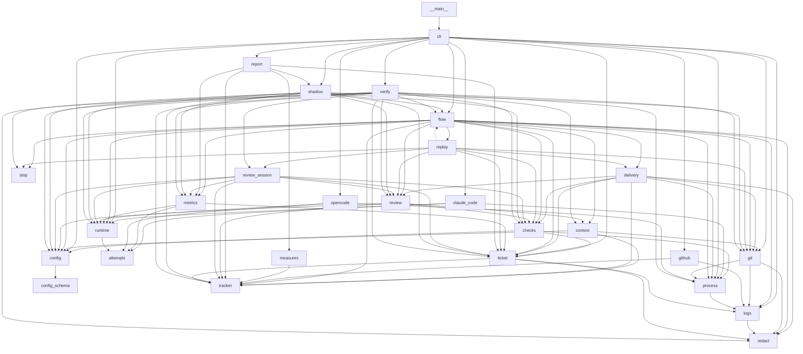
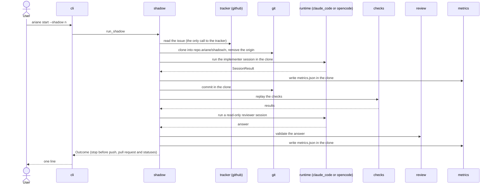
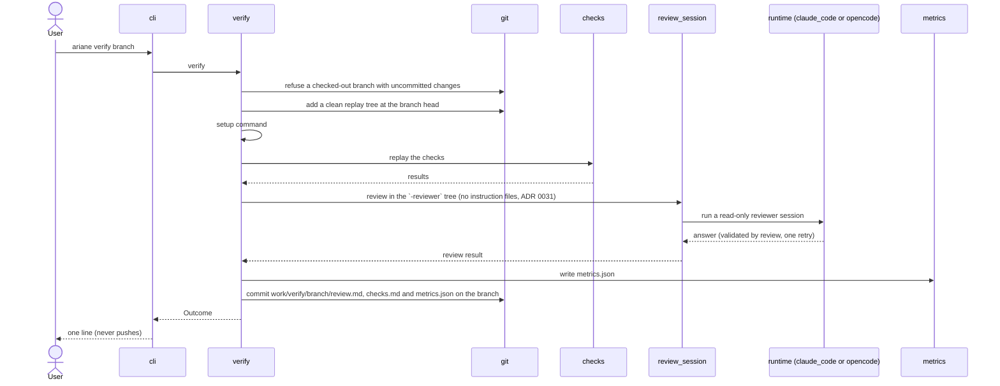
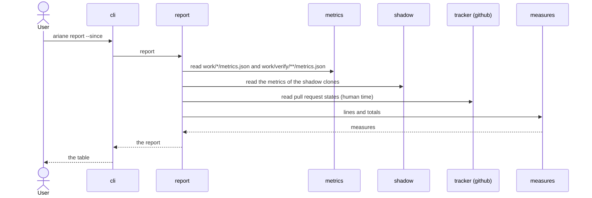
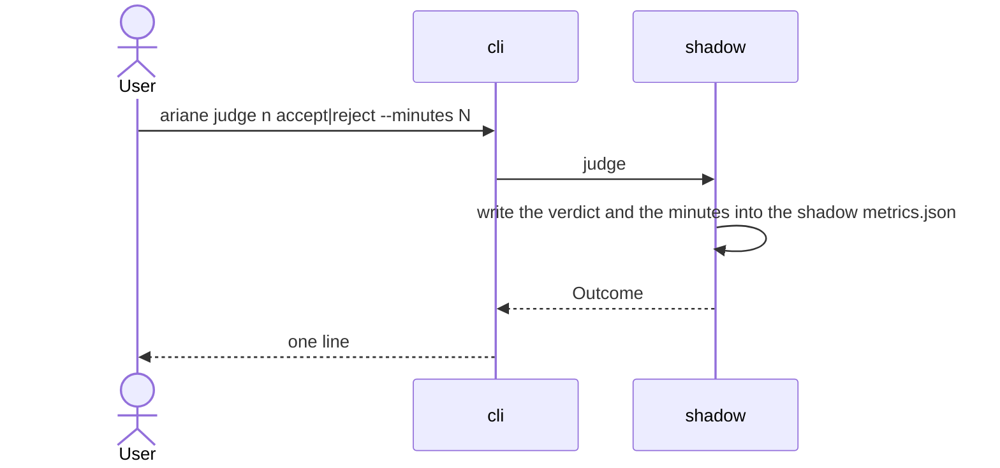

# Level 3: components

## Modules and their dependencies

An arrow goes from the importing module to the imported module; a dashed arrow is an import for
type checking only. Each module has a file in
[`modules/`](modules/).

<!-- generated: dependencies -->

<!-- end generated -->

## `ariane start <n>`

```mermaid
sequenceDiagram
  actor U as User
  participant CLI as cli
  participant F as flow
  participant T as tracker (github)
  participant G as git
  participant R as runtime (claude_code or opencode)
  participant P as replay
  participant C as checks
  participant S as review_session
  participant M as metrics
  participant D as delivery
  U->>CLI: ariane start n
  CLI->>F: start
  F->>T: read the issue
  F->>G: add the ticket working tree
  F->>F: setup command, ticket folder brief
  F->>R: run the implementer session
  R-->>F: SessionResult
  F->>M: write metrics.json
  F->>G: guard checks (configuration, branch, untracked files)
  F->>G: commit
  F->>P: replay and review
  P->>G: add a clean replay tree
  P->>C: replay the checks
  C-->>P: results
  alt a blocking check failed
    P-->>F: stop before any review, push nothing
  end
  P->>S: review in the reviewer tree (no instruction files, ADR 0031)
  S->>R: run a read-only reviewer session
  R-->>S: answer (validated by review, one retry)
  S-->>P: review-0.md; go continues
  P->>G: verify git, the tree and the remote did not change
  loop at most two fix rounds, while the review is no-go
    F->>R: run a fresh implementer session with the findings
    F->>M: write metrics.json
    F->>G: guard checks, commit
    F->>P: clean replay, checks, review (review-1.md, review-2.md)
  end
  F->>D: deliver
  D->>G: one push
  D->>T: open the pull request (a draft, needs a human, if still no-go)
  D->>T: publish statuses
  F-->>CLI: Outcome
  CLI-->>U: one line
```

## `ariane start --shadow <n>`

The run reads the issue only: no push, no pull request, no status, nothing written to the tracker
(ADR 0036). Everything is recorded in a separate clone with its origin removed.



## `ariane verify <branch>`



## `ariane report [--since]`



## `ariane judge`


