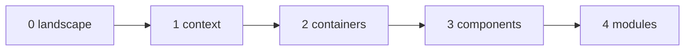

# Architecture of Ariane

How Ariane works, in Mermaid diagrams (flowcharts and sequence diagrams, ADR 0022), one file per
C4 level. Each level zooms into the previous one.

| Level | File | Shows |
| --- | --- | --- |
| 0 | [`0-landscape.md`](0-landscape.md) | The people and systems around Ariane. |
| 1 | [`1-context.md`](1-context.md) | Ariane as one system and what it exchanges with each neighbour. |
| 2 | [`2-containers.md`](2-containers.md) | The command, the working trees, the ticket folder, the sessions, the CI workflows. |
| 3 | [`3-components.md`](3-components.md) | The modules, their dependencies, and one sequence per command (`start`, `start --shadow`, `verify`, `report`, `judge`). |
| 4 | [`modules/`](modules/) | One file per module under `src/ariane/`. |

A test (`tests/test_docs_architecture.py`) fails when a module has no file in `modules/` or a file
there names a module that does not exist. Update these files in the same ticket as the code
(CLAUDE.md rule 11).

Some parts are generated from the code (ADR 0039), between `<!-- generated: <name> -->` and
`<!-- end generated -->`: the dependency graph of `3-components.md` (`dependencies`), the
"Collaborations" diagram of each module file (`collaborations`) and the module list below
(`modules`). Do not edit them by hand: run `uv run python scripts/generate_docs.py` to regenerate
them, `--check` (run by `tests/test_docs_reference.py`) fails when one differs. The text outside
the markers is hand-written, sequences included: `tests/test_docs_sequences.py` checks that every
call drawn between two modules is a real import.

### Module file template

Each module file under `modules/` has these sections, in this order (ADR 0039):

1. `# Module \`ariane.<m>\`` and a purpose paragraph.
2. `## Public API`: a table `Name | Kind | What it does`, one row per public name of the module
   (top-level function, class or constant defined there, not imported, no leading `_`), with its
   signature as in the code.
3. `## Behaviour and errors`: files read and written, errors raised and when.
4. `## Workflow`: a Mermaid `flowchart TD` of what the module does (one line if it has no behaviour).
5. `## Code view (C4 level 4)`: a Mermaid `classDiagram` of its classes and functions.
6. `## Collaborations`: generated (`collaborations`).
7. `## Reference` when the module has one, and `## Serves`.

Checked by `tests/test_docs_module_template.py`: the public API table against the code, the
section order, and the presence of the diagrams, on every module of `src/ariane/`.

## Modules

<!-- generated: modules -->
- [`__main__`](modules/__main__.md)
- [`attempts`](modules/attempts.md)
- [`cache`](modules/cache.md)
- [`checks`](modules/checks.md)
- [`claude_code`](modules/claude_code.md)
- [`cli`](modules/cli.md)
- [`codex`](modules/codex.md)
- [`config`](modules/config.md)
- [`config_schema`](modules/config_schema.md)
- [`context`](modules/context.md)
- [`delivery`](modules/delivery.md)
- [`flow`](modules/flow.md)
- [`full_replay`](modules/full_replay.md)
- [`git`](modules/git.md)
- [`github`](modules/github.md)
- [`globs`](modules/globs.md)
- [`logs`](modules/logs.md)
- [`measures`](modules/measures.md)
- [`metrics`](modules/metrics.md)
- [`next_ticket`](modules/next_ticket.md)
- [`opencode`](modules/opencode.md)
- [`pi`](modules/pi.md)
- [`process`](modules/process.md)
- [`redact`](modules/redact.md)
- [`replay`](modules/replay.md)
- [`report`](modules/report.md)
- [`resolve`](modules/resolve.md)
- [`restart`](modules/restart.md)
- [`review`](modules/review.md)
- [`review_escapes`](modules/review_escapes.md)
- [`review_session`](modules/review_session.md)
- [`risk`](modules/risk.md)
- [`runs`](modules/runs.md)
- [`runtime`](modules/runtime.md)
- [`shadow`](modules/shadow.md)
- [`slots`](modules/slots.md)
- [`stop`](modules/stop.md)
- [`ticket`](modules/ticket.md)
- [`tracker`](modules/tracker.md)
- [`update`](modules/update.md)
- [`verify`](modules/verify.md)
<!-- end generated -->
