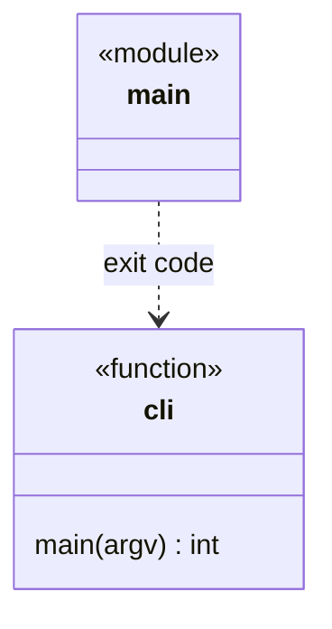

# Module `ariane.__main__`

Lets `python -m ariane` run the command line (C23). It holds no logic of its own: it imports `cli.main` and exits with its code.

## Public API

| Name | Kind | What it does |
| --- | --- | --- |

## Behaviour and errors

- Reads and writes no file. `main` is imported from `cli`, so this module defines no public name.
- Raises `SystemExit` with the exit code of `cli.main`.

## Workflow

This module has no behaviour of its own: it calls `cli.main` and exits with the code it returns (see [`cli`](cli.md)).

## Code view (C4 level 4)

## Collaborations

Arrows go from the importing module to the imported module; a dashed arrow is an import for type checking only.

<!-- generated: collaborations -->

<!-- end generated -->

## Serves

C23; ADR 0002. See [the component view](../3-components.md).
