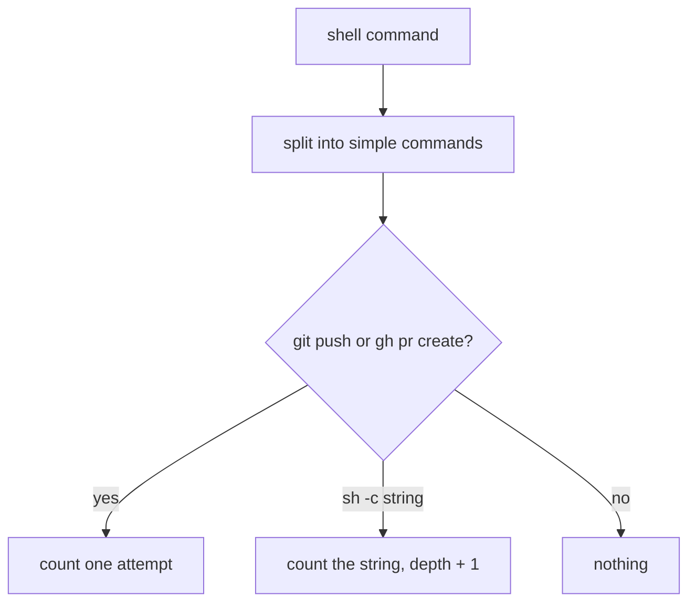
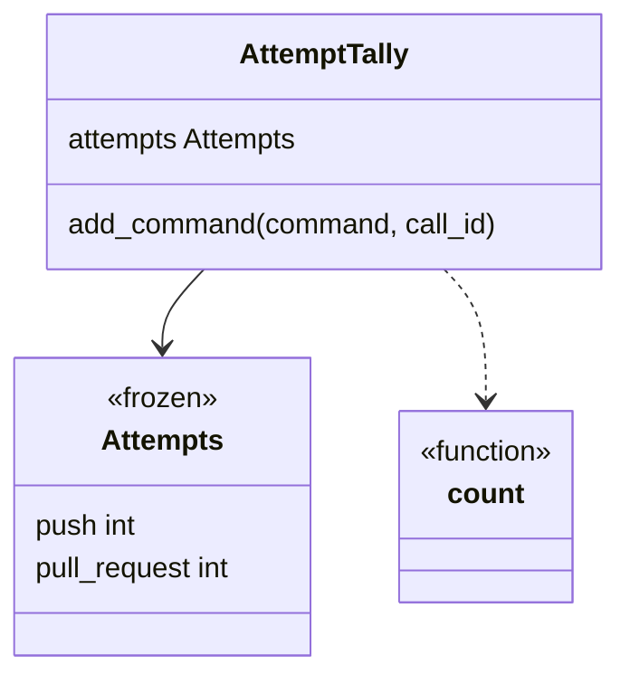
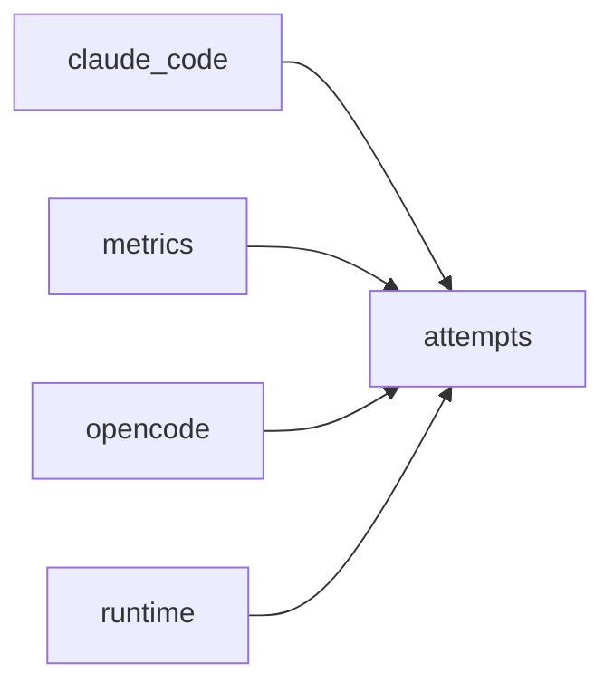

# Module `ariane.attempts`

Counts the commands an agent attempted that push or open a pull request (C19, ADR 0036), read from the shell commands of its session.

## Public API

| Name | Kind | What it does |
| --- | --- | --- |
| `Attempts` | class | Frozen counts `push` and `pull_request`; they add up with `+`. |
| `AttemptTally` | class | The running total of one session (`attempts`); `add_command(command, call_id)` adds the attempts of one shell command, once per call id. |
| `count(command, depth=0)` | function | The attempts in one shell command. |

## Behaviour and errors

- Reads and writes no file, raises nothing.
- `count` splits the command like a shell, so a quoted string is one word: `git push origin x`, `git -C dir push` and `gh pr create` count; `git pushd` and `echo "git push"` do not. The string of `sh -c` and `bash -c` is counted too, to a depth of 3.
- An unbalanced quote falls back on plain words.

## Workflow

## Code view (C4 level 4)

## Collaborations

Arrows go from the importing module to the imported module; a dashed arrow is an import for type checking only.

<!-- generated: collaborations -->

<!-- end generated -->

## Serves

C19; ADR 0030, ADR 0036. See [the component view](../3-components.md).
