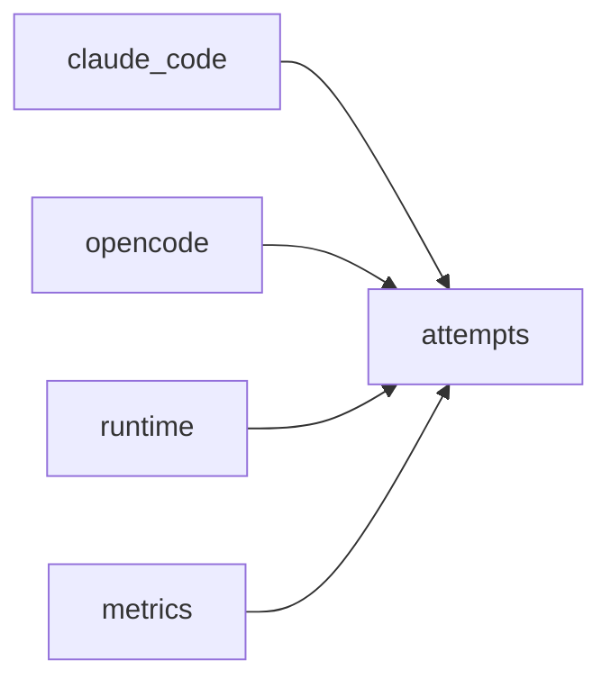

# Module `ariane.attempts`

Counts the commands an agent attempted that push or open a pull request (C19, ADR 0036), read from the shell commands of its session.

## Main types and functions

- `Attempts`: `push` and `pull_request` counts; they add up.
- `count(command)`: the attempts in one shell command. It splits the command like a shell, so a quoted string is one word: `git push origin x`, `git -C dir push` and `gh pr create` count; `git pushd` and `echo "git push"` do not. The string of `sh -c` and `bash -c` is counted too.
- `AttemptTally`: the running total of one session; the runtime adapters feed it each shell tool call once.

## Collaborations

Arrows go from the caller to the callee.

## Serves

C19; ADR 0030, ADR 0036. See [the component view](../3-components.md).
