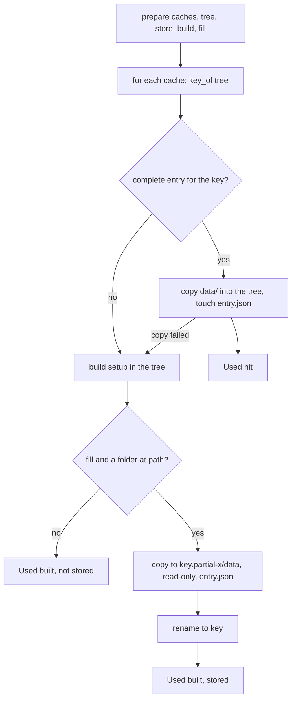
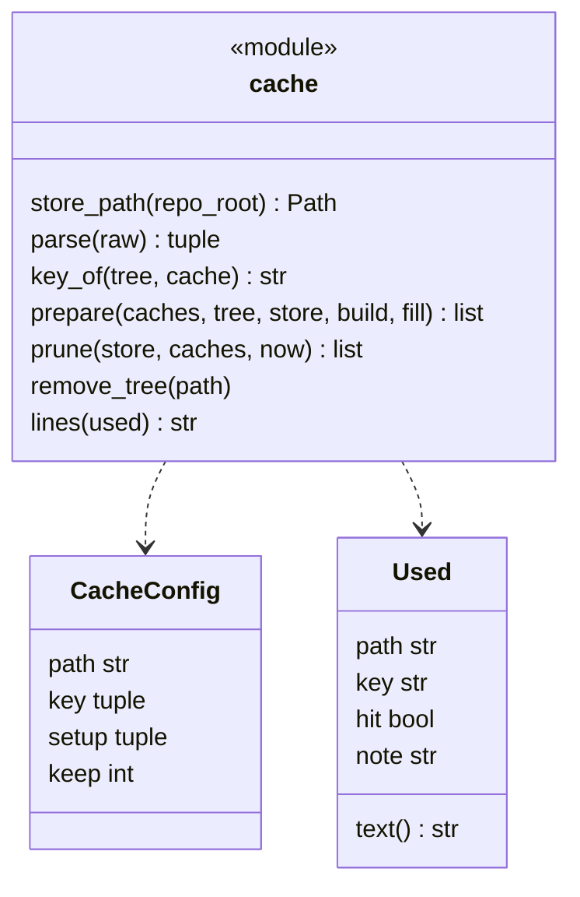
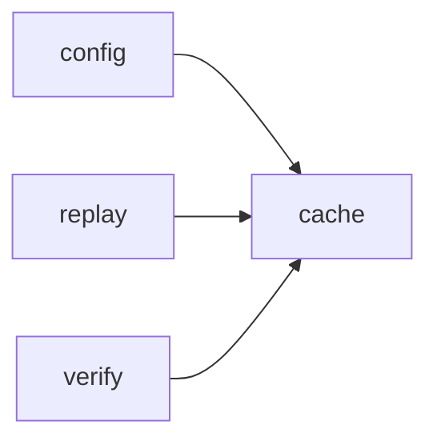

# Module `ariane.cache`

Dependency caches of the replay (C9, ADR 0054): a folder declared in `[[project.cache]]` (such as `node_modules` or `.venv`) is stored once, by the content of its key files and of its setup command, in `<repo>.ariane/cache/<key>/`, and copied into each later fresh tree instead of being rebuilt. The tree stays clean: only the copied folder comes from the store, and only Ariane's replay trees fill it.

## Public API

| Name | Kind | What it does |
| --- | --- | --- |
| `FOLDER` | constant | `"cache"`, the store's folder under `<repo>.ariane/`. |
| `DEFAULT_KEEP` | constant | `5`, the entries of one path kept when `keep` is not given (and for a path no longer declared). |
| `ENTRY` | constant | `"entry.json"`, written last inside a temporary entry: the path, the key and the setup of a complete entry. |
| `DATA` | constant | `"data"`, the entry's copy of the folder. |
| `PARTIAL` | constant | `".partial-"`, in the name of a temporary entry (`<key>.partial-<random>`), never read. |
| `PARTIAL_AGE_S` | constant | One day: a temporary entry older than this was left by a killed run and is removed by `prune`. |
| `CacheConfigError` | exception | A `[[project.cache]]` table is invalid; `config` reports it as a `ConfigError` naming the key. |
| `CacheConfig` | dataclass | One `[[project.cache]]` table: `path`, `key` (files), `setup` (argument list), `keep`. |
| `Used` | dataclass | What one cache did in one tree: `path`, `key`, `hit`, and `note` when a build was not stored; `text()` is its journal wording. |
| `store_path(repo_root)` | function | `<repo>.ariane/cache`, next to `worktrees/`. |
| `parse(raw)` | function | The `[[project.cache]]` tables, validated: paths relative to the tree (no `..`, not absolute, not under `.git`), paths that do not overlap, a non-empty key, a setup argument list, a positive `keep`. |
| `key_of(tree, cache)` | function | The SHA-256 of the setup command and of each key file's name and content in `tree`; a missing key file counts as missing, not as empty. |
| `prepare(caches, tree, store, build, fill=)` | function | Each cache in `tree`: copied from a complete entry, else built by `build(setup)` and, with `fill`, stored; returns one `Used` per cache. |
| `remove_tree(path)` | function | Removes a folder, read-only files and folders included. |
| `prune(store, caches, now=None)` | function | Keeps the `keep` most recently used entries of each path; removes the others, the unreadable ones and old temporary entries; returns the names removed. |
| `lines(used)` | function | One tree's caches for the journal, such as `` `node_modules` hit (key `1a2b…`) ``. |

## Behaviour and errors

- A hit: the entry's `entry.json` reads, names the same path and key, and `data/` exists. The folder is copied file by file into the tree (merged with what is there), as copy-on-write clones where the file system supports them (`FICLONE` on Linux, `clonefile` on macOS), else as plain copies, never as hard links; symbolic links stay links; the copies are writable, modes otherwise kept. The entry's `entry.json` is touched: its time is the entry's last use. A copy that fails (an entry removed meanwhile, a file that cannot be read) is undone and the cache is built instead: an entry is never used in part.
- A miss: `build(setup)` runs that cache's setup in the tree (guarded like any setup, and raising its stop). With `fill` and a folder at `path`, the folder is copied into `<key>.partial-<random>/data`, made read-only, `entry.json` written, an unreadable entry of that key removed, then the temporary entry renamed to `<key>`: a reader sees a complete entry or none. When the rename fails because another tree stored the same key at the same time, its entry is kept; any other failure leaves the build in the tree, unstored, with the reason in `note`.
- `fill` False (the ticket's own tree, where the agent works): hits are copied, misses built, nothing stored.
- `prune`: entries grouped by the path in their `entry.json`, newest use first; the ones beyond `keep` removed; an entry without a readable `entry.json` removed; a temporary entry removed only when older than `PARTIAL_AGE_S`, so a tree storing at the same time is not disturbed.

## Workflow

## Code view (C4 level 4)

## Collaborations

Arrows go from the importing module to the imported module; a dashed arrow is an import for type checking only.

<!-- generated: collaborations -->

<!-- end generated -->

## Serves

C9; ADR 0054. See [the component view](../3-components.md).
