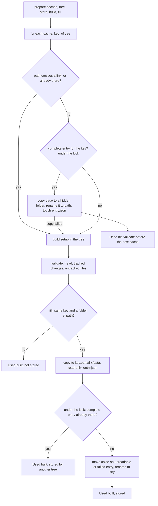
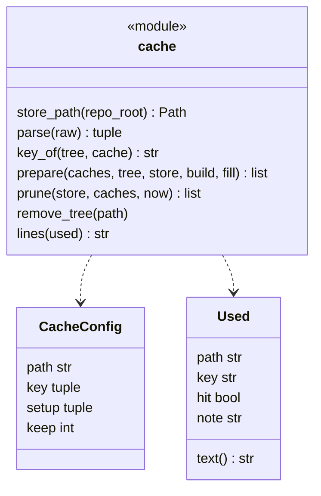
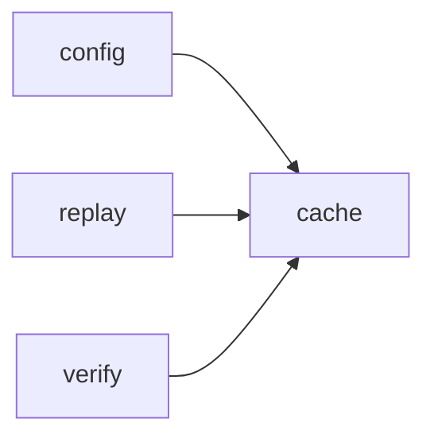

# Module `ariane.cache`

Dependency caches of the replay (C9, ADR 0054): a folder declared in `[[project.cache]]` (such as `node_modules` or `.venv`) is stored once, by the content of its key files and of its setup command, in `<repo>.ariane/cache/<key>/`, and copied into each later fresh tree instead of being rebuilt. The tree stays clean: only the copied folder comes from the store, and only Ariane's replay trees fill it.

## Public API

| Name | Kind | What it does |
| --- | --- | --- |
| `FOLDER` | constant | `"cache"`, the store's folder under `<repo>.ariane/`. |
| `DEFAULT_KEEP` | constant | `5`, the entries of one path kept when `keep` is not given (and for a path no longer declared). |
| `ENTRY` | constant | `"entry.json"`, written last inside a temporary entry: the path, the key and the setup of a complete entry. |
| `DATA` | constant | `"data"`, the entry's copy of the folder. |
| `PARTIAL` | constant | `".partial-"`, in the name of a temporary entry (`<key>.partial-<random>`), never read. |
| `LOCK` | constant | `".lock"`, the store's lock file: held to restore an entry, to publish or replace one, and to prune; never pruned. |
| `PARTIAL_AGE_S` | constant | One day: a temporary entry older than this was left by a killed run and is removed by `prune`. |
| `CacheConfigError` | exception | A `[[project.cache]]` table is invalid; `config` reports it as a `ConfigError` naming the key. |
| `CacheConfig` | dataclass | One `[[project.cache]]` table: `path`, `key` (files), `setup` (argument list), `keep`. |
| `Used` | dataclass | What one cache did in one tree: `path`, `key`, `hit`, and `note` when a build was not stored; `text()` is its journal wording. |
| `store_path(repo_root)` | function | `<repo>.ariane/cache`, next to `worktrees/`. |
| `parse(raw)` | function | The `[[project.cache]]` tables, validated: paths relative to the tree (no `..`, not absolute, not under `.git`), paths that do not overlap, a non-empty key, a setup argument list, a positive `keep`. |
| `key_of(tree, cache)` | function | The SHA-256 of the setup command and of each key file's name and content in `tree`; a missing key file counts as missing, not as empty; `""` when a key file is there but cannot be read (a folder in its place, no permission): no entry is chosen or stored for that tree, its setup builds the folder and the cache's `note` says "a key file cannot be read". |
| `prepare(caches, tree, store, build, fill=, validate=)` | function | Each cache in `tree`: copied from a complete entry, else built by `build(setup)` and, with `fill`, stored; a path crossing a symbolic link, or one the commit already has, is built and never stored; `validate()` (raising to stop) runs after each build, before anything is stored, and after each copy, before any other setup runs; returns one `Used` per cache. |
| `remove_tree(path)` | function | Removes a folder, read-only files and folders included. |
| `prune(store, caches, now=None)` | function | Under the store's lock: keeps the `keep` most recently used entries of each path; removes the others, the unreadable ones and old temporary entries; returns the names removed. |
| `lines(used)` | function | One tree's caches for the journal, such as `` `node_modules` hit (key `1a2b…`) ``. |

## Behaviour and errors

- The destination first: every folder on the way to `path` that exists must be a folder, not a symbolic link nor a file, and `path` itself must not exist (the commit does not have it). Otherwise nothing is restored: the cache's setup runs as without a cache, and the result is not stored (`note` says why). The same check runs again after the setup, before storing, so a link the setup made is never followed into the store.
- A hit, under the store's lock: the entry's `entry.json` reads, names the same path and key, and `data/` exists. The folder is copied file by file into a hidden `.<name>.partial-<random>` folder next to `path` (missing parent folders created), as copy-on-write clones where the file system supports them (`FICLONE` on Linux, `clonefile` on macOS), else as plain copies, never as hard links; symbolic links stay links; the copies are writable, modes otherwise kept. That folder is then renamed to `path`: the tree sees the whole folder or nothing. The entry's `entry.json` is touched: its time is the entry's last use. A copy that fails (a file that cannot be read) removes the hidden folder and the parent folders it created, and the cache is built instead: an entry is never used in part; the `id` in that entry's `entry.json` is kept, so the rebuild replaces that entry. Without an entry the store is not created.
- A miss: `build(setup)` runs that cache's setup in the tree (guarded like any setup, and raising its stop), then `validate()`: in a replay tree the head is still the commit, no tracked file or the index changed (`replay.tracked_changes`) and git ignores every file the setup left, so a setup that moved the head, changed a tracked file or left unignored files stops the run before anything is stored. A setup that changed a key file is not stored either. With `fill` and a folder at `path`, the folder is copied into `<key>.partial-<random>/data`, made read-only and `entry.json` written (with a random `id`); then, under the store's lock, a complete entry of that key already there whose `id` is not the one this tree failed to copy (another tree stored it meanwhile) is kept and the copy dropped, else the entry there (unreadable, or the one that failed) is renamed aside to a temporary name and removed, and the temporary entry renamed to `<key>`: a reader sees a complete entry or none, and a tree never removes an entry another just published. Any other failure leaves the build in the tree, unstored, with the reason in `note`.
- After each copy: `validate()` runs right away, before the next cache's setup, so a copied folder git no longer ignores (the commit changed `.gitignore`, not the key files) stops the run before any other setup, the agent or the check runs: a later setup cannot hide what the copy left.
- The lock (`<store>/.lock`, an operating-system lock freed when its process dies): restoring, publishing or replacing, and pruning never interleave, so an entry is never removed while a tree copies it. Two trees restoring at the same time copy one after the other.
- `fill` False (the ticket's own tree, where the agent works): hits are copied, misses built, nothing stored.
- `prune`, under the store's lock: entries grouped by the path in their `entry.json`, newest use first; the ones beyond `keep` removed; an entry without a readable `entry.json` removed; a temporary entry removed only when older than `PARTIAL_AGE_S`, so a tree storing at the same time is not disturbed.

## Workflow

## Code view (C4 level 4)

## Collaborations

Arrows go from the importing module to the imported module; a dashed arrow is an import for type checking only.

<!-- generated: collaborations -->

<!-- end generated -->

## Serves

C9; ADR 0054. See [the component view](../3-components.md).
