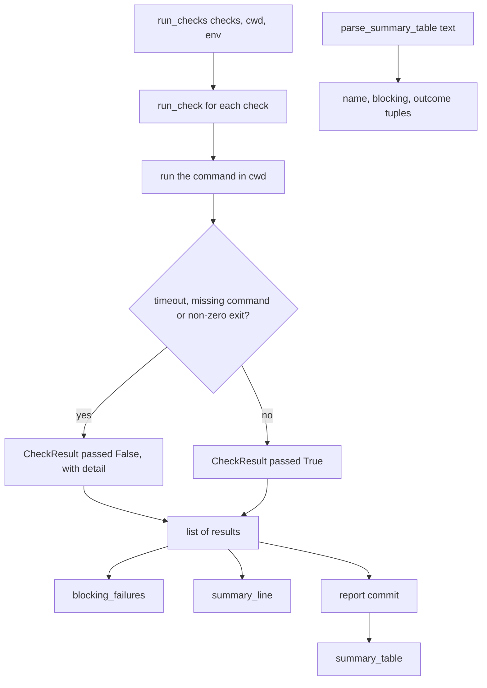
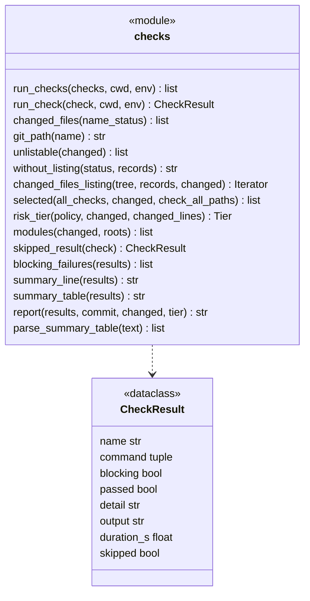
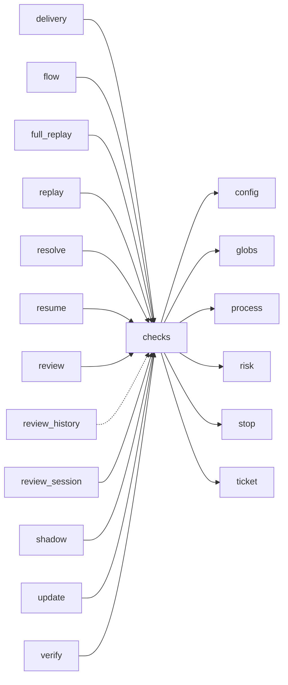

# Module `ariane.checks`

Runs the deterministic checks of `ariane.toml` itself and never believes an agent. It also renders the results as a summary line, a table and a committed report.

## Public API

| Name | Kind | What it does |
| --- | --- | --- |
| `PASSING_OUTPUT_LINES` | constant | How many output lines a passing check keeps in the report. |
| `shown_output(r)` | function | A check's output as the report shows it: a failing check's whole, a passing check's last `PASSING_OUTPUT_LINES` lines; also the output `ariane update` gives its implementer session for a check the merge broke (ADR 0033). |
| `CHANGED_FILES_VARIABLE` | constant | `ARIANE_CHANGED_FILES`: the variable naming the list of changed files a check gets (ADR 0056). |
| `CHANGED_FILES` | constant | `changed-files.txt`: that list's file name, in the replay tree's ticket folder. |
| `SKIPPED` | constant | The reason recorded for a check not selected: no changed file matches `paths`. |
| `CheckResult` | dataclass | Outcome of one check: `name`, `command`, `blocking`, `passed`, `detail`, `output`, `duration_s`, `not_run_locally` (the globs the check declares, ADR 0042), `skipped` (not selected, so not run; `passed` is true, ADR 0056). |
| `changed_files(name_status)` | function | The paths of a `git diff --name-status` listing, split at line feeds only (a name holding U+2028 stays whole), a rename or copy counted on both sides, each decoded by `git_path`. |
| `git_path(name)` | function | The real path behind a path as git prints it: a quoted one (a double quote, a backslash or a control character in it, even with `core.quotepath=off`) is unquoted and its octal escapes decoded as UTF-8 bytes. |
| `unlistable(changed)` | function | The changed paths whose name holds a line break: the line-delimited listing cannot hold them, so the replay stops on them (ADR 0056), category `guard` (ADR 0058). |
| `changed_files_listing(tree, records, changed)` | context manager | `<records>/changed-files.txt` in `tree`, listing `changed` one per line, made new for the block and never removed by name (the replay tree's removal takes it); on POSIX each folder is opened by handle without following a link and the file made relative to the last one, on Windows by path (ADR 0056). |
| `without_listing(status, records)` | function | A replay tree's `git status --porcelain` without the listing's path (and anything under it, if a check put a folder there): what the post-check verification compares (ADR 0056). |
| `selected(all_checks, changed, check_all_paths)` | function | The checks a change selects (ADR 0056): every one when it touches `ariane.toml` or a `project.check_all_paths` file, else those without `paths` and those whose `paths` match a changed file. |
| `risk_tier(policy, changed, changed_lines, check_all_paths=(), failed_before=False)` | function | The round's `risk.Tier` (ADR 0056): `high` with one reason per rule met (more than `max_changed_lines` changed lines, more than `max_modules` modules, a `critical_paths` file, `ariane.toml`, a `check_all_paths` file, a failed earlier round), else `low` with the counts ("2 changed lines, 1 module"); `risk.UNMEASURED` (`high`, "no `[checks_policy]`") when `policy` is `None`. |
| `modules(changed, roots=())` | function | The modules the changed paths touch, in order: for each path, the deepest folder matching a `roots` glob (a trailing `/` ignored) and the path's first segment below it; a path under no root counts none; without `roots`, the path's first segment. |
| `skipped_result(check)` | function | The `CheckResult` of a check not selected. |
| `skipped_names(results)` | function | The names of the skipped checks. |
| `partial_names(chosen, tier)` | function | The selected checks the round's tier runs with `ARIANE_FULL_SUITE=0` (ADR 0056). |
| `run_checks(checks, cwd, env)` | function | Runs the declared checks in a working tree, in order. |
| `run_check(check, cwd, env)` | function | Runs one check and returns its `CheckResult`. |
| `blocking_failures(results)` | function | The blocking checks that did not pass. |
| `summary_line(results)` | function | One line: how many checks passed and which blocking ones failed, and how many were skipped when some were. |
| `summary_table(results)` | function | A Markdown table of the results; a skipped check shows `skipped`. |
| `unrun_files(results, changed)` | function | The changed files matching a check's `not_run_locally` globs. |
| `report(results, commit, changed=(), tier=None)` | function | The committed `checks.md` text for a commit, starting with "Risk tier: <tier>: <reasons>." when given the round's `tier` (ADR 0056), with the globs a check does not run and the matching changed files, and each skipped check with its reason; it says each check was replayed in its own clean working tree, after the setup. |
| `parse_summary_table(text)` | function | Reads a committed report back as (name, blocking, outcome) tuples; a skipped check counts as passed. |

## Behaviour and errors

- `CheckResult`: name, blocking flag, outcome and output of one check.
- `run_checks`, `run_check`: run the declared commands in a working tree; `run_check` is called from the replay's worker threads when `project.parallel_checks` is above 1 (ADR 0052), each with its tree and its slot's environment; the flow also passes the generated-documentation commands as checks named `docs: <name>` (C25), so they appear in the report and the statuses like any check.
- A check runs after its tree's dependency caches were copied from the store or built (`[[project.cache]]`, ADR 0054) and after its setup; neither is part of its duration, and its report is the same with or without caches.
- `selected`, `skipped_result`: the replay runs only the selected checks and records the others as skipped (ADR 0056); a skipped check never fails, so it never blocks. `changed_files` turns the round's `--name-status` listing into the changed files the selection and `ARIANE_CHANGED_FILES` use.
- `risk_tier` (C9, ADR 0056): the round's tier from the same changed files and the changed lines of `git.changes`; the replay gives it to every check as `ARIANE_RISK_TIER` and `ARIANE_FULL_SUITE` (`risk.Tier.variables`). At a threshold is still `low`: only more than `max_changed_lines` lines or `max_modules` modules is `high`. Each critical or `check_all_paths` glob matched is its own reason.
- `changed_files_listing`: the listing a check gets. On POSIX (`os.supports_dir_fd`), the tree is opened, then each folder of `records` is made if missing and opened with `O_DIRECTORY | O_NOFOLLOW` relative to the previous one; the file is created with `O_EXCL | O_NOFOLLOW` in the last folder's handle. Ariane never removes it by name: a check could have swapped it, and the replay tree is removed after each check anyway. Another check that moves or replaces a folder on the way at any moment (parallel checks, ADR 0052) therefore never makes Ariane create a file outside the tree: a link met on the way, or a file the commit holds, stops with "the replayed commit holds work/<n>/changed-files.txt, or its folder leads outside the replay tree". Windows has no such call in Python's standard library: there the folder is checked inside the tree before it is made, a narrower guarantee.
- `blocking_failures`, `summary_line`, `summary_table`, `report`: read and render results.
- `parse_summary_table`: read a committed report back.

## Workflow

## Code view (C4 level 4)

## Collaborations

Arrows go from the importing module to the imported module; a dashed arrow is an import for type checking only.

<!-- generated: collaborations -->

<!-- end generated -->

## Serves

C9, C21, C25; ADR 0004, ADR 0018, ADR 0026, ADR 0054, ADR 0056. See [the component view](../3-components.md).
