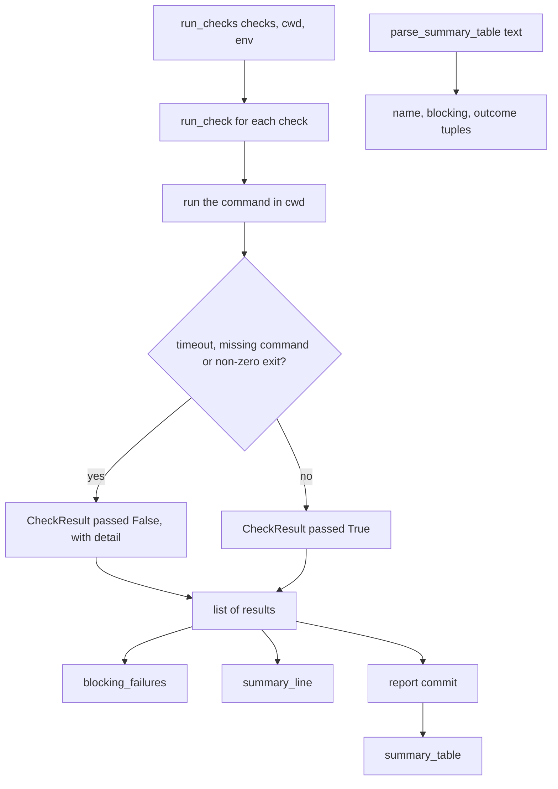
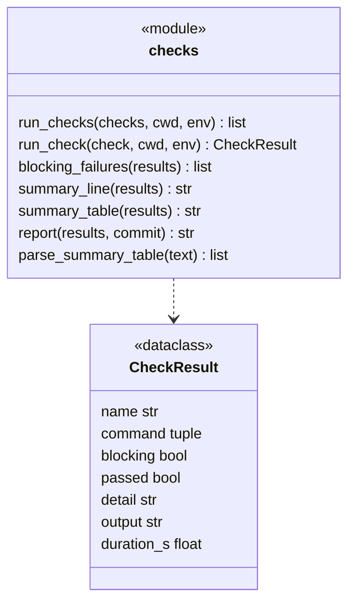
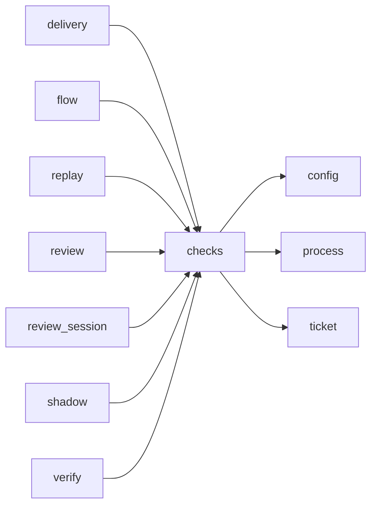

# Module `ariane.checks`

Runs the deterministic checks of `ariane.toml` itself and never believes an agent. It also renders the results as a summary line, a table and a committed report.

## Public API

| Name | Kind | What it does |
| --- | --- | --- |
| `PASSING_OUTPUT_LINES` | constant | How many output lines a passing check keeps in the report. |
| `CheckResult` | dataclass | Outcome of one check: `name`, `command`, `blocking`, `passed`, `detail`, `output`, `duration_s`, `not_run_locally` (the globs the check declares, ADR 0042). |
| `run_checks(checks, cwd, env)` | function | Runs the declared checks in a working tree, in order. |
| `run_check(check, cwd, env)` | function | Runs one check and returns its `CheckResult`. |
| `blocking_failures(results)` | function | The blocking checks that did not pass. |
| `summary_line(results)` | function | One line: how many checks passed and which blocking ones failed. |
| `summary_table(results)` | function | A Markdown table of the results. |
| `unrun_files(results, changed)` | function | The changed files matching a check's `not_run_locally` globs. |
| `report(results, commit, changed=())` | function | The committed `checks.md` text for a commit, with the globs a check does not run and the matching changed files; it says each check was replayed in its own clean working tree, after the setup. |
| `parse_summary_table(text)` | function | Reads a committed report back as (name, blocking, outcome) tuples. |

## Behaviour and errors

- `CheckResult`: name, blocking flag, outcome and output of one check.
- `run_checks`, `run_check`: run the declared commands in a working tree; the flow also passes the generated-documentation commands as checks named `docs: <name>` (C25), so they appear in the report and the statuses like any check.
- `blocking_failures`, `summary_line`, `summary_table`, `report`: read and render results.
- `parse_summary_table`: read a committed report back.

## Workflow

## Code view (C4 level 4)

## Collaborations

Arrows go from the importing module to the imported module; a dashed arrow is an import for type checking only.

<!-- generated: collaborations -->

<!-- end generated -->

## Serves

C9, C21, C25; ADR 0004, ADR 0018, ADR 0026. See [the component view](../3-components.md).
