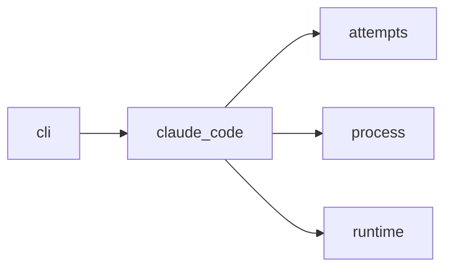

# Module `ariane.claude_code`

Claude Code as an agent runtime: it starts the `claude` CLI for one session and turns its structured output into a `SessionResult`. It reads `--output-format stream-json --verbose` line by line, counts tokens per `message.id` (the latest usage of each id counts once) and stops the session when the total reaches `Session.max_tokens` (stop reason `budget`, "stopped by Ariane at <n> tokens"); `--max-budget-usd` stays the runtime's own cost cap, and `SessionResult.cap` names the cap that applied. A session with a `json_schema` passes it to `--json-schema` without its `$schema` key (Claude Code rejects the draft 2020-12 identifier) and gets the parsed answer back in `SessionResult.structured_output`.

A `reviewer` session (ADR 0031) starts with `--restricted` and one `--add-dir` per `Session.add_dirs`, from an empty working directory, with no `--permission-mode bypassPermissions` and no `--setting-sources`; every other role keeps `bypassPermissions` and `--setting-sources project,local`.

Attempts (C19, ADR 0036): `TokenTally` also reads the `tool_use` blocks of the assistant messages and counts, once per block id, the `Bash` commands that push or open a pull request (`attempts` module); `run` puts the counts on `SessionResult.attempts`, whatever the stop reason.

## Main types and functions

- `ClaudeCodeRuntime`: implements `AgentRuntime`; it declares `ANTHROPIC_` and `CLAUDE_` as its login variables.
- `TokenTally`: the running token total of a stream.
- `parse_result`: maps the final `result` event (or a single JSON result), stderr and the exit code to a result and a stop reason; a stream without a result is `error`.
- `schema_argument`: the session's schema as given to `--json-schema`, without its `$schema` key.

## Collaborations

Arrows go from the caller to the callee.

## Serves

C5, C10; ADR 0007, ADR 0015, ADR 0016, ADR 0036. See [the component view](../3-components.md).
