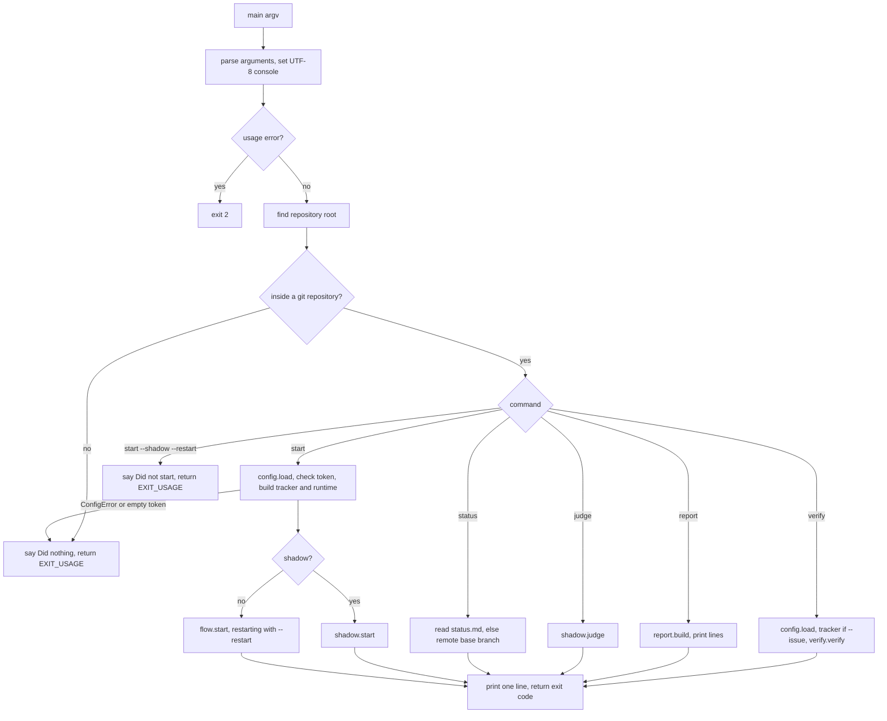
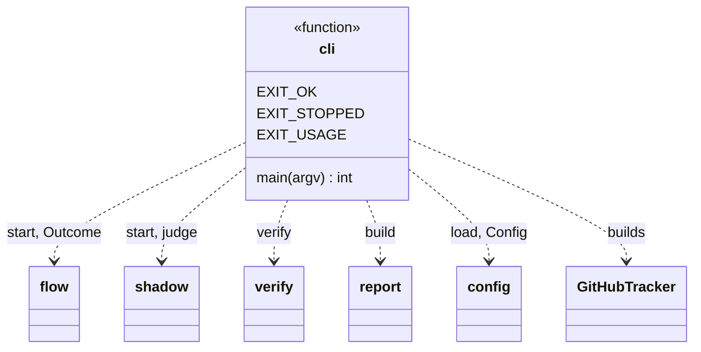
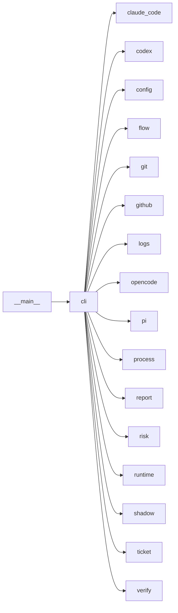

# Module `ariane.cli`

The `ariane` command line (C23). It parses arguments, wires the configuration, tracker and runtime, calls the flow, and ends every command with one line saying what it did and what comes next.

## Public API

| Name | Kind | What it does |
| --- | --- | --- |
| `EXIT_OK` | constant | Exit code 0, re-exported from `flow`. |
| `EXIT_STOPPED` | constant | Exit code of a stopped ticket, re-exported from `flow`. |
| `EXIT_USAGE` | constant | Exit code 2: a usage or configuration problem. |
| `main(argv=None)` | function | The entry point: parse `argv`, run the command, return the exit code. |

## Behaviour and errors

- Commands: `start [--shadow] [--restart]` (`--shadow`: the ticket runs in a separate clone through `shadow`, C19, ADR 0036; `--restart`: a stopped or interrupted ticket starts over through `flow.start(restarting=True)`, its trees removed and its branch kept, ADR 0047; both together exit 2 before the configuration is read: "--restart does not apply to shadow tickets", next action: remove the clone), `status`, `judge <n> accept|reject --minutes N [--note TEXT]` (records the human's verdict and time on a shadow ticket through `shadow.judge`, C19, ADR 0037), `report [--since YYYY-MM-DD]` (from `report`, C19, ADR 0038) and `verify <branch> [--issue N]` (checks and reviews a local branch finished by hand, C23, ADR 0028).
- Reads `ariane.toml` (or the file `ARIANE_CONFIG` names) through `config.load`, the token variable the configuration names, `ARIANE_LOG_LEVEL`; writes the log file `<repo>.ariane/logs/<name>.log` through `logs`.
- Token scope (C21, ADR 0017): once read, the token variable is removed from `os.environ` (`_take_token`); the run gets a copy of the environment that carries it, and the process is made undumpable on Linux (`process.make_undumpable`). It also becomes the subreaper of its orphaned descendants on Linux (`process.set_child_subreaper`), so a process an agent starts in a new session can be found and killed; if Linux refuses, `start` and `verify` do nothing and say why (C10, ADR 0031).
- `start` and `verify --issue` build the `GitHubTracker` with `[tracker].ready_label`, so both apply the issue gate (C21, ADR 0032). `report` builds it only when the configuration and the token exist (else waiting time is "not available"), and reads `[checks_policy] max_escape_rate` from the configuration (0.02 without it).
- The runtime of each role comes from `[agents.<role>].runtime` (`RoutedRuntime`, ADR 0029).
- Exit codes: `EXIT_OK` when the command did what was asked, `EXIT_STOPPED` for a ticket that stopped, `EXIT_USAGE` (2) for an invalid configuration, an empty token variable, a bad argument or a directory outside a git repository; each prints its reason and `Next:` step.
- `status` reads `work/<n>/status.md` from the ticket's working tree or the repository, else from the base branch on the remote (merged ticket).

## Workflow

## Code view (C4 level 4)

## Collaborations

Arrows go from the importing module to the imported module; a dashed arrow is an import for type checking only.

<!-- generated: collaborations -->

<!-- end generated -->

## Reference

See the generated [command-line reference](../../reference/cli.md), generated from the code (`scripts/generate_docs.py`).

## Serves

C23; ADR 0002, ADR 0047. See [the component view](../3-components.md).
