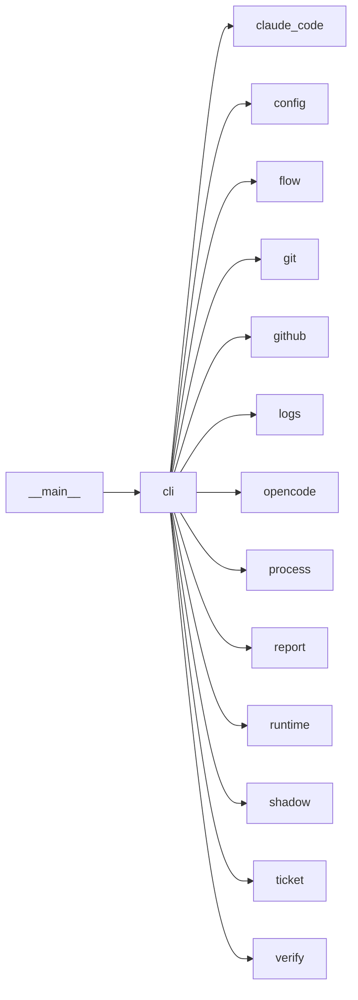

# Module `ariane.cli`

The `ariane` command line. It parses arguments, wires the configuration, tracker and runtime, calls the flow, and ends every command with one line saying what it did and what comes next.

## Main types and functions

- `main`: the entry point, returns the exit code. Commands: `start [--shadow]` (`--shadow`: the ticket runs in a separate clone through `shadow`, C19, ADR 0036), `status`, `judge <n> accept|reject --minutes N [--note TEXT]` (records the human's verdict and time on a shadow ticket through `shadow.judge`, C19, ADR 0037), `report [--since YYYY-MM-DD]` (cost, agent time, rounds, verdicts, human time, gates bypassed and shadow results, from `report`, C19, ADR 0038), and `verify <branch> [--issue N]` (checks and reviews a local branch finished by hand, C23, ADR 0028). `report` builds a `GitHubTracker` through `_report_tracker` from the configuration and the token variable, or none (waiting time "not available"). `start` and `verify --issue` both build the tracker with `[tracker].ready_label`, so both apply the issue gate (C21, ADR 0032).

`_runtime` builds the `RoutedRuntime` from each role's `runtime` in the configuration; `config.load` honours `ARIANE_CONFIG`.

## Collaborations

Arrows go from the importing module to the imported module; a dashed arrow is an import for type checking only.

<!-- generated: collaborations -->

<!-- end generated -->

## Reference

See the generated [command-line reference](../../reference/cli.md), generated from the code (`scripts/generate_docs.py`).

## Serves

C23; ADR 0002. See [the component view](../3-components.md).
