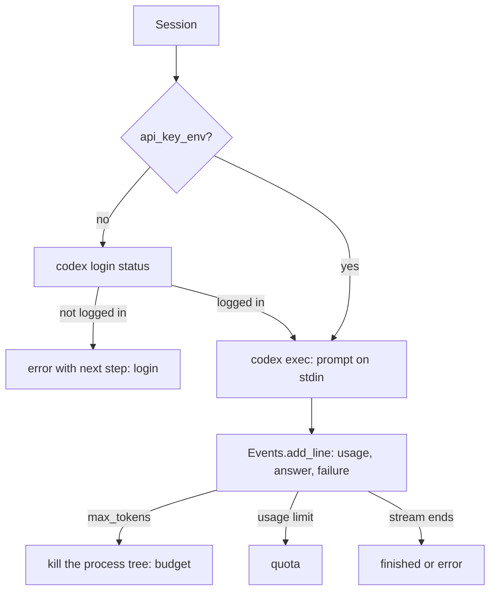
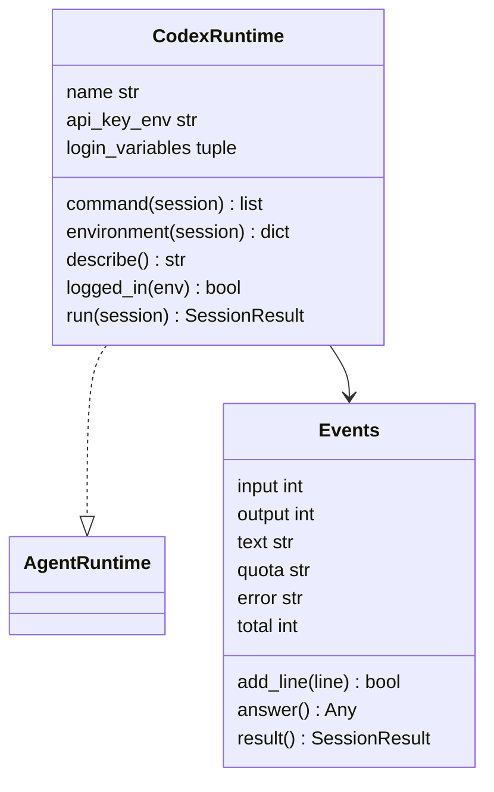
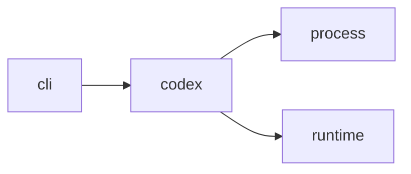

# Module `ariane.codex`

Codex as an agent runtime, for the reviewer role (ADR 0043): it starts the official CLI as `codex exec --json --sandbox read-only --skip-git-repo-check --ephemeral -m <model> -C <working tree> -` with the prompt on standard input, and turns the JSON Lines events into a `SessionResult`. Ariane never reads, copies or logs `~/.codex/auth.json`.

## Public API

| Name | Kind | What it does |
| --- | --- | --- |
| `NOT_LOGGED_IN` | constant | "Codex is not logged in", the summary of the session that does not start. |
| `LOGIN_NEXT` | constant | "run codex login, or set agents.reviewer.api_key_env", its next step. |
| `PLAN` | constant | The `billing` value `plan`: covered by a subscription. |
| `API` | constant | The `billing` value `api`: billed per token. |
| `CodexRuntime` | class | `CodexRuntime(executable=("codex",), api_key_env=None)` implements `AgentRuntime`; its only login variable is `api_key_env`; `command`, `environment`, `describe` (`codex --version`), `logged_in(env)` (`codex login status`) and `run(session)`. |
| `Events` | class | `Events(max_tokens, billing)`: the running totals of a stream, the last agent message, the quota or error; `add_line(line)` reads one event. |

## Behaviour and errors

- The prompt goes on standard input; the schema of the answer is appended to it and the answer is the last fenced `json` block of the last `agent_message`.
- The process environment holds no `OPENAI_*` variable and no `CODEX_API_KEY` of Ariane's own. With `api_key_env`, that variable's value is passed as `CODEX_API_KEY` to this process only and the variable itself is not passed on (matched case-insensitively; a name ending in `_` is a prefix, ADR 0024). A `turn.completed` clears an earlier `error` notice.
- Without `api_key_env`, `codex login status` runs first; "Not logged in" ends the session as `error` with the next step `LOGIN_NEXT`, and `codex exec` is never started.
- `turn.completed` usage is summed (cached tokens, which Codex counts inside `input_tokens`, are recorded as cache read); the session stops (`budget`) when `max_tokens` is reached. A `turn.failed` or `error` event naming a usage limit stops the session as `quota`, with the next step "restart the ticket after <time>" when Codex gives the time. Any other failure or a non-zero exit is `error`.
- Billing: a plan login records `cost_usd` 0 and `billing` `plan`; an API key records `api` and no cost.

## Workflow

## Code view (C4 level 4)

## Collaborations

Arrows go from the importing module to the imported module; a dashed arrow is an import for type checking only.

<!-- generated: collaborations -->

<!-- end generated -->

## Serves

C5, C10, C19; ADR 0015, ADR 0043. See [the component view](../3-components.md).
