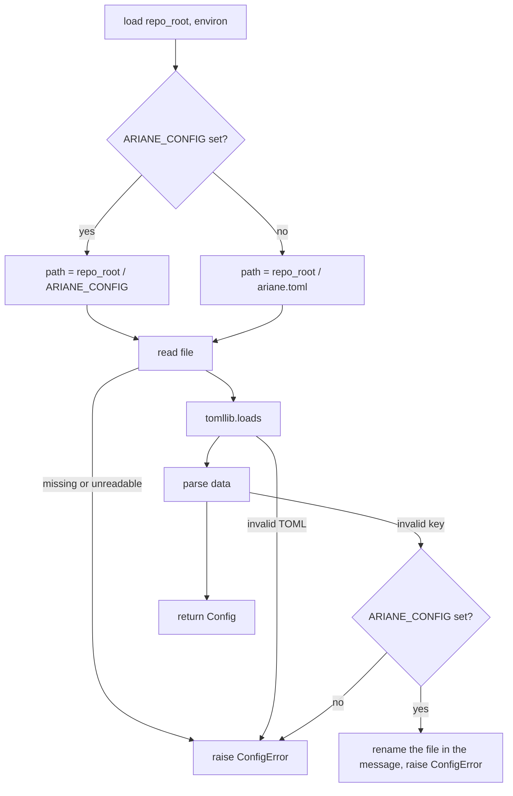
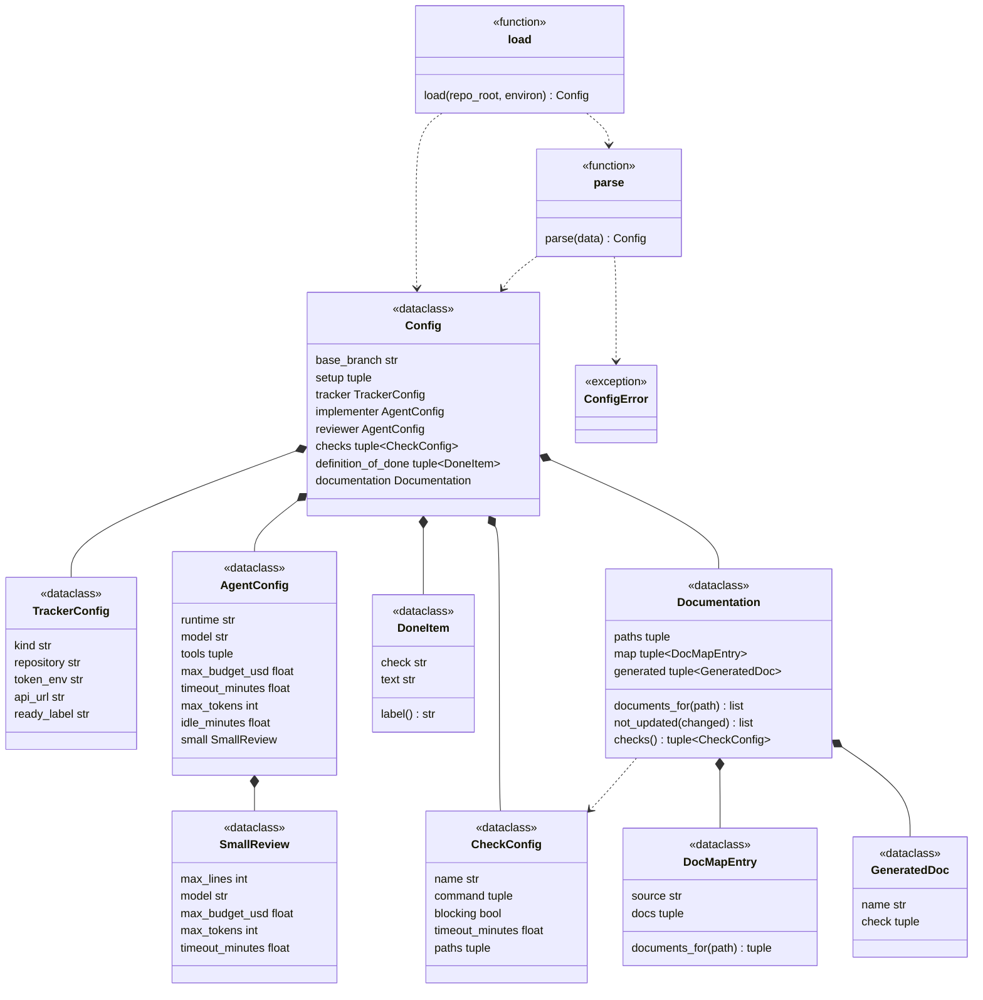
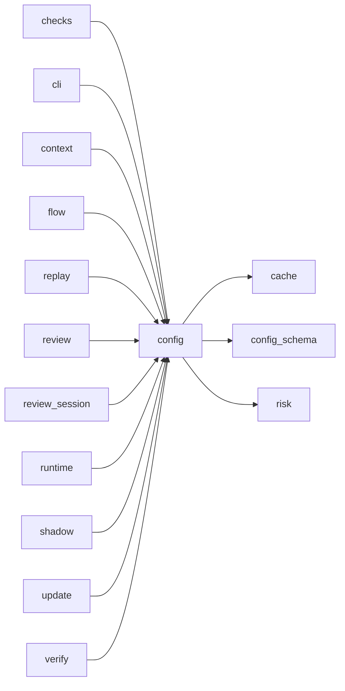

# Module `ariane.config`

Loads and validates `ariane.toml` (C22). Every error names the faulty key.

## Public API

| Name | Kind | What it does |
| --- | --- | --- |
| `CONFIG_FILE` | constant | The configuration file name, `ariane.toml`. |
| `CONFIG_ENV` | constant | The variable naming another configuration file, `ARIANE_CONFIG`. |
| `DEFAULT_IDLE_MINUTES` | constant | 10: the idle limit of a session when `idle_minutes` is absent and `timeout_minutes` is above 10 (ADR 0045). |
| `ConfigError` | exception | The configuration is missing or invalid; the message names the faulty key. |
| `TrackerConfig` | dataclass | `[tracker]`: `kind`, `repository`, `token_env`, `api_url`, `ready_label` (default `ariane`, C21, ADR 0032). |
| `AgentConfig` | dataclass | `[agents.<role>]`: `runtime`, `model`, `tools`, `max_budget_usd`, `timeout_minutes`, optional `max_tokens`, `idle_minutes` (resolved: the configured value, else 10, or `None` when `timeout_minutes` is 10 or less, ADR 0045), and for the reviewer `small`. |
| `SmallReview` | dataclass | `[agents.reviewer.small]` (ADR 0046): `max_lines`, and optional `model`, `max_budget_usd`, `max_tokens`, `timeout_minutes` replacing the reviewer's for a small change (`None` keeps the reviewer's). |
| `CheckConfig` | dataclass | One `[[checks]]` entry: `name`, `command`, `blocking`, `timeout_minutes`, optional `setup` (replaces `project.setup` in that check's replay tree, ADR 0041), optional `not_run_locally` (path globs of the files whose tests only CI runs, ADR 0042), `paths` (path globs of the files the check covers; empty: always selected, ADR 0056), `full_when` (`"high"` or `"always"`: when the check gets `ARIANE_FULL_SUITE=1`, ADR 0056). |
| `DoneItem` | dataclass | One item of the definition of done (C26): a declared check or a sentence; `label()` is its text. |
| `DocMapEntry` | dataclass | Source files (a glob) and the documents that cover them; `documents_for(path)` expands them. |
| `GeneratedDoc` | dataclass | A `[[documentation.generated]]` entry: `name` and the `check` command. |
| `matching_paths(globs, paths)` | function | The paths matching at least one glob (same glob rules as `documentation.map`); a line break in a path is matched like any other character (ADR 0056). |
| `Documentation` | dataclass | The optional `[documentation]` table (C25, ADR 0026): `paths`, `map`, `generated`; `documents_for(path)`, `not_updated(changed)`, `checks()`. |
| `NO_DOCUMENTATION` | constant | The empty `Documentation`, used without the table. |
| `DEFAULT_DEFINITION_OF_DONE` | constant | The definition of done when the table is absent (C26). |
| `Config` | dataclass | The validated settings: base branch, setup, tracker, implementer, reviewer, checks, definition of done, documentation, `env` (the `[project] env` entries, default empty, ADR 0024) `parallel_checks` (default 1, ADR 0052) `caches` (the `[[project.cache]]` tables as `cache.CacheConfig`, default none, ADR 0054) `check_all_paths` (the `[project] check_all_paths` globs, default none, ADR 0056) `checks_policy` (the `[checks_policy]` table as `risk.ChecksPolicy`, `None` without it, ADR 0056) and `sensitive_paths` (the `[review] sensitive_paths` globs, default none, ADR 0057). |
| `load(repo_root, environ=None)` | function | Read `ariane.toml`, or the file `ARIANE_CONFIG` names, and validate it (C22). |
| `parse(data)` | function | Validate a parsed TOML mapping and return a `Config`. |

## Behaviour and errors

- `load` reads `ariane.toml` at the repository root, or the file `ARIANE_CONFIG` names (relative to the repository root; errors then name `ARIANE_CONFIG (<file>)`). It raises `ConfigError` when the file is missing, unreadable or not valid TOML, then whatever `parse` raises.
- `Config.reviewer` is the required `[agents.reviewer]` table (same keys as the implementer's); `parse` refuses a reviewer model equal to the implementer's, naming `agents.reviewer.model` (C10).
- `[agents.reviewer.small]` (optional, reviewer only, ADR 0046) becomes `AgentConfig.small`: `max_lines` is required and a positive integer, `model` a non-empty string (`<provider>/<model>` on opencode and pi, and with pi's `api_key_env` on the reviewer's provider list), `max_budget_usd` and `timeout_minutes` positive numbers, `max_tokens` a positive integer; any other key (`runtime` and `tools` included) is refused naming `agents.reviewer.small.<key>`, as is the table under `agents.implementer`. A `small.model` equal to the implementer's is refused naming `agents.reviewer.small.model`, with the same wording as for the reviewer (C10).
- `Config.definition_of_done` is `DEFAULT_DEFINITION_OF_DONE` when the table is absent (C26). A `[[checks]]` name starting with `docs: ` is refused (`checks[i].name`); `{ check = "docs: <name>" }` is accepted when `<name>` is a `[documentation.generated]` entry.
- Globs (`documentation.map[].source`): `**/` matches zero or more whole folders (`src/**/*.py` matches `src/a.py`); other `**` crosses segments (ADR 0026). In `docs`, `{stem}` expands and `*` stays in a folder.
- `Documentation.not_updated` lists mapped documents a change left untouched; `Documentation.checks` turns generated entries into blocking checks `docs: <name>`.
- Runtimes (C5, ADR 0029): `runtime` is `claude-code`, or `opencode` for the reviewer only; an opencode agent takes `<provider>/<model>`, tools among `read`, `glob`, `grep`, and must set `max_tokens` (else `agents.<role>.max_tokens` is refused). A Claude Code reviewer's `tools` are a subset of `Read`, `Glob`, `Grep` (ADR 0031). `AgentConfig.max_tokens` is Ariane's own token cap per session. `codex` is also for the reviewer only (ADR 0043); its optional `api_key_env` names the variable holding an API key (refused with another runtime, and it requires `max_tokens`), and its tools follow the Claude Code reviewer's allow list. `pi` is also for the reviewer only (ADR 0051): `<provider>/<model>`, tools among `read`, `grep`, `find`, `ls` (`bash`, `edit`, `write` are refused, C10), `max_tokens` required; its optional `api_key_env` needs a provider whose key variable pi documents (`config_schema.PI_PROVIDER_KEYS`). The rules per runtime are `config_schema.agent_problem`; `parse` raises the `ConfigError` naming `agents.<role>.<key>` it returns.
- Idle limit (C5, ADR 0045): `agents.<role>.idle_minutes` is optional, for both roles and every runtime; a value that is not a positive number, or is at or above `timeout_minutes`, is refused naming `agents.<role>.idle_minutes`. `DEFAULT_IDLE_MINUTES` (10) applies when it is absent and `timeout_minutes` is above 10.
- `[project] env` is an optional list of variable names or prefixes ending in `_` (C21, ADR 0024): the variables agents, checks and setup commands receive beyond the base set. Anything but a list of non-empty strings is refused, naming `project.env`.
- `[project] parallel_checks` is an optional positive integer, default 1 (C9, ADR 0052): the number of checks replayed at the same time. Anything else (0, a negative or fractional number, a boolean, a string) is refused, naming `project.parallel_checks`.
- Selective checks (C9, ADR 0056): `checks[i].paths` is an optional non-empty list of non-empty path globs (the rules of `not_run_locally`); anything else is refused naming `checks[i].paths`. `checks[i].always` may only be `true` (the default without `paths`; `false` is refused naming `checks[i].always`), and setting both `paths` and `always` is refused naming `checks[i]`. `[project] check_all_paths` is an optional non-empty list of path globs, refused otherwise naming `project.check_all_paths`: a change to one of those files, or to `ariane.toml`, selects every check.
- Sensitive paths (C10, ADR 0057): the optional `[review]` table holds only `sensitive_paths`, a non-empty list of non-empty path globs (the rules of `not_run_locally`); a value that is not a table is refused naming `review`, an unknown key naming `review.<key>`, another value naming `review.sensitive_paths`.
- Risk tier (C9, ADR 0056): `checks[i].full_when` is `"high"` (the default) or `"always"`, refused otherwise naming `checks[i].full_when`. The optional `[checks_policy]` table is parsed by `risk.parse`: a value that is not a table, an unknown key, a `max_changed_lines` or `max_modules` that is not a positive integer, and a `module_roots` or `critical_paths` that is not a non-empty list of non-empty path globs are refused naming `checks_policy` or `checks_policy.<key>`. Positive integers (`project.parallel_checks`, `max_tokens`, `small.max_lines`) share one validation, with the same messages.
- `[[project.cache]]` is an optional list of tables (C9, ADR 0054), parsed by `cache.parse`: `path` (a folder relative to the tree: not absolute, no `..`, not under `.git`, not overlapping another cache's path), `key` (a non-empty list of files relative to the tree), `setup` (an argument list) and `keep` (a positive integer, default 5); any other key, or a wrong value, is refused naming `project.cache[<index>].<key>`.
- `SCHEMA` is re-exported from `config_schema`.

## Workflow

## Code view (C4 level 4)

## Collaborations

Arrows go from the importing module to the imported module; a dashed arrow is an import for type checking only.

<!-- generated: collaborations -->

<!-- end generated -->

## Reference

See the generated [JSON Schema of `ariane.toml`](../../reference/ariane.toml.schema.json), generated from the code (`scripts/generate_docs.py`).

## Serves

C9, C10, C22, C25, C26; ADR 0003, ADR 0023, ADR 0016, ADR 0026, ADR 0054, ADR 0056. See [the component view](../3-components.md).
