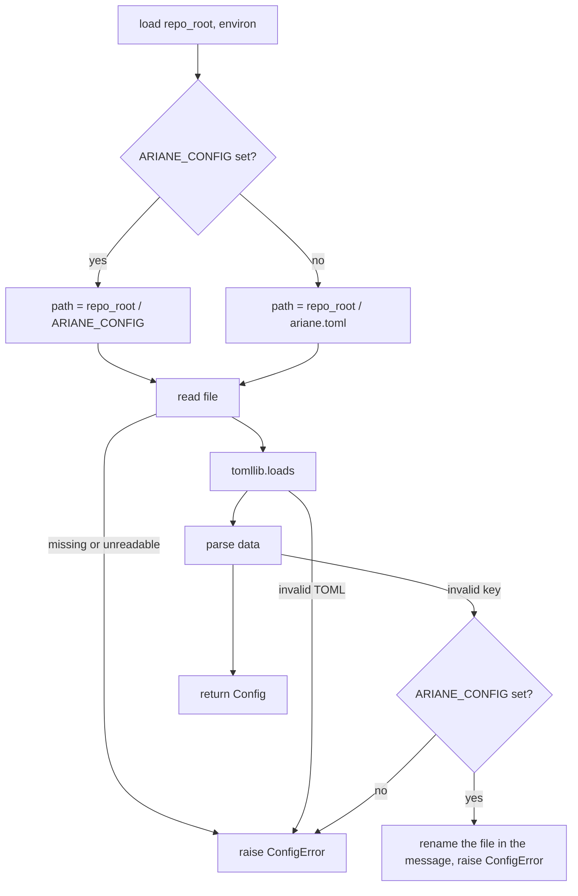
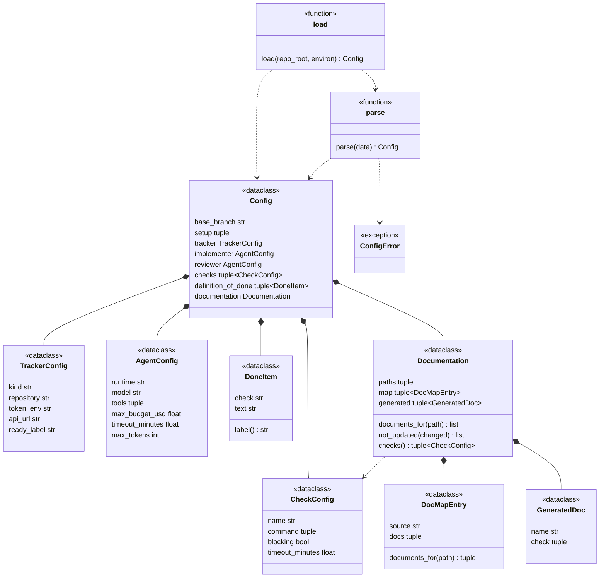
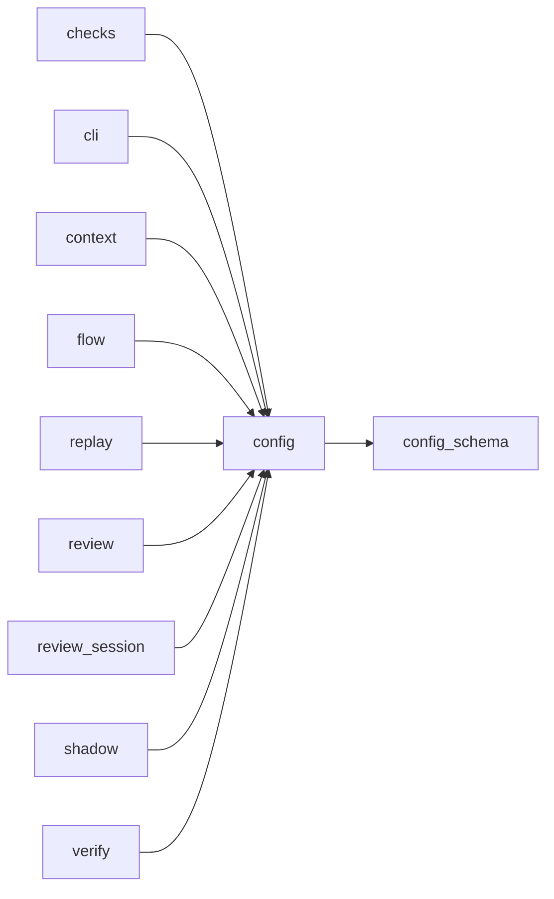

# Module `ariane.config`

Loads and validates `ariane.toml` (C22). Every error names the faulty key.

## Public API

| Name | Kind | What it does |
| --- | --- | --- |
| `CONFIG_FILE` | constant | The configuration file name, `ariane.toml`. |
| `CONFIG_ENV` | constant | The variable naming another configuration file, `ARIANE_CONFIG`. |
| `ConfigError` | exception | The configuration is missing or invalid; the message names the faulty key. |
| `TrackerConfig` | dataclass | `[tracker]`: `kind`, `repository`, `token_env`, `api_url`, `ready_label` (default `ariane`, C21, ADR 0032). |
| `AgentConfig` | dataclass | `[agents.<role>]`: `runtime`, `model`, `tools`, `max_budget_usd`, `timeout_minutes`, optional `max_tokens`. |
| `CheckConfig` | dataclass | One `[[checks]]` entry: `name`, `command`, `blocking`, `timeout_minutes`, optional `setup` (replaces `project.setup` in that check's replay tree, ADR 0041), optional `not_run_locally` (path globs of the files whose tests only CI runs, ADR 0042). |
| `DoneItem` | dataclass | One item of the definition of done (C26): a declared check or a sentence; `label()` is its text. |
| `DocMapEntry` | dataclass | Source files (a glob) and the documents that cover them; `documents_for(path)` expands them. |
| `GeneratedDoc` | dataclass | A `[[documentation.generated]]` entry: `name` and the `check` command. |
| `matching_paths(globs, paths)` | function | The paths matching at least one glob (same glob rules as `documentation.map`). |
| `Documentation` | dataclass | The optional `[documentation]` table (C25, ADR 0026): `paths`, `map`, `generated`; `documents_for(path)`, `not_updated(changed)`, `checks()`. |
| `NO_DOCUMENTATION` | constant | The empty `Documentation`, used without the table. |
| `DEFAULT_DEFINITION_OF_DONE` | constant | The definition of done when the table is absent (C26). |
| `Config` | dataclass | The validated settings: base branch, setup, tracker, implementer, reviewer, checks, definition of done, documentation. |
| `load(repo_root, environ=None)` | function | Read `ariane.toml`, or the file `ARIANE_CONFIG` names, and validate it (C22). |
| `parse(data)` | function | Validate a parsed TOML mapping and return a `Config`. |

## Behaviour and errors

- `load` reads `ariane.toml` at the repository root, or the file `ARIANE_CONFIG` names (relative to the repository root; errors then name `ARIANE_CONFIG (<file>)`). It raises `ConfigError` when the file is missing, unreadable or not valid TOML, then whatever `parse` raises.
- `Config.reviewer` is the required `[agents.reviewer]` table (same keys as the implementer's); `parse` refuses a reviewer model equal to the implementer's, naming `agents.reviewer.model` (C10).
- `Config.definition_of_done` is `DEFAULT_DEFINITION_OF_DONE` when the table is absent (C26). A `[[checks]]` name starting with `docs: ` is refused (`checks[i].name`); `{ check = "docs: <name>" }` is accepted when `<name>` is a `[documentation.generated]` entry.
- Globs (`documentation.map[].source`): `**/` matches zero or more whole folders (`src/**/*.py` matches `src/a.py`); other `**` crosses segments (ADR 0026). In `docs`, `{stem}` expands and `*` stays in a folder.
- `Documentation.not_updated` lists mapped documents a change left untouched; `Documentation.checks` turns generated entries into blocking checks `docs: <name>`.
- Runtimes (C5, ADR 0029): `runtime` is `claude-code`, or `opencode` for the reviewer only; an opencode agent takes `<provider>/<model>`, tools among `read`, `glob`, `grep`, and must set `max_tokens` (else `agents.<role>.max_tokens` is refused). A Claude Code reviewer's `tools` are a subset of `Read`, `Glob`, `Grep` (ADR 0031). `AgentConfig.max_tokens` is Ariane's own token cap per session.
- `SCHEMA` is re-exported from `config_schema`.

## Workflow

## Code view (C4 level 4)

## Collaborations

Arrows go from the importing module to the imported module; a dashed arrow is an import for type checking only.

<!-- generated: collaborations -->

<!-- end generated -->

## Reference

See the generated [JSON Schema of `ariane.toml`](../../reference/ariane.toml.schema.json), generated from the code (`scripts/generate_docs.py`).

## Serves

C10, C22, C25, C26; ADR 0003, ADR 0023, ADR 0016, ADR 0026. See [the component view](../3-components.md).
