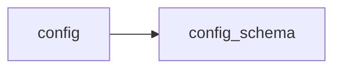

# Module `ariane.config_schema`

The description of `ariane.toml` as a JSON Schema (`SCHEMA`, written to `docs/reference/ariane.toml.schema.json` by `scripts/generate_docs.py`) and the runtimes each role may use: `claude-code` for both roles, `opencode` for the reviewer (ADR 0029). `config.parse` is the validation; a test checks that both agree.

## Main types and functions

- `SCHEMA`: the schema of the file. The reviewer (the only role that may run on opencode) carries an `if`/`then` that requires `max_tokens` when `runtime` is `opencode`, as `config.parse` does; the implementer has none.
- The reviewer also carries an `if`/`then` limiting a Claude Code reviewer's `tools` to `REVIEWER_TOOLS`, as `config.parse` does (ADR 0031).
- `RUNTIMES`, `OPENCODE_TOOLS`, `REVIEWER_TOOLS`: the runtimes allowed per role, the tools of an opencode agent and those of a Claude Code reviewer.

## Collaborations

Arrows go from the importing module to the imported module; a dashed arrow is an import for type checking only.

<!-- generated: collaborations -->

<!-- end generated -->

## Serves

C22, C5; ADR 0003, ADR 0022, ADR 0029, ADR 0031. See [the component view](../3-components.md).
