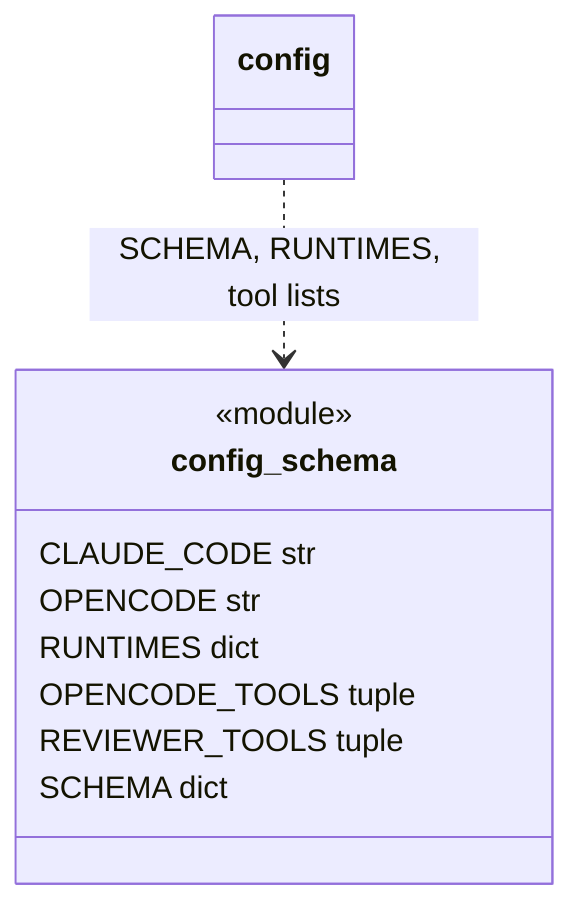
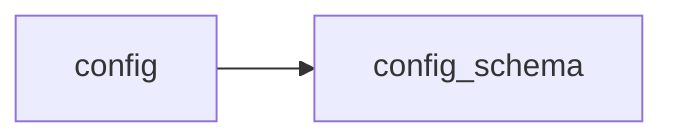

# Module `ariane.config_schema`

The description of `ariane.toml` as a JSON Schema, and the runtimes each role may use (C22, C5). `config.parse` is the validation; a test checks that both agree.

## Public API

| Name | Kind | What it does |
| --- | --- | --- |
| `CLAUDE_CODE` | constant | The runtime name `claude-code`. |
| `OPENCODE` | constant | The runtime name `opencode`. |
| `RUNTIMES` | constant | The runtimes allowed per role: `claude-code` for both, `opencode` for the reviewer only (ADR 0029). |
| `CODEX` | constant | The runtime name `codex`, for the reviewer only (ADR 0043); the agent schema gains the optional `api_key_env`. |
| `OPENCODE_TOOLS` | constant | The tools of an opencode agent: `read`, `glob`, `grep`. |
| `REVIEWER_TOOLS` | constant | The tools a Claude Code reviewer may be given: `Read`, `Glob`, `Grep` (ADR 0031). |
| `SCHEMA` | constant | The JSON Schema of the file, with `checks[].not_run_locally` (ADR 0042), written to `docs/reference/ariane.toml.schema.json` by `scripts/generate_docs.py`. |

## Behaviour and errors

- Reads and writes no file itself; `scripts/generate_docs.py` writes `SCHEMA` to `docs/reference/ariane.toml.schema.json`.
- The reviewer, the only role that may run on opencode, carries an `if`/`then` that requires `max_tokens` when `runtime` is `opencode`, as `config.parse` does; the implementer has none.
- The reviewer alone accepts the optional `small` object (`[agents.reviewer.small]`, ADR 0046): required `max_lines` (positive integer), optional `model`, `max_budget_usd`, `max_tokens`, `timeout_minutes`, no other key.
- The reviewer also carries an `if`/`then` limiting a Claude Code reviewer's `tools` to `REVIEWER_TOOLS` (ADR 0031).
- `agents.<role>.idle_minutes` is an optional positive number (ADR 0045); that it is below `timeout_minutes` is checked by `config.parse` only.
- `checks[].setup` is an optional argument list.
- `project.env` is an optional list of non-empty strings, default `[]` (ADR 0024).
- Raises nothing.

## Workflow

This module has no behaviour of its own: it only declares constants and the schema built from them.

## Code view (C4 level 4)

## Collaborations

Arrows go from the importing module to the imported module; a dashed arrow is an import for type checking only.

<!-- generated: collaborations -->

<!-- end generated -->

## Serves

C22, C5; ADR 0003, ADR 0022, ADR 0029, ADR 0031. See [the component view](../3-components.md).
