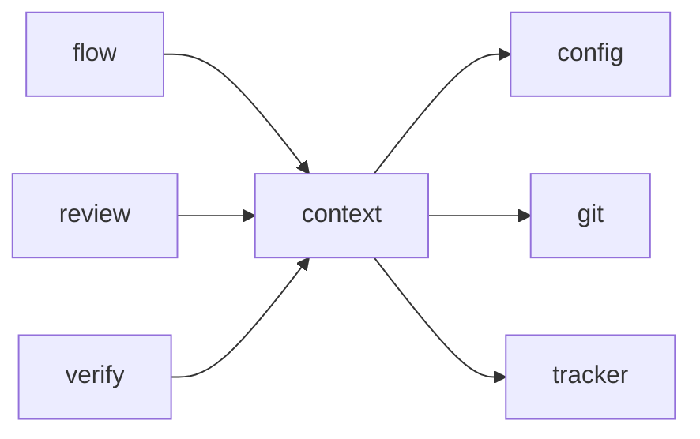

# Module `ariane.context`

Builds what an agent receives from Ariane: its prompt and a trimmed environment that holds no secret.

## Main types and functions

- `implementer_prompt`: the prompt of the implementer session: rules, the checks to replay and the
  definition of done (C26), and a "Documentation" section with the project's map of source files to documents, so the agent knows which to update (C25). For a fix round (C10) it adds the review's findings in an escaped untrusted block.
- `known_secrets`: the values to redact.
- `untrusted_environment`: the environment of an agent process. It withholds the tracker token, credential channels, secret-looking names and `ARIANE_CONFIG` (matched case-insensitively; Ariane's own configuration, not a secret, so `known_secrets` ignores it). It keeps only the login variables the runtime declares (`login_variables`: exact names, and prefixes ending in `_`, ADR 0024); the checks' environment gets none. When it runs as root and keeps a login, it sets `IS_SANDBOX=1` (Claude Code refuses `bypassPermissions` as root otherwise). `known_secrets` still masks a kept login variable whose name looks like a credential.

## Collaborations

Arrows go from the importing module to the imported module; a dashed arrow is an import for type checking only.

<!-- generated: collaborations -->

<!-- end generated -->

## Serves

C5, C21, C25, C26; ADR 0015, ADR 0026. See [the component view](../3-components.md).
