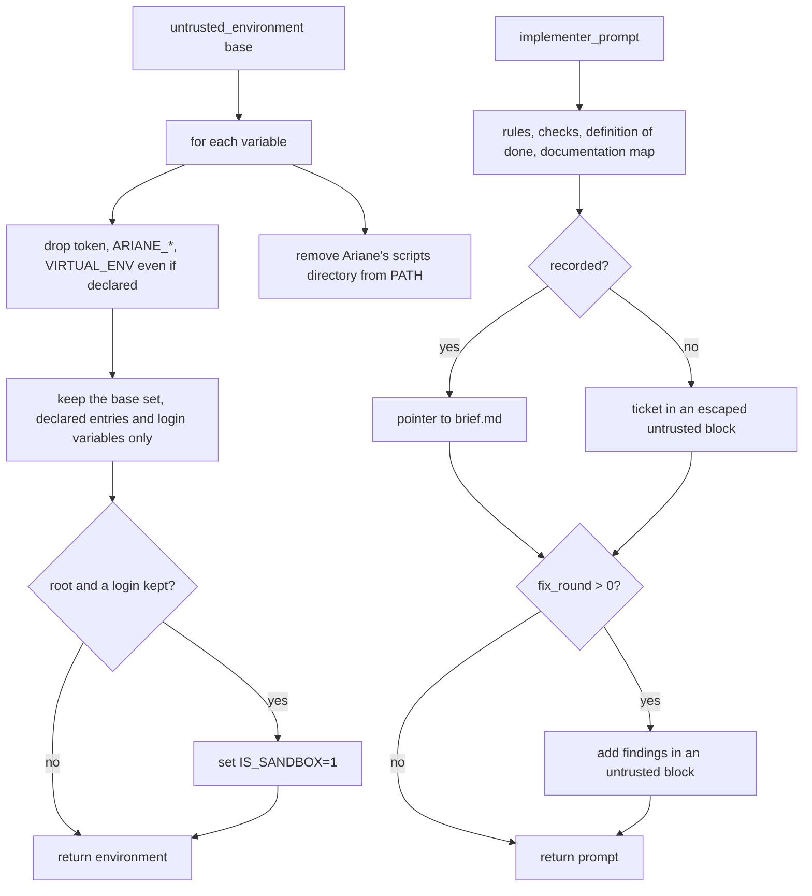
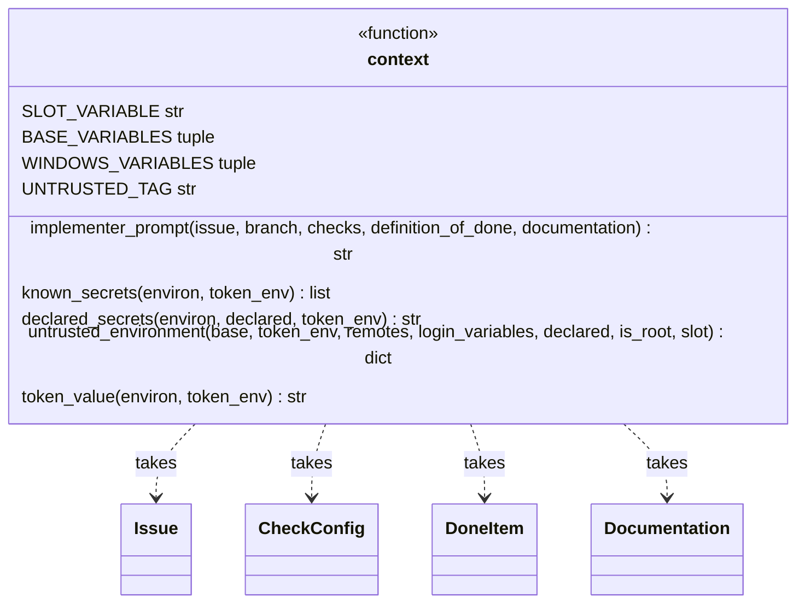
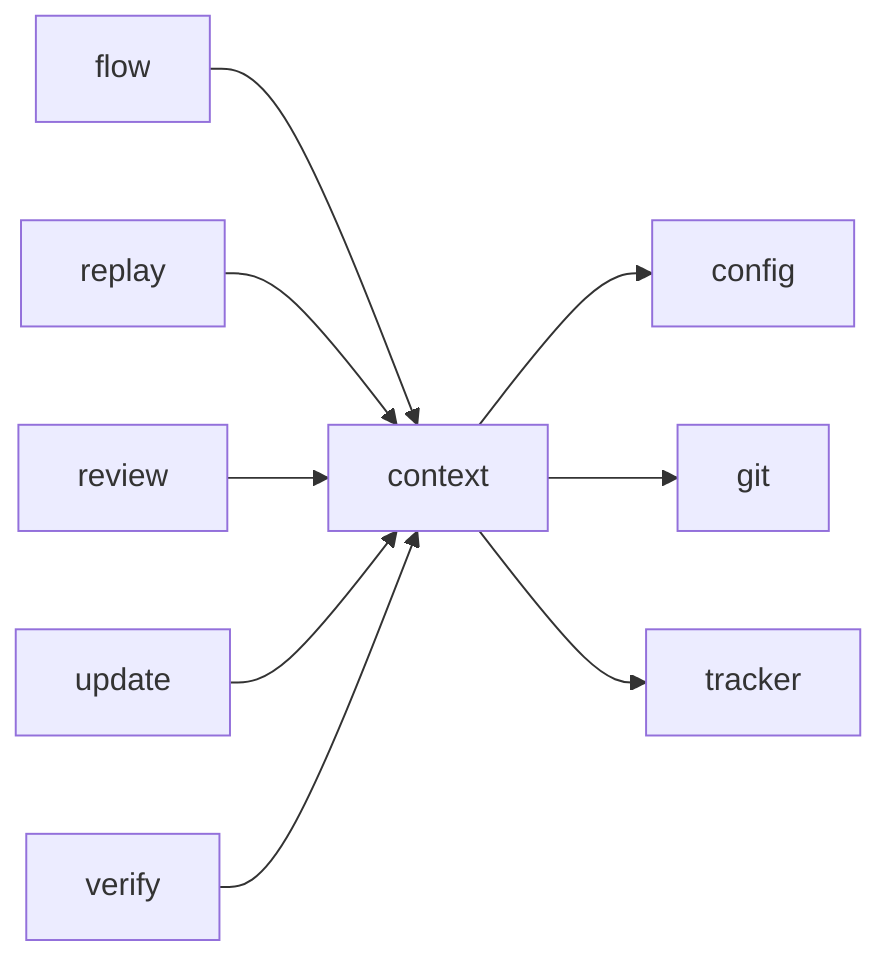

# Module `ariane.context`

Builds what an agent receives from Ariane (C5, C21, C25, C26): its prompt and an allow-listed environment that holds no secret the project did not declare.

## Public API

| Name | Kind | What it does |
| --- | --- | --- |
| `UNTRUSTED_TAG` | constant | The tag, `untrusted-ticket`, that wraps the ticket text in a prompt. |
| `implementer_prompt(issue, branch, checks, definition_of_done=DEFAULT_DEFINITION_OF_DONE, documentation=NO_DOCUMENTATION, *, recorded=False, read_at='', fix_round=0, findings='')` | function | The prompt of the implementer session; a check with `not_run_locally` is marked as not run locally (ADR 0042). |
| `BASE_VARIABLES` | constant | The variables untrusted code receives without being declared: system, proxy and certificate variables (ADR 0024). |
| `WINDOWS_VARIABLES` | constant | The system variables added to the base set on Windows. |
| `SLOT_VARIABLE` | constant | `ARIANE_SLOT`, the one `ARIANE_*` variable Ariane sets for the project (ADR 0050). |
| `token_value(environ, token_env)` | function | The tracker token's value in `environ`, its name matched case-insensitively; empty if unset. |
| `known_secrets(environ, token_env)` | function | The values to redact: the tracker token, the credential channels and every variable named like a secret (`git.SECRET_NAME`), declared or not, and a proxy URL with credentials (its value and its `user:password` part, with or without a scheme). |
| `declared_secrets(environ, declared, token_env)` | function | One journal line naming (never valuing) the variables named like secrets that pass because `[project] env` declares them; empty if none. |
| `untrusted_environment(base, *, token_env, remotes, login_variables=(), declared=(), is_root=None, slot=None)` | function | The environment of an agent session or of checks and setup commands running code an agent wrote; with `slot`, `ARIANE_SLOT` is set to it. |

## Behaviour and errors

- `implementer_prompt` holds the rules, the checks to replay, the definition of done (C26) and a "Documentation" section with the map of source files to documents (C25). The ticket sits in an escaped untrusted block, or a pointer to `brief.md` when `recorded`. The rules tell the agent not to do what the issue lists under Out of scope, even when a finding asks for it. For a fix round (C10) it adds the review's findings in an escaped untrusted block.
- `untrusted_environment` is an allow list (ADR 0024): it passes only `BASE_VARIABLES` (plus `WINDOWS_VARIABLES` on Windows), the entries `declared` in `[project] env`, and, for an agent session, the login variables the runtime declares; the checks' environment gets no login variable. A proxy variable (`HTTP_PROXY`, `HTTPS_PROXY`, `ALL_PROXY`) whose URL holds credentials passes only when declared, and `declared_secrets` then names it. Names are matched case-insensitively; an entry ending in `_` is a prefix, any other an exact name. The tracker token, every `ARIANE_*` variable and Ariane's own virtual environment (`VIRTUAL_ENV`, `VIRTUAL_ENV_PROMPT`) never pass, even if declared; the `PATH` entries that are Ariane's scripts directory or that of the interpreter running Ariane are removed (ADR 0040). It adds `GIT_SSH_COMMAND`, the push-blocking git config, and, as root with a kept login, `IS_SANDBOX=1` (Claude Code refuses `bypassPermissions` as root otherwise). With `slot` (the run's machine-wide slot, `slots.held`), it then sets `ARIANE_SLOT=<slot>`: after the `ARIANE_*` variables are withheld, so an `ARIANE_SLOT` in Ariane's own environment never passes (ADR 0050).
- A declared name that looks like a secret passes; `declared_secrets` names it for the journal (`ticket.env.declared_secret`), and `known_secrets` still masks its value, as it masks a kept login variable whose name looks like a credential.
- Reads no file and raises nothing.

## Workflow

## Code view (C4 level 4)

## Collaborations

Arrows go from the importing module to the imported module; a dashed arrow is an import for type checking only.

<!-- generated: collaborations -->

<!-- end generated -->

## Serves

C5, C21, C25, C26; ADR 0015, ADR 0026. See [the component view](../3-components.md).
