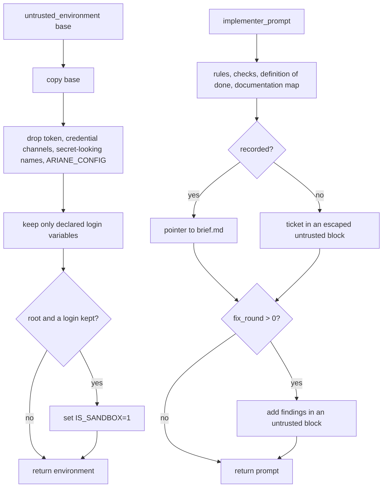
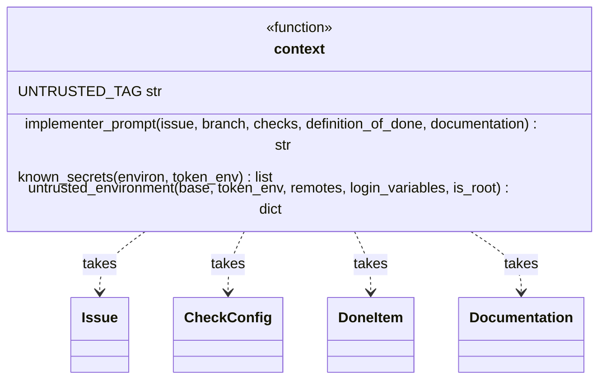
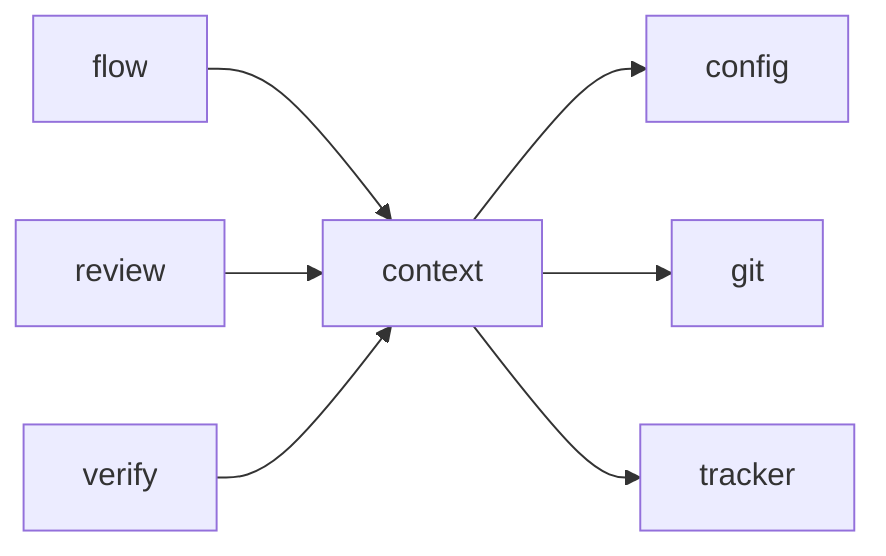

# Module `ariane.context`

Builds what an agent receives from Ariane (C5, C21, C25, C26): its prompt and a trimmed environment that holds no secret.

## Public API

| Name | Kind | What it does |
| --- | --- | --- |
| `UNTRUSTED_TAG` | constant | The tag, `untrusted-ticket`, that wraps the ticket text in a prompt. |
| `implementer_prompt(issue, branch, checks, definition_of_done=DEFAULT_DEFINITION_OF_DONE, documentation=NO_DOCUMENTATION, *, recorded=False, read_at='', fix_round=0, findings='')` | function | The prompt of the implementer session. |
| `known_secrets(environ, token_env)` | function | The values to redact: the tracker token and every variable `untrusted_environment` withholds. |
| `untrusted_environment(base, *, token_env, remotes, login_variables=(), is_root=None)` | function | The environment of an agent session or of checks running code an agent wrote. |

## Behaviour and errors

- `implementer_prompt` holds the rules, the checks to replay, the definition of done (C26) and a "Documentation" section with the map of source files to documents (C25). The ticket sits in an escaped untrusted block, or a pointer to `brief.md` when `recorded`. For a fix round (C10) it adds the review's findings in an escaped untrusted block.
- `untrusted_environment` withholds the tracker token, credential channels, secret-looking names, the remotes' credentials and `ARIANE_CONFIG` (matched case-insensitively; Ariane's own configuration is not a secret, so `known_secrets` ignores it). It keeps only the login variables the runtime declares (exact names, and prefixes ending in `_`, ADR 0024); the checks' environment gets none. As root with a kept login it sets `IS_SANDBOX=1` (Claude Code refuses `bypassPermissions` as root otherwise).
- `known_secrets` still masks a kept login variable whose name looks like a credential.
- Reads no file and raises nothing.

## Workflow

## Code view (C4 level 4)

## Collaborations

Arrows go from the importing module to the imported module; a dashed arrow is an import for type checking only.

<!-- generated: collaborations -->

<!-- end generated -->

## Serves

C5, C21, C25, C26; ADR 0015, ADR 0026. See [the component view](../3-components.md).
