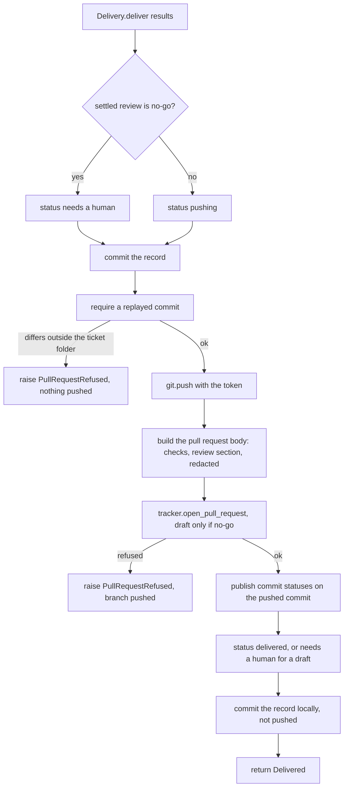
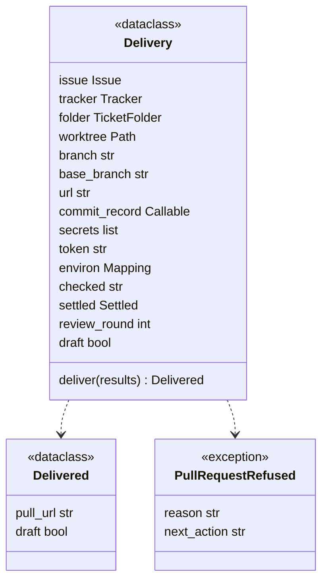
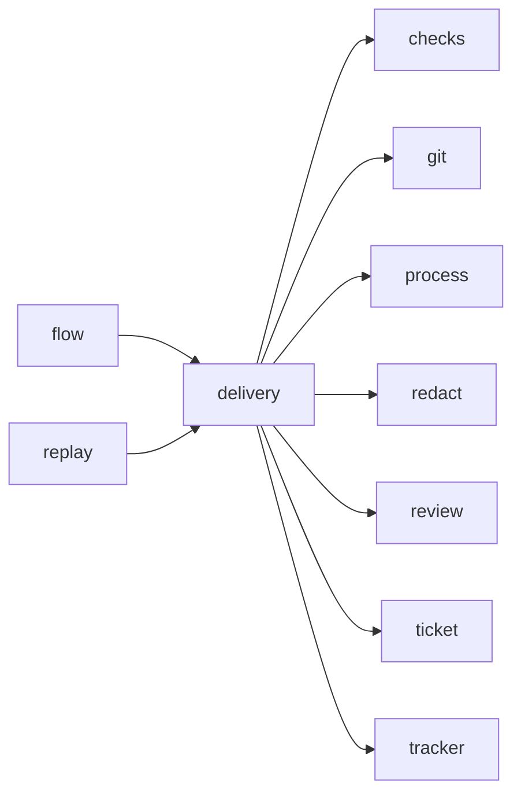

# Module `ariane.delivery`

Delivers a ticket: one push, the pull request (a draft that can carry failing blocking checks, after the fix rounds) and the commit statuses.

## Public API

| Name | Kind | What it does |
| --- | --- | --- |
| `FAILURES` | constant | The exception types a delivery step can raise (git, tracker, OS, missing command). |
| `PullRequestRefused` | exception | The tracker refused the pull request; carries `reason` and `next_action`. |
| `Delivered` | dataclass | The result: `pull_url` and `draft`. |
| `Delivery` | dataclass | Performs the delivery of one ticket; `deliver(results)` pushes, opens the pull request and publishes the statuses. |

## Behaviour and errors

- `Delivery`: performs the delivery.
- `Delivered`: the pull request (and whether it is a draft) and the statuses published. When the last review is still `no-go` after the fix rounds the pull request is a draft whose body says "Needs a human", and the ticket status is `needs a human` with next action "finish by hand, then run `ariane verify`". The pull request body carries the review's verdict and definition-of-done results. When the reviewed diff was cut (`truncated`, the files whose hunks it lacked), the review section says the diff given to the reviewer was truncated and how many files were missing (ADR 0031).
- Last guard (C11, ADR 0017): right before the push, the `guard` callable given by the run is called (the same check as after an agent session), and any `url.*.insteadof` or `url.*.pushinsteadof` key whose prefix matches the push URL stops the delivery with `PullRequestRefused`; nothing is pushed.
- Record (C1, C23, ADR 0027): the status committed before the push is `pushing` (`needs a human` for a draft) and never claims a push or a pull request. After the pull request is opened and the statuses published, the status becomes `delivered` with the pull request's number and URL (`needs a human`, "draft pull request #
 opened" for a draft) and `work/<n>/` is committed as `#<n>: record the pull request` on the local branch only: the pushed commit, which carries the statuses, does not move, and the ticket's working tree is clean.
- `PullRequestRefused`: raised when the tracker refuses the pull request.

## Workflow

## Code view (C4 level 4)

## Collaborations

Arrows go from the importing module to the imported module; a dashed arrow is an import for type checking only.

<!-- generated: collaborations -->

<!-- end generated -->

## Serves

C11, C21; ADR 0017, ADR 0018, ADR 0027. See [the component view](../3-components.md).
