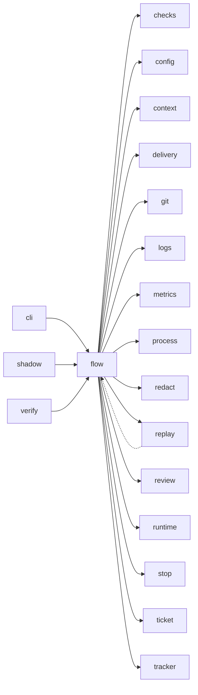

# Module `ariane.flow`

`ariane start`: turns one issue into a pull request whose checks Ariane replayed. It sets up the working tree, runs the agent session, applies the guards, commits, replays the checks on a clean tree, runs the read-only reviewer on a separate tree without instruction files or `.claude/` (C10, ADR 0031), runs up to two fix rounds after a negative review and hands over to delivery.

## Main types and functions

- `start`: the whole flow for one ticket number.
- `Outcome`: the result reported to the command line.
- The push guard's remote check (C11, ADR 0017) is `git.remote_changes`, called after the agent session with the ticket's branch.
- `Stop` (module `stop`): ends the flow early with a recorded reason.
- The replay of the checks and the review round are in [replay](replay.md) (ADR 0034).
- Metrics (C19): `work/<n>/metrics.json` is rewritten after the folder is opened, each session, the checks replayed, and the delivery or stop ([metrics](metrics.md)); delivery also records `blocking_red_at_delivery`, the number of blocking checks red at that point (C19, ADR 0038).
- Issue gate (C21, ADR 0032): the start exit code comes from `TrackerError.exit_code`; an issue refused by the tracker gate (no label, labelled by someone without write access, or changed after the label) gives exit 2 before any branch, worktree or agent.
- Environments (C21, ADR 0029): the implementer and fix sessions get an environment built from the implementer runtime's login variables, the reviewer from the reviewer runtime's; the checks get none.
- Documentation upkeep (C25): after the agent's work is committed, mapped documents of changed files that the ticket did not change are journaled (`ticket.docs.not_updated`) and given to the reviewer; the `generated` documentation commands run in the clean replay as blocking checks `docs: <name>`, in `checks.md` and the statuses.
- Each reviewer session journals `ticket.review.stopped` ("Reviewer session <n> stopped: <reason>") with its cost and tokens, in the implementer's format, including an invalid answer's.
- Fix rounds (C10, ADR 0027): after a `no-go`, or blocking checks failing after a fix round, a fresh implementer session gets the findings (an escaped untrusted block) and fixes them in the ticket's working tree; Ariane commits, replays the checks in a clean tree and reviews again (`review-1.md`, `review-2.md`). After the second fix round a review still `no-go` is delivered as a draft pull request with status `needs a human`. The journal records each round's sessions (`ticket.fix.round`, `ticket.session.*`, `ticket.review.*`) and verdict.
- The journal names the runtime of the session's role (`runtime.for_role`).
- Interruption (C5, C23): Ctrl-C during a ticket is recorded like any stop ("interrupted by the user" in the journal and `status.md`, committed) and the outcome has exit code `EXIT_INTERRUPTED` (130); Ctrl-C before the ticket folder exists (reading the issue, preparing the branch) has nothing to record: one line, same code. `ariane verify` handles its own interruption (see [verify](verify.md)).
- `worktree_path`, `branch_name`: where a ticket lives.
- Shadow mode (C19, ADR 0036): delivery is the overridable `_TicketRun._deliver`; [shadow](shadow.md) subclasses the run, with its own preparation, no remote check and a local record instead of the push.
- Guard violations (C19): `verify` counts each `Stop` of the post-session check in the metrics before raising it.

## Collaborations

Arrows go from the importing module to the imported module; a dashed arrow is an import for type checking only.

<!-- generated: collaborations -->

<!-- end generated -->

## Serves

C1, C5, C9, C10, C11, C25; ADR 0006, ADR 0017, ADR 0018, ADR 0019, ADR 0016, ADR 0025, ADR 0026, ADR 0027, ADR 0034, ADR 0036, C19. See [the component view](../3-components.md).
