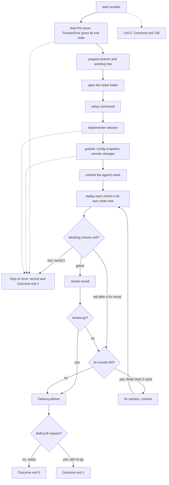
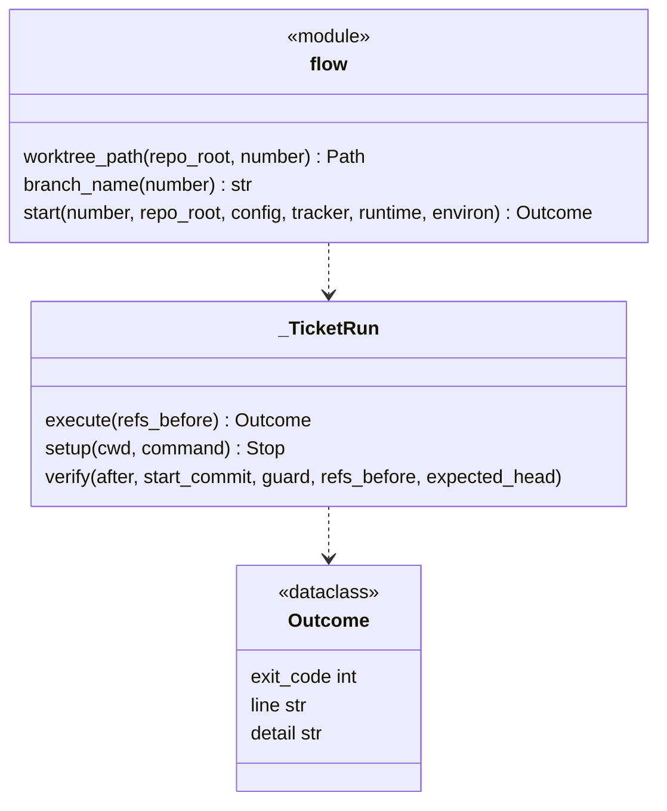
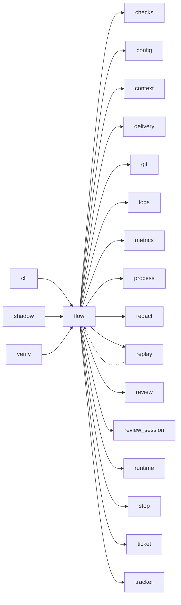

# Module `ariane.flow`

`ariane start`: turns one issue into a pull request whose checks Ariane replayed. It sets up the working tree, runs the agent session, applies the guards, commits, replays each check in its own clean tree, runs the read-only reviewer on a separate tree without instruction files or `.claude/` (C10, ADR 0031), runs up to two fix rounds after a negative review and hands over to delivery.

## Public API

| Name | Kind | What it does |
| --- | --- | --- |
| `REMOTE` | constant | The remote name, `origin`. |
| `SETUP_TIMEOUT_S` | constant | Time allowed for the setup command, in seconds. |
| `EXIT_OK` | constant | Exit code 0: delivered. |
| `EXIT_STOPPED` | constant | Exit code 1: the ticket stopped. |
| `EXIT_INTERRUPTED` | constant | Exit code 130: Ctrl-C. |
| `MAX_FIX_ROUNDS` | constant | Fix rounds after a negative review (2). |
| `Outcome` | dataclass | What `ariane start` reports: `exit_code`, `line`, `detail`. |
| `QUIET` | constant | The sentence naming the rule that nobody touches the repository while a ticket runs. |
| `worktree_path(repo_root, number)` | function | Where the ticket's working tree lives. |
| `branch_name(number)` | function | The ticket's branch, `ariane/<n>`. |
| `start(number, ...)` | function | The whole flow for one ticket number; returns an `Outcome`. |

## Behaviour and errors

- `start`: the whole flow for one ticket number.
- `Outcome`: the result reported to the command line.
- The push guard's remote check (C11, ADR 0017) is `git.remote_changes`, called after the agent session with the ticket's branch.
- `Stop` (module `stop`): ends the flow early with a recorded reason.
- The replay of the checks and the review round are in [replay](replay.md) (ADR 0034).
- Metrics (C19): `work/<n>/metrics.json` is rewritten after the folder is opened, each session, the checks replayed, and the delivery or stop ([metrics](metrics.md)); delivery also records `blocking_red_at_delivery`, the number of blocking checks red at that point (C19, ADR 0038).
- Issue gate (C21, ADR 0032): the start exit code comes from `TrackerError.exit_code`; an issue refused by the tracker gate (no label, labelled by someone without write access, or changed after the label) gives exit 2 before any branch, worktree or agent.
- Environments (C21, ADR 0029): the implementer and fix sessions get an environment built from the implementer runtime's login variables, the reviewer from the reviewer runtime's; the checks get none.
- Documentation upkeep (C25): after the agent's work is committed, mapped documents of changed files that the ticket did not change are journaled (`ticket.docs.not_updated`) and given to the reviewer; the `generated` documentation commands run in the clean replay as blocking checks `docs: <name>`, in `checks.md` and the statuses.
- Each reviewer session journals `ticket.review.stopped` ("Reviewer session <n> stopped: <reason>") with its cost and tokens, in the implementer's format, including an invalid answer's.
- Fix rounds (C10, ADR 0027): after a `no-go`, or blocking checks failing after a fix round, a fresh implementer session gets the findings (an escaped untrusted block) and fixes them in the ticket's working tree; Ariane commits, replays the checks in a clean tree and reviews again (`review-1.md`, `review-2.md`). A fix round that leaves the head where it was (`ticket.fix.unchanged`, the session's summary in the journal) skips the replay and the review and ends the rounds: the same draft pull request, with the stop line "fix round N changed nothing". After the second fix round a review still `no-go` is delivered as a draft pull request with status `needs a human`. The journal records each round's sessions (`ticket.fix.round`, `ticket.session.*`, `ticket.review.*`) and verdict.
- The journal names the runtime of the session's role (`runtime.for_role`).
- Interruption (C5, C23): Ctrl-C during a ticket is recorded like any stop ("interrupted by the user" in the journal and `status.md`, committed) and the outcome has exit code `EXIT_INTERRUPTED` (130); Ctrl-C before the ticket folder exists (reading the issue, preparing the branch) has nothing to record: one line, same code. `ariane verify` handles its own interruption (see [verify](verify.md)).
- Base instructions (C11, ADR 0028): read once in the preparation, right after the fetch and before any agent runs, and kept in memory for every review round; the guard's snapshot also holds the base branch's remote-tracking ref. The delivery gets a last guard (`verify("the delivery", ...)`) before the push.
- `worktree_path`, `branch_name`: where a ticket lives.
- Shadow mode (C19, ADR 0036): delivery is the overridable `_TicketRun._deliver`; [shadow](shadow.md) subclasses the run, with its own preparation, no remote check and a local record instead of the push.
- Guard violations (C19): `verify` counts each `Stop` of the post-session check in the metrics before raising it.
- Reviewer instruction files (C10, ADR 0031): the guard's snapshot also holds `git.instruction_snapshot` of the folders the reviewer can load instructions from (`review_session.instruction_dirs` of `<n>-review`) for the configured reviewer runtime and its environment; it is taken before the implementer's session, so an instruction file written outside the repository by a session, a setup or a check stops the ticket before the review ("<step> changed instruction files the reviewer can load", the changed paths in the journal).
- Surviving processes (C10, ADR 0031): the running descendants are noted when the ticket starts; after each setup command (`setup`) and at the start of every post-session check (`verify`: after each agent session, check and reviewer session), `survivors` kills any new one with `process.kill_survivors`, counts them in `metrics.json` (`surviving_processes`) and stops the ticket as a guard violation ("<step> left N process(es) running after it ended"). It finds them on Linux only.
- Truncated diff (C10, ADR 0031): `run.truncated` keeps the files whose hunks the last reviewed diff lacked; the delivery says so in the pull request body.

## Workflow

## Code view (C4 level 4)

## Collaborations

Arrows go from the importing module to the imported module; a dashed arrow is an import for type checking only.

<!-- generated: collaborations -->

<!-- end generated -->

## Serves

C1, C5, C9, C10, C11, C25; ADR 0006, ADR 0017, ADR 0018, ADR 0019, ADR 0016, ADR 0025, ADR 0026, ADR 0027, ADR 0034, ADR 0036, C19. See [the component view](../3-components.md).
