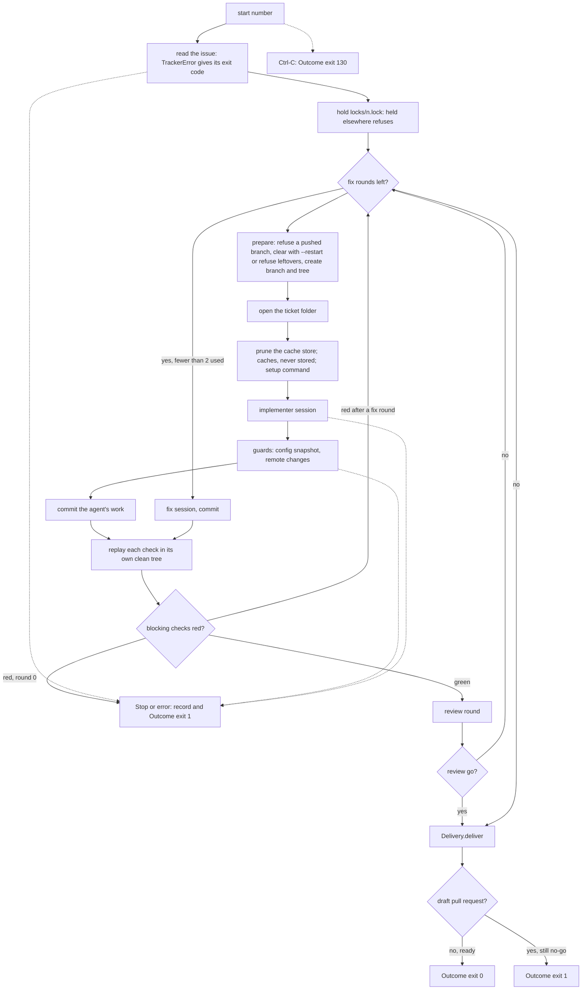
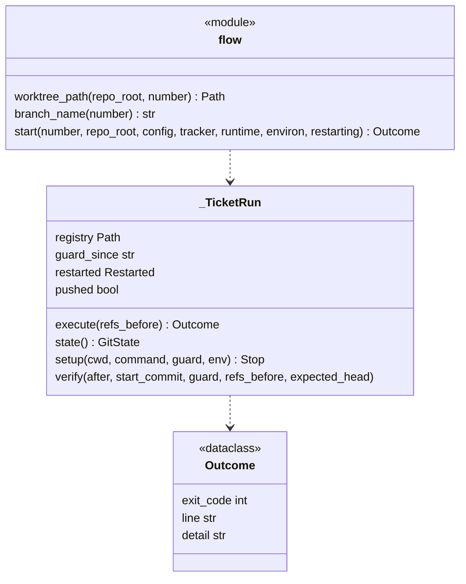
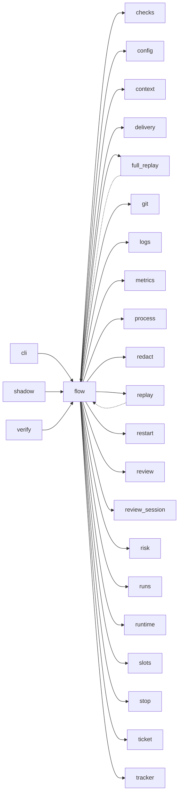

# Module `ariane.flow`

`ariane start`: turns one issue into a pull request whose checks Ariane replayed. It sets up the working tree, runs the agent session, applies the guards, commits, replays each check in its own clean tree, runs the read-only reviewer on a separate tree without instruction files or `.claude/` (C10, ADR 0031), runs up to two fix rounds after a negative review and hands over to delivery.

## Public API

| Name | Kind | What it does |
| --- | --- | --- |
| `REMOTE` | constant | The remote name, `origin`. |
| `SETUP_TIMEOUT_S` | constant | Time allowed for the setup command, in seconds. |
| `EXIT_OK` | constant | Exit code 0: delivered. |
| `EXIT_STOPPED` | constant | Exit code 1: the ticket stopped. |
| `EXIT_INTERRUPTED` | constant | Exit code 130: Ctrl-C. |
| `MAX_FIX_ROUNDS` | constant | Fix rounds after a negative review (2). |
| `Outcome` | dataclass | What `ariane start` reports: `exit_code`, `line`, `detail`. |
| `QUIET` | constant | The sentence naming the rule that only Ariane runs git commands in the repository or pushes to it while a ticket runs. |
| `worktree_path(repo_root, number)` | function | Where the ticket's working tree lives. |
| `stopped_metrics_path(worktree, number)` | function | `<repo>.ariane/stopped/<n>/metrics.json`: where a ticket stopped before its folder exists (Ctrl-C or an error in the first setup) keeps its metrics, survivors included (ADR 0031). |
| `branch_name(number)` | function | The ticket's branch, `ariane/<n>`. |
| `start(number, ..., restarting=False)` | function | The whole flow for one ticket number; `restarting` is `ariane start --restart` (ADR 0047); returns an `Outcome`. |

## Behaviour and errors

- `start`: the whole flow for one ticket number.
- `Outcome`: the result reported to the command line.
- The push guard's remote check (C11, ADR 0017) is `git.remote_changes`, called after the agent session with the ticket's branch; its stop is `runs.remote_stop`, a change to git or the instruction files is `runs.guard_stop`.
- Fewer git processes per verification (C11, ADR 0053): `verify` reads git once (`state`: `git.state` with the instruction files, three git processes) and takes the branch and head the guard checks from that read, not from separate commands; the ancestry of the start commit (`git.is_ancestor`) and the head are checked every time: a commit id does not fix git's view of its history, which the shared `shallow` file or a replacement ref can change. Every verification still lists the remote once (`git.remote_changes`), after each check of the replay too: a later check could undo what an earlier one pushed.
- Parallel tickets (C11, ADR 0017): `start` registers the run with `runs.registered` in `<repo>.ariane/runs/<n>` before preparing the branch and removes the entry however the run ends (a live run of the same ticket: "Did not start ticket #n: ticket #n is already running"). `_unchanged` takes the new snapshot first, then reads the registry (a run registers before it writes to git, so every run whose changes the snapshot shows is known), and compares the guard's snapshots through `runs.foreign_changes`, with the tickets other than this one that were running at any time since the guard's first snapshot and that Ariane can vouch for (`runs.during`, from `guard_since`, with the runs `runs.watching` saw live during the whole run): another run's branch `ariane/<m>`, its `remote` and `merge` keys, and the branch its restart keeps (`runs.kept_branches`: `Run.kept`, registered before the rename, accepted only as that ticket's own `ariane-restarted/<m>-<stamp>`) are ignored; anything else stops the ticket, and the journal lists only what is not another run's own.
- Back-to-back tickets (C11, ADR 0055): when the only change left is the base's tracking ref, `_unchanged` passes it to `runs.tracking_fast_forward` with `_remote_base` (one `git.remote_refs` of the URL, read only then): a fast-forward to the commit the remote's base points to now, another run's fetch after a merge, is tolerated and the guard takes the new commit; any other move stops. Parallel checks share the guard: `guard_lock` (one per run) is held by `verify` and `_unchanged` from the read of git until the guard advanced, so no check compares an older read with a guard another check advanced, which would look like a move backwards. The ticket keeps its start base: the reviewer's diff and the delivered range start from `start_commit`, and the base instructions were read at the start.
- `Stop` (module `stop`): ends the flow early with a recorded reason and a stop category (C19, ADR 0058). `_stopped` records it in `metrics.json` (`stop.category_of`: anything but a `Stop`, Ctrl-C included, is `infra`); a delivery that is not green records `review.not_green(settled, results)`: `checks` when blocking checks are still red after the rounds, else `review` (a review still `no-go`, or a fix round that changed nothing after one). Each stop path names its category: the guards `guard`, the setup `infra`, an implementer session that did not finish `budget` (cost, token, turn or time limit) or `runtime` (error, quota), no changed file `spec`, blocking checks red on the first replay `checks`, a reviewer failure its own (`budget` or `runtime`).
- Ticket lock and restart (C5, C23, ADR 0047): `start` first holds `restart.locked` on `<repo>.ariane/locks/<n>.lock` until it returns (held by another process: "Did not start ticket #n: ticket #n is running in another Ariane process", nothing removed). Right after, before any branch, tree or setup, it holds the run's machine-wide slot (`slots.held`, ADR 0050) until it returns; with all 16 held: "Did not start ticket #n: 16 Ariane runs already hold a slot on this machine. Next: wait for one to end.", nothing created. `ticket.started` names the slot. The preparation is `restart.prepare`: a pushed `ariane/<n>` refuses; with `restarting`, `start` registers the kept name `restart.kept_name(n)` with the run, then `restart.clear` saves the uncommitted work of the tree `<n>` in a commit, removes the ticket's trees (registered ones with git, unknown folders as folders) and keeps the branch, the saved commit on top, under that name, `ariane-restarted/<n>-<UTC time>`; leftover trees or a local branch refuse with "run `ariane start <n> --restart`", and an interruption or failure of the preparation that is not one of its refusals (a `Stop`) names `--restart` when the ticket's tree or local branch exists. A run that started over sets `restarted_from` in the metrics before its first setup and opens its journal with `ticket.restarted`, before `ticket.started`. Every stop of a ticket not pushed (`_stopped`, unless `on_pushed` was called or the run is a shadow run, `restartable = False`) ends its next action with "to start over, run `ariane start <n> --restart`" (`restart.with_restart`).
- The replay of the checks and the review round are in [replay](replay.md) (ADR 0034).
- Dependency caches (C9, ADR 0054): the first setup is `replay.set_up_ticket_tree`: old cache entries pruned, the ticket's tree given its `[[project.cache]]` folders (copied from the store or built, never stored), then `project.setup`; `ticket.setup` names what each cache did.
- Metrics (C19): `work/<n>/metrics.json` is rewritten after the folder is opened, each session, the checks replayed, and the delivery or stop ([metrics](metrics.md)); delivery also records `blocking_red_at_delivery`, the number of blocking checks red at that point (C19, ADR 0038).
- Issue gate (C21, ADR 0032): the start exit code comes from `TrackerError.exit_code`; an issue refused by the tracker gate (no label, labelled by someone without write access, or changed after the label) gives exit 2 before any branch, worktree or agent.
- Environments (C21, ADR 0029, ADR 0024): every environment is the allow list of `context.untrusted_environment` with the `[project] env` entries; the implementer and fix sessions add the implementer runtime's login variables, the reviewer those of the reviewer's model, and a small reviewer round those of the small model (`review_session.agent_logins`, ADR 0046); the setup and the checks get none. Every one of them, and the commits' hooks, gets the run's slot as `ARIANE_SLOT` (`slot=`, ADR 0050), except the setup and check of a parallel replay worker, which get that worker's slot (`setup(cwd, command, guard, env)`, ADR 0052). When a declared name looks like a secret, the journal says so once, after `ticket.started`, as `ticket.env.declared_secret` (names only).
- Documentation upkeep (C25): after the agent's work is committed, mapped documents of changed files that the ticket did not change are journaled (`ticket.docs.not_updated`) and given to the reviewer; the `generated` documentation commands run in the clean replay as blocking checks `docs: <name>`, in `checks.md` and the statuses.
- Each reviewer session journals `ticket.review.stopped` ("Reviewer session <n> stopped: <reason>") with its cost and tokens, in the implementer's format, including an invalid answer's.
- Fix rounds (C10, ADR 0027): after a `no-go`, or blocking checks failing after a fix round, a fresh implementer session gets the findings (an escaped untrusted block) and fixes them in the ticket's working tree; Ariane commits, replays the checks in a clean tree and reviews again (`review-1.md`, `review-2.md`). A fix round that leaves the head where it was (`ticket.fix.unchanged`, the session's summary in the journal) skips the replay and the review and ends the rounds: the same draft pull request, with the stop line "fix round N changed nothing". After the second fix round a review still `no-go` is delivered as a draft pull request with status `needs a human`. The journal records each round's sessions (`ticket.fix.round`, `ticket.session.*`, `ticket.review.*`) and verdict.
- The journal names the runtime of the session's role (`runtime.for_role`).
- An implementer session that did not finish stops the ticket with "the implementer session stopped: <reason>" and its work kept on the branch; a `timeout` adds its summary in parentheses (`SessionResult.stop_text`), which says whether the total or the idle limit was reached and, for the idle limit, the last event (C5, ADR 0045).
- Interruption (C5, C23): Ctrl-C during a ticket is recorded like any stop ("interrupted by the user" in the journal and `status.md`, committed) and the outcome has exit code `EXIT_INTERRUPTED` (130); Ctrl-C before the ticket folder exists (reading the issue, preparing the branch) has nothing to record: one line, same code. `ariane verify` handles its own interruption (see [verify](verify.md)).
- Base instructions (C11, ADR 0028): read once in the preparation, right after the fetch and before any agent runs, and kept in memory for every review round; the guard's snapshot also holds the base branch's remote-tracking ref (a fast-forward to the remote's base is tolerated, ADR 0055). The delivery gets a last guard (`verify("the delivery", ...)`) before the push.
- `worktree_path`, `branch_name`: where a ticket lives.
- Shadow mode (C19, ADR 0036): delivery is the overridable `_TicketRun._deliver`; [shadow](shadow.md) subclasses the run, with its own preparation, no remote check and a local record instead of the push.
- Guard violations (C19): `verify` counts each `Stop` of the post-session check in the metrics before raising it.
- Reviewer instruction files (C10, ADR 0031): the guard's snapshot also holds `git.instruction_snapshot` of the folders the reviewer can load instructions from (`review_session.instruction_dirs` of `<n>-review`) for the configured reviewer runtime and its environment; it is taken before the first setup command and compared right after every setup command, the ticket's and each replay tree's, before its check runs (`setup` calls `_unchanged`; counted as a guard violation), so an instruction file written outside the repository by a setup, a session or a check stops the ticket before the review ("<step> changed instruction files the reviewer can load", the changed paths in the journal).
- Surviving processes (C10, ADR 0031): each command's own teardown in `process` already killed what it left running. The descendants (exited ones included) are noted when the ticket starts; after each setup command (`setup`, before its exit code is looked at) and at the start of every post-session check (`verify`: after each agent session, check and reviewer session), `survivors` kills any new one with `process.kill_survivors`, takes what was killed with `process.take_killed`, counts them in `metrics.json` (`surviving_processes`) and stops the ticket as a guard violation ("<step> left N process(es) running after it ended"). A ticket stopped or interrupted for another reason (`_stopped`) kills and counts them too. It finds them on Linux only.
- Round's diff (C9, ADR 0053, ADR 0056): `run.changes` keeps, per replayed commit, the diff from the start commit (`replay.round_changes`), read once and used both to select the round's checks and for its review.
- Risk tier (C9, ADR 0056): `run.tier` holds the last replayed round's tier and `run.check_failed` whether a replayed round failed a check (`replay.replay` sets both); `checks.md` starts with the tier and `Delivery` states it in the pull request body. When the run is made, before any setup or agent session, it reads the accepted residuals of the ADRs in the fresh working tree, which is the base commit (`review.residuals_in`, no git process, ADR 0057), as `run.residuals`. `Delivery` also gets the ticket's changed files matching `[review] sensitive_paths`, for the `owner-review` label and line (ADR 0057).
- Sensitive paths (C10, ADR 0057): `_deliver` gives `Delivery`, as `sensitive`, `replay.sensitive` of the delivered commit: the same match the review was given (decoded, both sides of a rename, without `work/`).
- Full replay (C9, C19, ADR 0056): once `Delivery.deliver` returns, `_deliver` calls `full_replay.after_delivery` with the replayed commit, the last round's results and the `Delivered` result; it changes neither the outcome nor its line. `execute` keeps the start commit in `run.start_commit` for it.
- Truncated diff (C10, ADR 0031): `run.truncated` keeps the files whose hunks the last reviewed diff lacked; the delivery says so in the pull request body.

## Workflow

## Code view (C4 level 4)

## Collaborations

Arrows go from the importing module to the imported module; a dashed arrow is an import for type checking only.

<!-- generated: collaborations -->

<!-- end generated -->

## Serves

C1, C5, C9, C10, C11, C25; ADR 0006, ADR 0017, ADR 0018, ADR 0019, ADR 0016, ADR 0025, ADR 0026, ADR 0027, ADR 0034, ADR 0036, ADR 0047, ADR 0053, ADR 0054, ADR 0058, C19, C23. See [the component view](../3-components.md).
