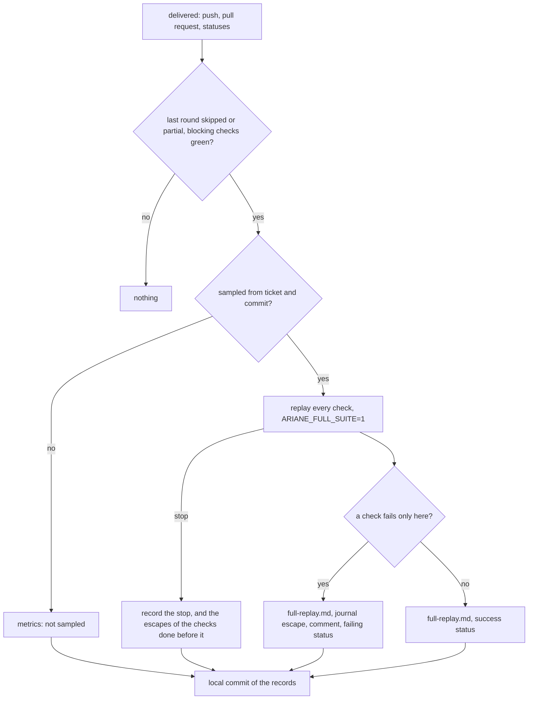
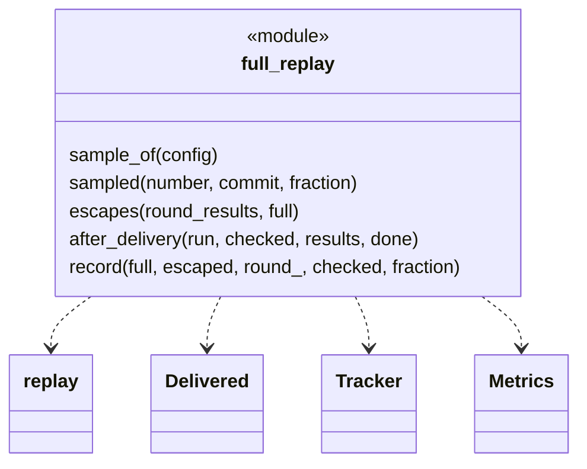
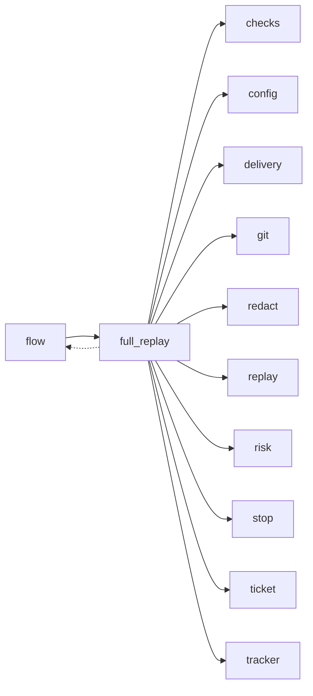

# Module `ariane.full_replay`

The sampled full replay after delivery (C9, C19, ADR 0056): when the last round of a ticket skipped a check or ran one with `ARIANE_FULL_SUITE=0`, a sample of the tickets get every check replayed with `ARIANE_FULL_SUITE=1`, after the push and the pull request, so that what selective checks missed is caught and counted.

## Public API

| Name | Kind | What it does |
| --- | --- | --- |
| `RECORD` | constant | `full-replay.md`, the record in the ticket folder. |
| `STATUS` | constant | `ariane/full-replay` (`config.FULL_REPLAY_CHECK`, a name no check may take), the commit status it publishes. |
| `SKIPPED` | constant | `skipped`: the selective round did not run the check. |
| `PARTIAL` | constant | `partial`: the round ran it with `ARIANE_FULL_SUITE=0`. |
| `RAN` | constant | `ran in full`: the round ran it with `ARIANE_FULL_SUITE=1`. |
| `sample_of(config)` | function | `[checks_policy] full_replay_sample`, 0.2 without the table. |
| `sampled(number, commit, fraction)` | function | Whether ticket `number` at `commit` is in the sample: SHA-256 of both, its first 8 bytes against `fraction`; never with 0, always with 1, the same at every rerun. |
| `selective(round_)` | function | Whether a round's measures (`Metrics.replayed`) show a skipped or partial check. |
| `escapes(round_results, full)` | function | The checks failing in the full replay that passed (or were skipped) in the round. |
| `how(name, round_)` | function | `skipped`, `partial` or `ran in full`, for check `name` in the round. |
| `after_delivery(run, checked, results, done)` | function | Called by `flow` after `Delivery.deliver`: decides, replays, records and publishes. |
| `record(full, escaped, round_, checked, fraction)` | function | The text of `full-replay.md`. |

## Behaviour and errors

- Nothing happens when the last round has no skipped or partial check, or a blocking check failed. Otherwise `sampled` decides; not sampled, `metrics.json` gets `full_replay` `{"ran": false}` and the journal `ticket.checks.full_replay` "Full replay not sampled".
- Sampled: `replay.replay(..., full=True)` replays every check at the replayed commit, each in a fresh tree, with `risk.FULL_REPLAY` (`ARIANE_RISK_TIER=high`, `ARIANE_FULL_SUITE=1`) and `ARIANE_CHANGED_FILES`, in the run's slot (and more with `parallel_checks`). The guard's baseline is git and the remote as the delivery left them; each tree is verified as in a round.
- An escape (a check failing only in the full replay) is written to `full-replay.md` with its output (redacted by the ticket folder), journaled `ticket.checks.escape`, commented on the pull request naming the checks (redacted), and published as a failing `ariane/full-replay` status on the pushed commit; a passing full replay publishes a success. A refused status or comment is a journaled warning (`ticket.warning.statuses_refused`, `ticket.warning.comment_refused`).
- The push, the pull request, its body, the review and the run's outcome are never changed. A stop or Ctrl-C during the full replay is recorded (`full_replay.stopped`, the journal, `full-replay.md`) and ends only the full replay. The checks that finished before it are kept (`replay(..., ran=)`): one that failed is still an escape, recorded with its output, journaled, commented and published as a failing status, before the stop is journaled and added to `full-replay.md` ("## Stopped"); a stop without an escape publishes no status. Whatever stops it after the replay (Ctrl-C or an error while recording, publishing or committing, or while recording a stop) is journaled when it can be ("Full replay stopped: <reason>", then the commit is tried again) and never reaches the run: the delivered outcome, status and exit code stay. Its records go in one local commit, "record the full replay", never pushed by Ariane.

## Workflow

## Code view (C4 level 4)

## Collaborations

Arrows go from the importing module to the imported module; a dashed arrow is an import for type checking only.

<!-- generated: collaborations -->

<!-- end generated -->

## Serves

C9, C19; ADR 0056. See [the component view](../3-components.md).
