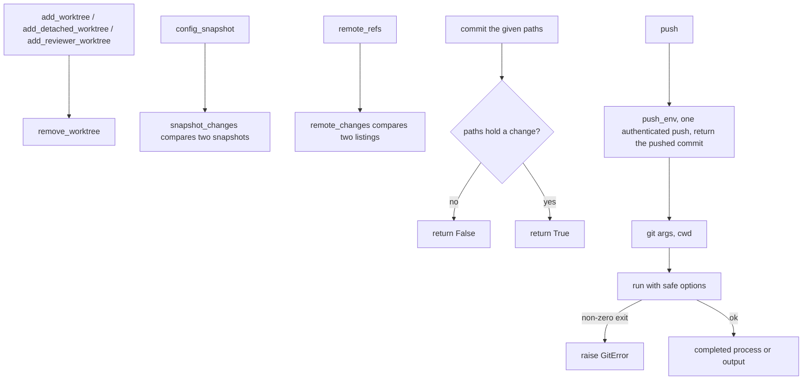
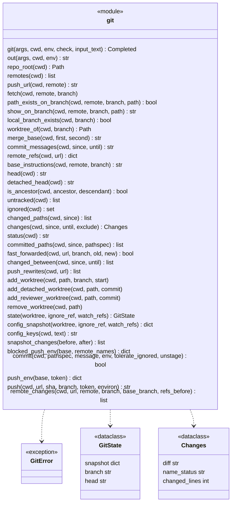
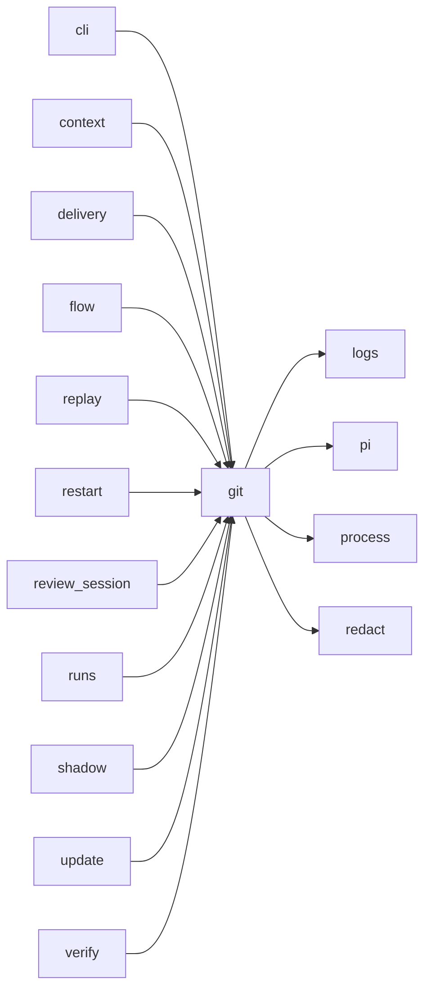

# Module `ariane.git`

The git operations Ariane performs itself: working trees, snapshots of the git configuration, guards against edits outside the tree, commits and the single authenticated push.

## Public API

| Name | Kind | What it does |
| --- | --- | --- |
| `BLOCKED_PUSH_URL` | constant | The push URL agents see, which cannot be pushed to. |
| `INSTRUCTION_FILES` | constant | Lower-case names of the instruction files left out of the reviewer tree. |
| `INSTRUCTION_DIRS` | constant | Directories left out of the reviewer tree (`.claude`, `.codex`, `.agents`, `.pi`). |
| `PI_FILES` | constant | pi's global files the guard watches: `settings.json`, `models.json`, `AGENTS.md`, `SYSTEM.md`, `APPEND_SYSTEM.md`. |
| `GitError` | exception | A git command failed. |
| `git(args, cwd, env, check, input_text)` | function | Runs git with safe options (`input_text` on its standard input); returns the completed process. |
| `out(args, cwd, env)` | function | Runs git and returns its stripped output. |
| `repo_root(cwd)` | function | The top-level folder of the repository. |
| `remotes(cwd)` | function | The names of the remotes. |
| `push_url(cwd, remote)` | function | The push URL of a remote. |
| `fetch(cwd, remote, branch)` | function | Fetches one branch from a remote. |
| `path_exists_on_branch(cwd, remote, branch, path)` | function | Whether a path exists on a remote branch. |
| `show_on_branch(cwd, remote, branch, path)` | function | The content of a file on a remote branch. |
| `local_branch_exists(cwd, branch)` | function | Whether a local branch exists. |
| `worktree_of(cwd, branch)` | function | Where a branch is checked out, or None. |
| `merge_base(cwd, first, second)` | function | The common ancestor of two revisions. |
| `commit_messages(cwd, since, until)` | function | The commit messages between two revisions. |
| `remote_refs(cwd, url)` | function | The refs of a remote URL, by name. |
| `add_worktree(cwd, path, branch, start)` | function | Adds a working tree on a new branch, without upstream (`--no-track`: no `branch.<name>.*` key is written, #159). |
| `add_detached_worktree(cwd, path, commit)` | function | Adds a detached working tree at a commit. |
| `add_reviewer_worktree(cwd, path, commit)` | function | Adds a detached tree without instruction files or symlinks leaving it. |
| `base_instructions(cwd, remote, branch)` | function | The base branch's `CLAUDE.md`, or empty. |
| `ANCESTOR_INSTRUCTIONS` | constant | The instruction files looked for in the ancestors of the reviewer's folders (`CLAUDE.md`, `CLAUDE.local.md`). |
| `instruction_snapshot(dirs, runtime, env)` | function | The digests of the instruction files a reviewer runtime can load from outside the reviewer tree, by part (`instructions <path>`); an absent file is a part too (ADR 0031). |
| `remove_worktree(cwd, path)` | function | Removes a working tree. |
| `GitState` | dataclass | What `state` reads: `snapshot`, the checked-out `branch` and its commit `head` (both empty when HEAD is detached). |
| `state(worktree, ignore_ref, watch_refs=())` | function | The guard's read of git in three git processes (ADR 0053): a snapshot of the git configuration files, hooks, local refs and the watched refs (full names: the base's remote-tracking ref), to detect tampering, with the branch and head of the tree. The snapshot also keeps the shared `config`'s text (`keys <path>`, the very bytes its digest is taken from), so that `runs.foreign_changes` compares that file by key; each setting's value is its positions among the settings of the same key, so reordering them is a change. |
| `config_snapshot(worktree, ignore_ref, watch_refs=())` | function | `state(...).snapshot`. |
| `config_keys(cwd, text)` | function | `git config --file - --list --null` of a configuration file's text, or `unreadable`; what `runs.foreign_changes` compares by key. |
| `push_rewrites(cwd, url)` | function | The `url.*.insteadof` and `url.*.pushinsteadof` settings (any scope; read with `--null`, from the push's environment) whose prefix is a prefix of `url`. |
| `snapshot_changes(before, after)` | function | The entries that differ between two snapshots. |
| `blocked_push_env(base, remote_names)` | function | An environment in which every remote's push URL is blocked. |
| `head(cwd)` | function | The current commit. |
| `detached_head(cwd)` | function | The commit of a detached HEAD, or empty when HEAD is a branch, in one git process (`rev-parse HEAD --symbolic-full-name HEAD`): how a replay or reviewer tree is checked unmoved. |
| `is_ancestor(cwd, ancestor, descendant)` | function | Whether one revision is an ancestor of another. |
| `untracked(cwd)` | function | Untracked paths. |
| `ignored(cwd)` | function | Ignored paths. |
| `changed_paths(cwd, since)` | function | Paths changed since a revision. |
| `Changes` | dataclass | `diff`, `name_status` and `changed_lines` of a range, as the reviewer is shown it. |
| `changes(cwd, since, until, exclude)` | function | The `Changes` between two revisions, without the excluded pathspec and without external diff or textconv drivers, read by one git process (`git diff --raw --numstat -p`, ADR 0053): `name_status` is what `git diff --name-status` prints (the raw lines after their modes and objects; records split at line feeds only, never at U+2028), `changed_lines` the added plus deleted lines of `--numstat` (a binary file counts 0), `diff` the patch after them. The review and `ariane verify` use it; `changed_lines` sizes the review (ADR 0046). |
| `changed_between(cwd, since, until)` | function | Paths that differ between two commits. |
| `status(cwd)` | function | The short status of the tree. |
| `committed_paths(cwd, since, pathspec)` | function | Paths committed since a revision under a pathspec. |
| `commit(cwd, pathspec, message, env, tolerate_ignored, unstage)` | function | Commits only the given paths (`reset`, `add`, `commit`: three git processes); False when they hold no change, which only a refused commit checks (ADR 0053); the `unstage` paths leave the index first; the `git commit` adds Ariane's own git identity variables (`GIT_AUTHOR_*`, `GIT_COMMITTER_*`, `EMAIL`) to `env`, which the allow list withholds from untrusted code (ADR 0024). |
| `token_free_environment(base=None)` | function | The environment without any variable the credential filter withholds; the default of `git` and `out` (C21). |
| `SECRET_NAME` | constant | The pattern of credential variable names, shared with `context`; it includes `PAT` and `_AUTH` as whole name parts, `_KEY` at the end, `DSN`, `DATABASE_URL`, `KUBECONFIG`, `DOCKER_AUTH_CONFIG` (ADR 0024). |
| `CREDENTIAL_CHANNELS` | constant | The credential channels (SSH agent, askpass) the filter withholds. |
| `push_env(base, token)` | function | An environment carrying the push credential. |
| `push(cwd, url, sha, branch, token, environ)` | function | The single authenticated push; returns the pushed commit. |
| `fast_forwarded(cwd, url, branch, old, new)` | function | Whether a branch moved by fast-forward. |
| `remote_changes(cwd, url, remote, branch, base_branch, refs_before)` | function | The push guard's check of the remote refs. |

## Behaviour and errors

- `git`, `out`: run git and return output.
- `add_worktree`, `add_detached_worktree`, `remove_worktree`: ticket and replay trees.
- `add_reviewer_worktree`: a detached tree without `CLAUDE.md`, `CLAUDE.local.md`, `AGENTS.md`, `AGENTS.override.md`, `.claude/`, `.codex/`, `.agents/` and `.pi/` at any depth, and without symlinks that leave the tree; a tree that cannot be built is removed (ADR 0031). `base_instructions`: the base branch's `CLAUDE.md` read with git, or empty.
- `worktree_of`, `merge_base`, `commit_messages`: where a branch is checked out, and what `ariane verify` reads of a branch (ADR 0028).
- `instruction_snapshot`: what a reviewer runtime can load from outside its tree (ADR 0031): `CLAUDE.md` and `CLAUDE.local.md` in each given folder and every ancestor (as given and resolved), the user-level Claude file (`$CLAUDE_CONFIG_DIR/CLAUDE.md`, else `~/.claude/CLAUDE.md`, with `HOME` from `env`), and for opencode `AGENTS.md`, `opencode.json`, `opencode.jsonc` and `config.json` of its global folder (`$XDG_CONFIG_HOME/opencode`, else `~/.config/opencode`) and `$OPENCODE_CONFIG`; for Codex `AGENTS.md`, `AGENTS.override.md` and `config.toml` of `$CODEX_HOME` (else `~/.codex`); for pi `PI_FILES` of `pi.agent_dir` (`$PI_CODING_AGENT_DIR` made absolute, else `~/.pi/agent`). Each part is a digest of the content, the link target of a symlink, `absent`, `not a file` or `unreadable`; the flow merges it into the guard snapshot.
- `state`, `config_snapshot`, `snapshot_changes`: detect configuration tampering, in three git processes per read (ADR 0053): one `rev-parse` for the shared and private git folders, one `git config --list --show-origin --show-scope` for the settings, and one `git for-each-ref` for the branches, tags, the refs in `watch_refs` (`refs/remotes/<remote>/<base>`) and which branch HEAD is on (`%(HEAD)`); the files are read directly. Next to the shared `config`'s digest, the snapshot keeps its text, read once (part `keys <path>`): another process writing the file meanwhile can never make the digest and the keys disagree. `config_keys` lists that text by key (`git config --file - --list --null`, `unreadable` if git cannot parse it) only when two snapshots differ there. Each `setting` part's value is the setting's positions (comma-separated) among all the settings of the same key, in the order git reads them, so swapping two values of a repeated key, in any file, changes the snapshot. [runs](runs.md) uses those keys to tolerate another Ariane run's own branch keys (C11, ADR 0017). `push_rewrites`: the URL-rewriting keys that apply to the push URL and would reroute it (ADR 0017).
- Every git command runs with `protocol.ext.allow=never`; every diff with `--no-ext-diff --no-textconv`, so that no configured driver runs (ADR 0017). `fast_forwarded` fetches from the URL, so the base's tracking ref (part of the snapshot) stays where `fetch` left it. A move of that ref is still a snapshot change here; [runs](runs.md) tolerates it only as a fast-forward to the commit the remote's base points to, read with `remote_refs` (`runs.tracking_fast_forward`, C11, ADR 0055).
- `blocked_push_env`, `push_env`, `push`: push only from Ariane.
- `commit`: commits only the given paths; returns False when they hold no change (the index is compared with HEAD only after `git commit` refused, so a commit that has a change runs three git processes), raises `GitError` when `git add` fails (for example an ignored `work/`), except with `tolerate_ignored=True` (used by `ariane verify`), which returns False so that it can say nothing was recorded. The `unstage` paths are removed from the index (`git rm --cached`) before the add, so that a link committed earlier becomes a regular file (`100644`) on every platform.
- `head`, `detached_head`, `changed_paths`, `committed_paths`, `is_ancestor`, `fast_forwarded`: history queries.
- `remote_changes`: the push guard's remote check (C11, ADR 0017): of the refs that differ from the start, only the given branch, the base branch (a fast-forward is tolerated) and tags count; other branches are ignored. Used by `ariane start` and `ariane verify`.
- `GitError`: raised on a failing git command.

## Workflow

## Code view (C4 level 4)

## Collaborations

Arrows go from the importing module to the imported module; a dashed arrow is an import for type checking only.

<!-- generated: collaborations -->

<!-- end generated -->

## Serves

C8, C11, C21; ADR 0017, ADR 0018, ADR 0053. See [the component view](../3-components.md).
