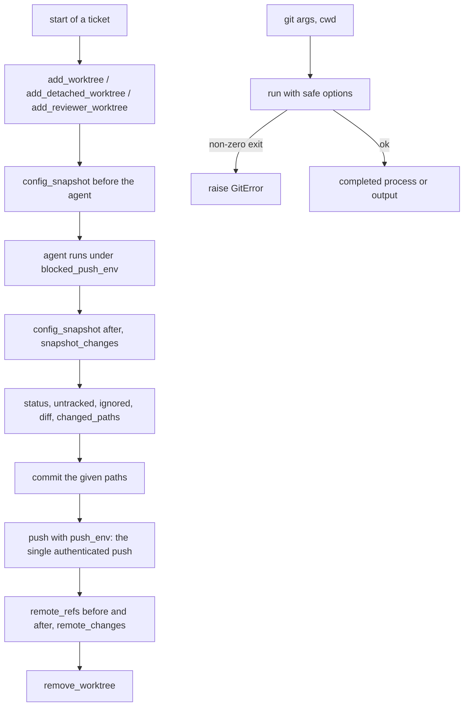
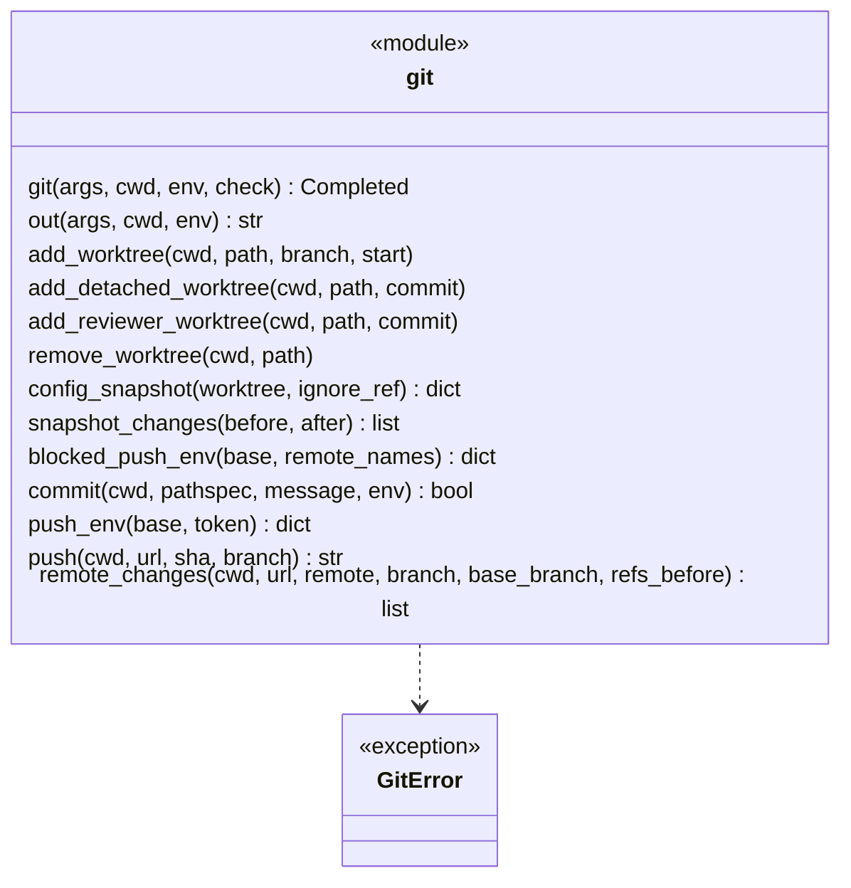
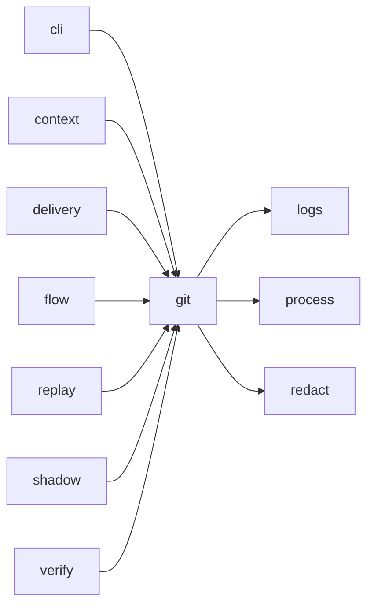

# Module `ariane.git`

The git operations Ariane performs itself: working trees, snapshots of the git configuration, guards against edits outside the tree, commits and the single authenticated push.

## Public API

| Name | Kind | What it does |
| --- | --- | --- |
| `BLOCKED_PUSH_URL` | constant | The push URL agents see, which cannot be pushed to. |
| `INSTRUCTION_FILES` | constant | Lower-case names of the instruction files left out of the reviewer tree. |
| `INSTRUCTION_DIRS` | constant | Directories left out of the reviewer tree (`.claude`). |
| `GitError` | exception | A git command failed. |
| `git(args, cwd, env, check)` | function | Runs git with safe options; returns the completed process. |
| `out(args, cwd, env)` | function | Runs git and returns its stripped output. |
| `repo_root(cwd)` | function | The top-level folder of the repository. |
| `remotes(cwd)` | function | The names of the remotes. |
| `push_url(cwd, remote)` | function | The push URL of a remote. |
| `fetch(cwd, remote, branch)` | function | Fetches one branch from a remote. |
| `path_exists_on_branch(cwd, remote, branch, path)` | function | Whether a path exists on a remote branch. |
| `show_on_branch(cwd, remote, branch, path)` | function | The content of a file on a remote branch. |
| `local_branch_exists(cwd, branch)` | function | Whether a local branch exists. |
| `worktree_of(cwd, branch)` | function | Where a branch is checked out, or None. |
| `merge_base(cwd, first, second)` | function | The common ancestor of two revisions. |
| `commit_messages(cwd, since, until)` | function | The commit messages between two revisions. |
| `remote_refs(cwd, url)` | function | The refs of a remote URL, by name. |
| `add_worktree(cwd, path, branch, start)` | function | Adds a working tree on a new branch. |
| `add_detached_worktree(cwd, path, commit)` | function | Adds a detached working tree at a commit. |
| `add_reviewer_worktree(cwd, path, commit)` | function | Adds a detached tree without instruction files or symlinks leaving it. |
| `base_instructions(cwd, remote, branch)` | function | The base branch's `CLAUDE.md`, or empty. |
| `remove_worktree(cwd, path)` | function | Removes a working tree. |
| `config_snapshot(worktree, ignore_ref)` | function | A snapshot of the git configuration files, to detect tampering. |
| `snapshot_changes(before, after)` | function | The entries that differ between two snapshots. |
| `blocked_push_env(base, remote_names)` | function | An environment in which every remote's push URL is blocked. |
| `head(cwd)` | function | The current commit. |
| `current_branch(cwd)` | function | The checked-out branch. |
| `is_ancestor(cwd, ancestor, descendant)` | function | Whether one revision is an ancestor of another. |
| `untracked(cwd)` | function | Untracked paths. |
| `ignored(cwd)` | function | Ignored paths. |
| `changed_paths(cwd, since)` | function | Paths changed since a revision. |
| `diff(cwd, since, until, exclude)` | function | The diff between two revisions, without the excluded pathspec. |
| `status(cwd)` | function | The short status of the tree. |
| `committed_paths(cwd, since, pathspec)` | function | Paths committed since a revision under a pathspec. |
| `commit(cwd, pathspec, message, env, tolerate_ignored)` | function | Commits only the given paths; False when they hold no change. |
| `push_env(base, token)` | function | An environment carrying the push credential. |
| `push(cwd, url, sha, branch, token, environ)` | function | The single authenticated push; returns the pushed commit. |
| `fast_forwarded(cwd, remote, branch, old, new)` | function | Whether a branch moved by fast-forward. |
| `remote_changes(cwd, url, remote, branch, base_branch, refs_before)` | function | The push guard's check of the remote refs. |

## Behaviour and errors

- `git`, `out`: run git and return output.
- `add_worktree`, `add_detached_worktree`, `remove_worktree`: ticket and replay trees.
- `add_reviewer_worktree`: a detached tree without `CLAUDE.md`, `CLAUDE.local.md`, `AGENTS.md` and `.claude/` at any depth, and without symlinks that leave the tree; a tree that cannot be built is removed (ADR 0031). `base_instructions`: the base branch's `CLAUDE.md` read with git, or empty.
- `worktree_of`, `merge_base`, `commit_messages`: where a branch is checked out, and what `ariane verify` reads of a branch (ADR 0028).
- `config_snapshot`, `snapshot_changes`: detect configuration tampering.
- `blocked_push_env`, `push_env`, `push`: push only from Ariane.
- `commit`: commits only the given paths; returns False when they hold no change, raises `GitError` when `git add` fails (for example an ignored `work/`), except with `tolerate_ignored=True` (used by `ariane verify`), which returns False so that it can say nothing was recorded.
- `head`, `changed_paths`, `committed_paths`, `is_ancestor`, `fast_forwarded`: history queries.
- `remote_changes`: the push guard's remote check (C11, ADR 0017): of the refs that differ from the start, only the given branch, the base branch (a fast-forward is tolerated) and tags count; other branches are ignored. Used by `ariane start` and `ariane verify`.
- `GitError`: raised on a failing git command.

## Workflow

## Code view (C4 level 4)

## Collaborations

Arrows go from the importing module to the imported module; a dashed arrow is an import for type checking only.

<!-- generated: collaborations -->

<!-- end generated -->

## Serves

C8, C11, C21; ADR 0017, ADR 0018. See [the component view](../3-components.md).
