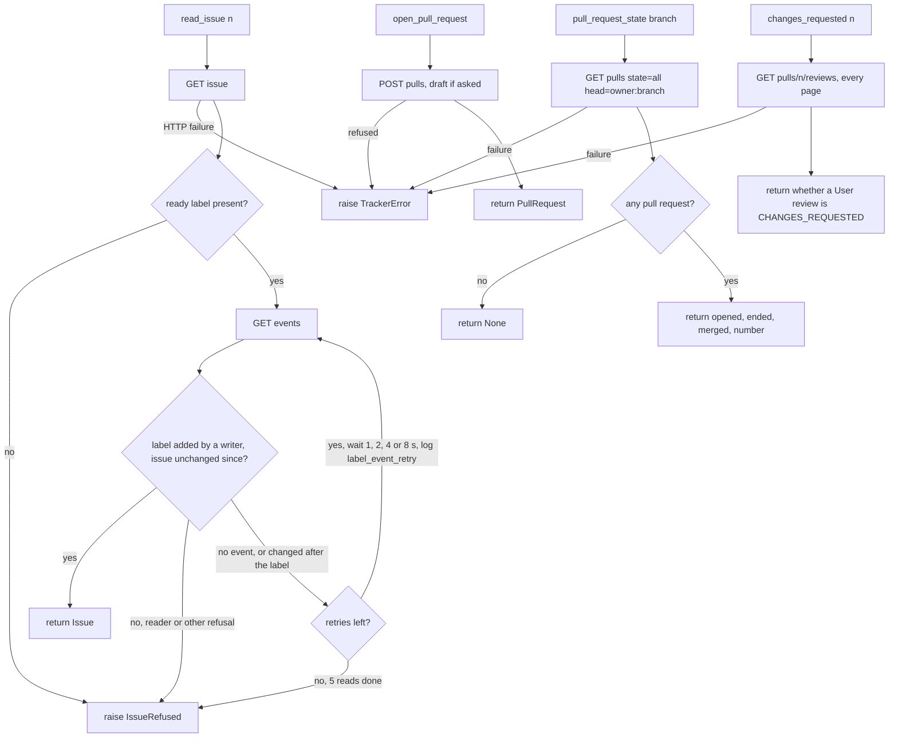
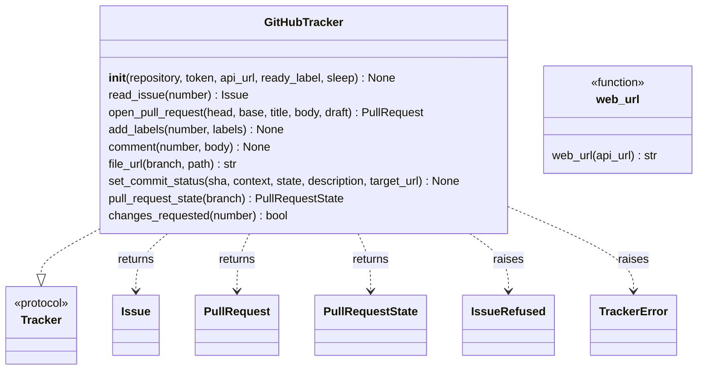
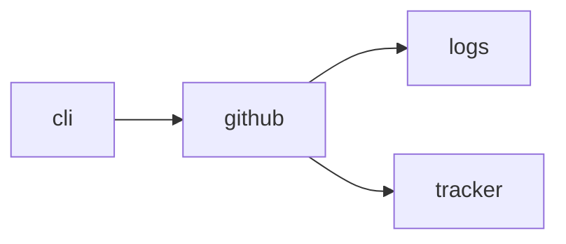

# Module `ariane.github`

The GitHub tracker over the REST API, with the standard library only (C1, C10, C21).

## Public API

| Name | Kind | What it does |
| --- | --- | --- |
| `web_url(api_url)` | function | The web address matching an API address (GitHub or GitHub Enterprise Server). |
| `GitHubTracker(*, repository, token, api_url, ready_label, sleep=time.sleep)` | class | Implements `Tracker`: `read_issue`, `open_pull_request`, `add_labels`, `comment`, `file_url`, `set_commit_status`, `pull_request_state`, `changes_requested`. |

## Behaviour and errors

- `read_issue` returns an issue only if it carries the ready label put by a user with write permission (the owner of a user-owned repository needs no permission call) and has not changed since, through REST only (ADR 0032 and its amendment); otherwise it raises `IssueRefused`, naming the reason and how to fix it. When the events show no `labeled` event for the label, or an issue changed after the last one listed, they are read again up to 4 more times after 1, 2, 4 and 8 s (`sleep` is injectable; log `github.label_event_retry`), and the last read decides; the issue is not read again.
- `open_pull_request` opens a draft when asked and returns the `PullRequest`; `add_labels` posts the labels to the pull request's issue (`POST /repos/<repository>/issues/<n>/labels`, GitHub creates a label it does not have, ADR 0057); `comment` posts a comment on the pull request's conversation (`POST /repos/<repository>/issues/<n>/comments`, the full replay's escapes); `set_commit_status` publishes a status.
- `pull_request_state(branch)`: `GET /pulls?state=all&head=<owner>:<branch>`, newest first; the end is `merged_at`, else `closed_at`, with the pull request's `number`; none when the branch has no pull request.
- `changes_requested(number)`: `GET /pulls/<n>/reviews`, page after page (100 per page, as the issue events); yes when a review's `state` is `CHANGES_REQUESTED` and its `user.type` is `User` (a bot account's is `Bot`), for the review escapes of `ariane report` (C19, ADR 0058).
- `read_issue` also raises `TrackerError` for a pull request number.
- Any refused or failed request, or an unreachable server, raises `TrackerError`. The token is sent only in the request header and never logged.

## Workflow

## Code view (C4 level 4)

## Collaborations

Arrows go from the importing module to the imported module; a dashed arrow is an import for type checking only.

<!-- generated: collaborations -->

<!-- end generated -->

## Serves

C1, C10, C19, C21; ADR 0007, ADR 0027, ADR 0032, ADR 0058. See [the component view](../3-components.md).
