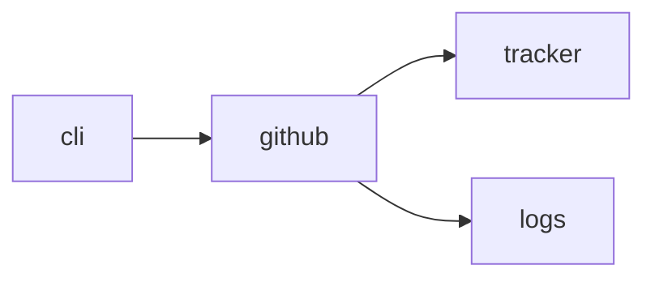

# Module `ariane.github`

The GitHub tracker over the REST API, with the standard library only.

## Main types and functions

- `GitHubTracker`: implements `Tracker` (read an issue, only if labelled by a writer (the owner of a user-owned repository needs no permission call) and not changed since, through REST only (ADR 0032 and its amendment); open a pull request, as a draft when asked, publish statuses).
- `web_url`: the web address matching an API address.

## Collaborations

Arrows go from the caller to the callee.

## Serves

C1, C10, C21; ADR 0007, ADR 0027, ADR 0032. See [the component view](../3-components.md).
