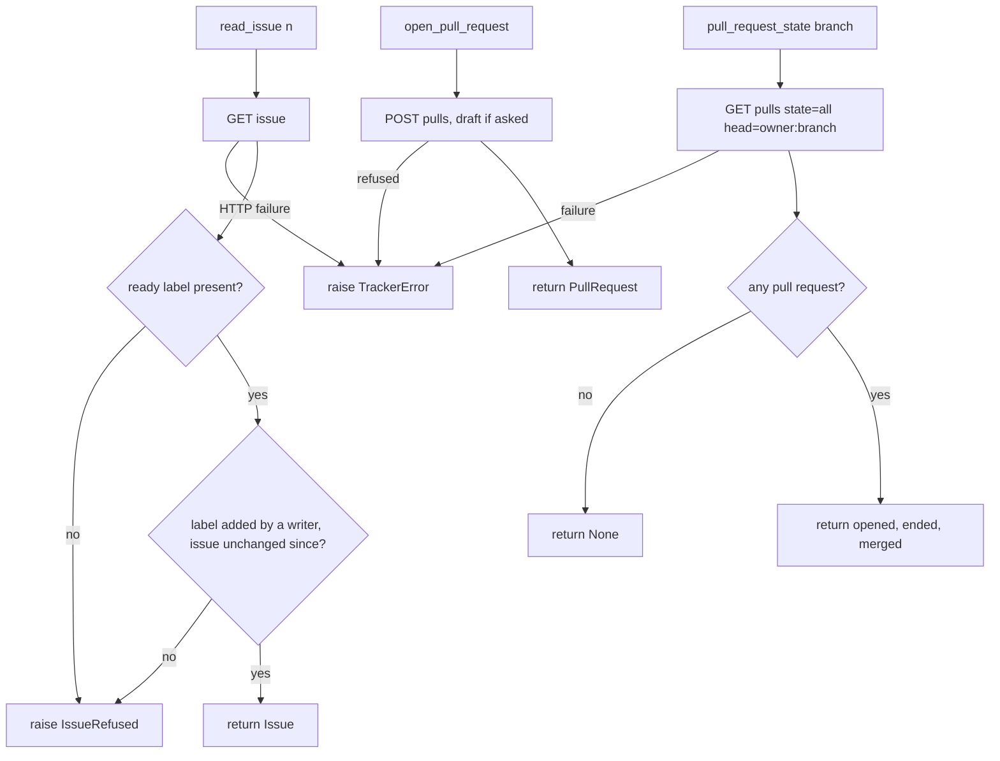
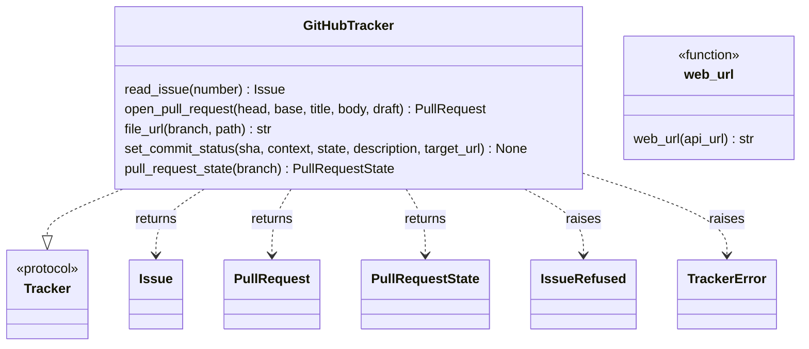
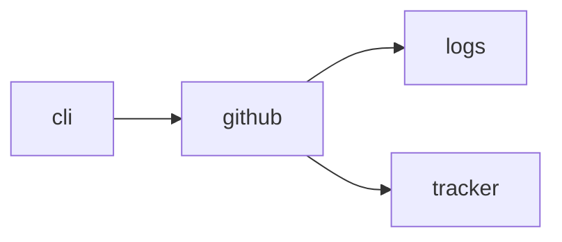

# Module `ariane.github`

The GitHub tracker over the REST API, with the standard library only (C1, C10, C21).

## Public API

| Name | Kind | What it does |
| --- | --- | --- |
| `web_url(api_url)` | function | The web address matching an API address (GitHub or GitHub Enterprise Server). |
| `GitHubTracker` | class | Implements `Tracker`: `read_issue`, `open_pull_request`, `file_url`, `set_commit_status`, `pull_request_state`. |

## Behaviour and errors

- `read_issue` returns an issue only if it carries the ready label put by a user with write permission (the owner of a user-owned repository needs no permission call) and has not changed since, through REST only (ADR 0032 and its amendment); otherwise it raises `IssueRefused`, naming the reason and how to fix it.
- `open_pull_request` opens a draft when asked and returns the `PullRequest`; `set_commit_status` publishes a status.
- `pull_request_state(branch)`: `GET /pulls?state=all&head=<owner>:<branch>`, newest first; the end is `merged_at`, else `closed_at`; none when the branch has no pull request.
- `read_issue` also raises `TrackerError` for a pull request number.
- Any refused or failed request, or an unreachable server, raises `TrackerError`. The token is sent only in the request header and never logged.

## Workflow

## Code view (C4 level 4)

## Collaborations

Arrows go from the importing module to the imported module; a dashed arrow is an import for type checking only.

<!-- generated: collaborations -->

<!-- end generated -->

## Serves

C1, C10, C21; ADR 0007, ADR 0027, ADR 0032. See [the component view](../3-components.md).
