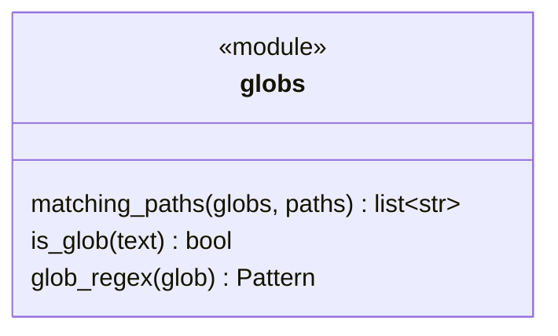
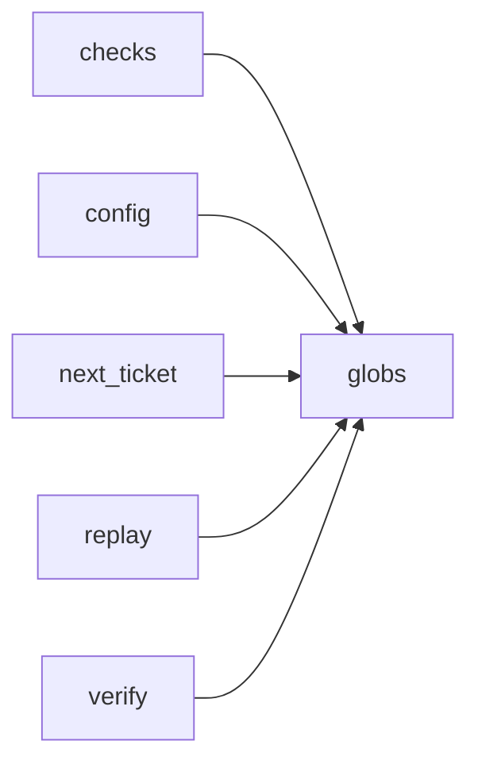

# Module `ariane.globs`

Path globs (C9, C22, ADR 0056): the one set of rules for every glob of `ariane.toml` (`documentation.map`, `checks[].paths`, `not_run_locally`, `check_all_paths`, `review.sensitive_paths`, `next.paths`) and for the expected files of `ariane next` (ADR 0059).

## Public API

| Name | Kind | What it does |
| --- | --- | --- |
| `matching_paths(globs, paths)` | function | The paths matching at least one glob; a line break in a path is matched like any other character (ADR 0056). |
| `is_glob(text)` | function | Whether `text` holds `*` or `?`, rather than naming one path. |
| `glob_regex(glob)` | function | The regular expression of one glob: `*` and `?` stay within a path segment, `**` crosses segments, `**/` is any folders (none included). |

## Behaviour and errors

- Paths are relative, with `/` as separator, as git prints them; matching is case-sensitive and whole (`fullmatch`).
- Every other character matches itself: there are no character classes or braces.

## Workflow

`matching_paths` compiles each glob once with `glob_regex` and keeps the paths one of them matches whole.

## Code view (C4 level 4)

## Collaborations

Arrows go from the importing module to the imported module; a dashed arrow is an import for type checking only.

<!-- generated: collaborations -->

<!-- end generated -->

## Serves

C9, C22; ADR 0056, ADR 0059. See [the component view](../3-components.md).
