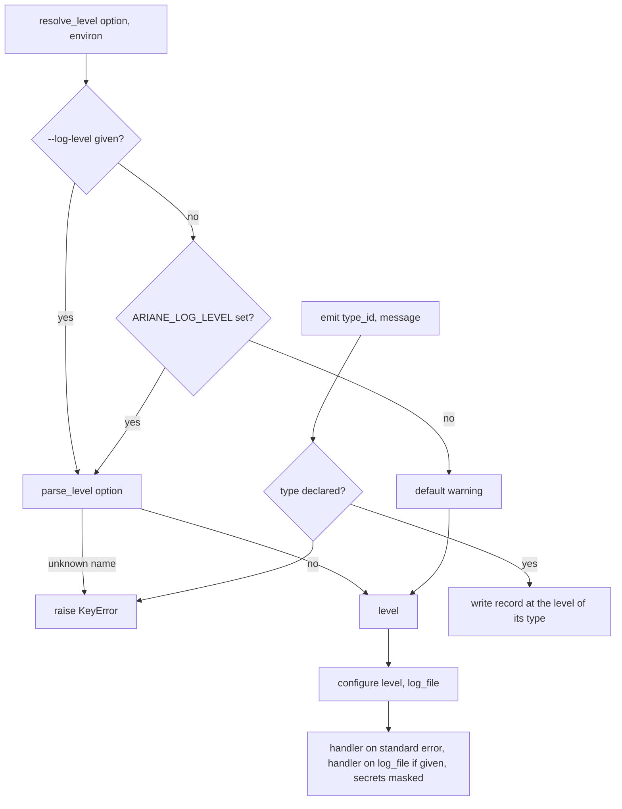
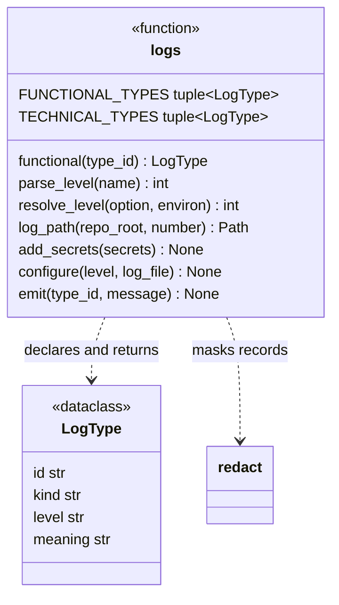
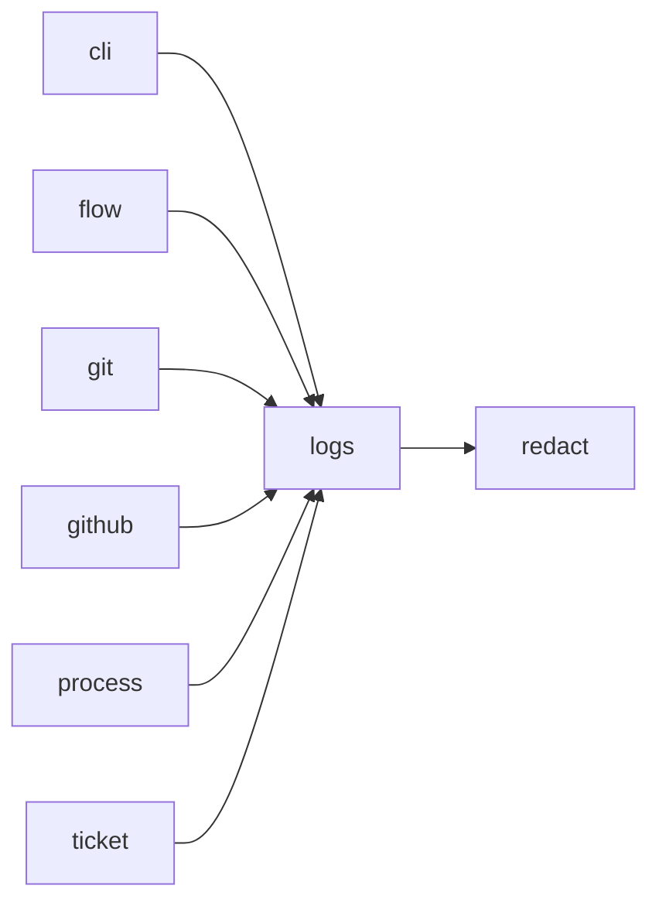

# Module `ariane.logs`

Declares every log type once (functional journal entries and technical records) with its identifier, level and meaning, and configures the technical logs: level, standard error, a log file outside the repository, and redaction (C21, C23).

## Public API

| Name | Kind | What it does |
| --- | --- | --- |
| `LOGGER_NAME` | constant | The name of the logger, `ariane`. |
| `LEVEL_VARIABLE` | constant | The variable that sets the level, `ARIANE_LOG_LEVEL`. |
| `DEFAULT_LEVEL` | constant | The level without option or variable: `warning`. |
| `LEVELS` | constant | The level names and their `logging` values. |
| `FUNCTIONAL` | constant | The kind of a journal entry type. |
| `TECHNICAL` | constant | The kind of a technical record type. |
| `LogType` | dataclass | One declared type: `id`, `kind`, `level`, `meaning`. |
| `FUNCTIONAL_TYPES` | constant | The declared journal entry types. |
| `TECHNICAL_TYPES` | constant | The declared technical record types. |
| `functional(type_id)` | function | The declared journal entry type; an undeclared one is refused. |
| `parse_level(name)` | function | The `logging` level of a level name. |
| `resolve_level(option, environ)` | function | The level from `--log-level`, else `ARIANE_LOG_LEVEL`, else warning. |
| `log_path(repo_root, number)` | function | The log file `<repo>.ariane/logs/<n>.log` (`verify-<branch>.log` for `ariane verify`). |
| `add_secrets(secrets)` | function | Register known secrets that every record masks. |
| `configure(level, log_file=None)` | function | Send records of at least `level` to standard error and, if given, to `log_file`. |
| `emit(type_id, message)` | function | Write one technical record naming its declared type. |

## Behaviour and errors

- Writes the log file given to `configure`, beside the working trees and outside the repository; standard error gets the same records. Every record goes through `redact` with the secrets from `add_secrets`.
- `functional` raises `ValueError` for an undeclared type, `emit` a `KeyError`; `parse_level` and `resolve_level` raise `ValueError` for an unknown level name.
- The generated [log catalogue](../../logs.md) lists every declared type.
- Reviewer integrity (C10, ADR 0031) declares, among others: `ticket.review.diff_truncated` (the reviewer's diff was cut; the files to read in the tree), `process.survivors_killed` (processes that outlived a command were killed) and `process.subreaper_failed` (an error: Ariane could not become the subreaper, so `start` and `verify` run nothing).
- Environment (C21): `ticket.env.declared_secret` warns, names only, when variables named like secrets pass to agents and checks because `[project] env` declares them.

## Workflow

## Code view (C4 level 4)

## Collaborations

Arrows go from the importing module to the imported module; a dashed arrow is an import for type checking only.

<!-- generated: collaborations -->

<!-- end generated -->

## Reference

See the generated [log catalogue](../../logs.md), generated from the declarations (`scripts/generate_docs.py`).

## Serves

C21, C23; ADR 0022. See [the component view](../3-components.md).
