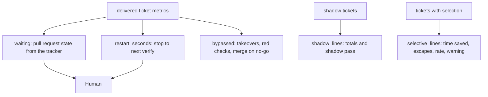
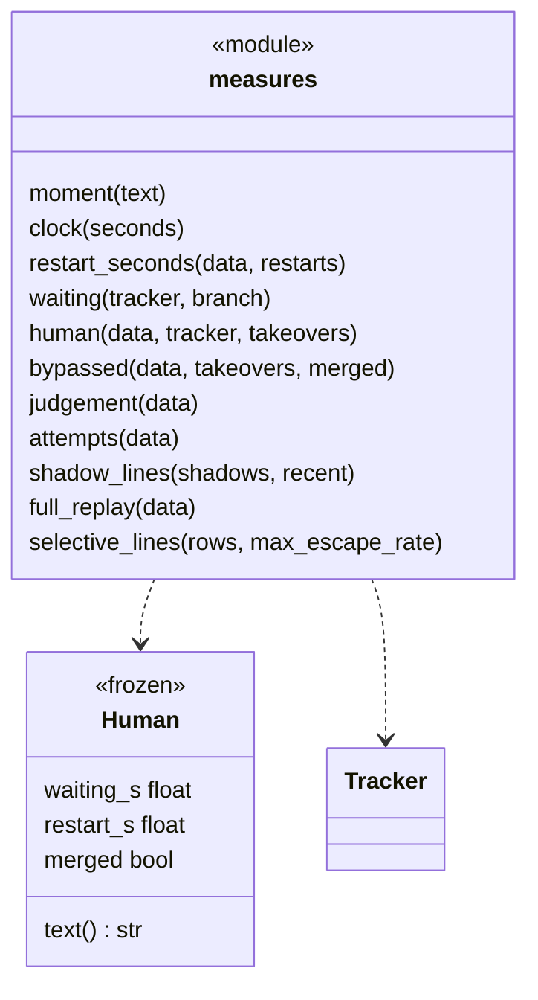
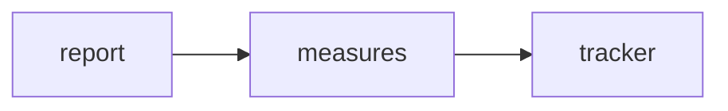

# Module `ariane.measures`

The success measure of `ariane report` (C19, ADR 0038): human time, gates bypassed and shadow results.

## Public API

| Name | Kind | What it does |
| --- | --- | --- |
| `SHADOW_WINDOW` | constant | 10: the number of last shadow tickets the shadow pass looks at. |
| `SHADOW_ACCEPTED` | constant | 8: the accepted tickets required among them. |
| `NOT_AVAILABLE` | constant | The text shown when the waiting time is unknown. |
| `moment(text)` | function | An ISO 8601 time (a trailing `Z` allowed) as a `datetime`. |
| `clock(seconds)` | function | Seconds as `<h>h<mm>m`. |
| `Human` | class | Human time of one ticket: `waiting_s` (None when the tracker could not tell), `restart_s`, `merged`; `text()` words it. |
| `restart_seconds(data, restarts)` | function | Each stop in `steps` to the next `verify` record of the same ticket or branch, plus the previous run's stop to this run's start when it started over, in seconds. |
| `waiting(tracker, branch)` | function | Seconds from the pull request's opening to its merge or close, and whether it merged. |
| `human(data, tracker, takeovers)` | function | A delivered ticket's `Human` time. |
| `bypassed(data, takeovers, merged)` | function | The gates bypassed on one delivered ticket. |
| `judgement(data)` | function | The `judgement` object of a shadow ticket's metrics, or None. |
| `attempts(data)` | function | The `(push, pull_request, guard_violations)` counts of a ticket's metrics. |
| `shadow_lines(shadows, recent)` | function | The shadow lines of the report: totals over `shadows`, then the pass line over `recent`. |
| `full_replay(data)` | function | The `full_replay` object of a ticket's metrics when it ran to its end (not stopped), or None. |
| `check_full_replay(found)` | function | Raises `TypeError` when a `full_replay` object is not one: `ran` a boolean, `escapes` a list of check names, `duration_s` a number (`report` names and skips the file). |
| `selective_lines(rows, max_escape_rate)` | function | The "Selective checks" line of the report, and its warning above `max_escape_rate`. |

## Behaviour and errors

- Reads and writes no file; it works on the parsed metrics and asks the tracker for the pull request's state.
- `waiting` is None when the tracker is missing or fails (`TrackerError`, `ValueError`, `OSError`); 0 while the pull request is open or absent.
- `restart_seconds` adds each stop (an `outcome: ` step that is not `delivered`, `needs a human` or `running`) to the next `verify` start, and, for a run that started over with `ariane start --restart`, `restarted_from.stopped_at` to the run's `started`, plus `restarted_from.earlier_s` for the earlier restarts of a chain (ADR 0047; never negative, an unreadable time adds nothing).
- `bypassed`: a hand takeover per `verify` record of the branch, blocking checks red at delivery, and a merge while the last review on the branch is no-go (the last `verify` go cancels it).
- `shadow_lines`: tickets, accept rate, not yet judged, agent push and pull-request attempts, guard violations, then `shadow pass: yes|no` over the last `SHADOW_WINDOW` tickets of `recent` (all the shadow tickets, whatever `--since`): ten required, no attempt, no violation, at least `SHADOW_ACCEPTED` accepted. No shadow ticket gives no line.
- `selective_lines` (#186): over the tickets with a replayed round (`replays`) that skipped a check or ran one partly: their count and total replay time; on the sampled tickets (a full replay that ran, not stopped), their last round's replay time against the full replays' time and the difference (saved); the full replays, the escapes (failing checks, summed) and the escape rate, escapes / full replays ("not measured" without a full replay). Above `max_escape_rate` a second line warns: "Warning: the escape rate 
% is above max_escape_rate <q>%: ... consider turning selection off". Nothing is turned off: the owner decides. No such ticket gives no line; a field of the wrong type counts as nothing.

## Workflow

## Code view (C4 level 4)

## Collaborations

Arrows go from the importing module to the imported module; a dashed arrow is an import for type checking only.

<!-- generated: collaborations -->

<!-- end generated -->

## Serves

C9, C19; ADR 0030, ADR 0038, ADR 0047, ADR 0056. See [the component view](../3-components.md).
