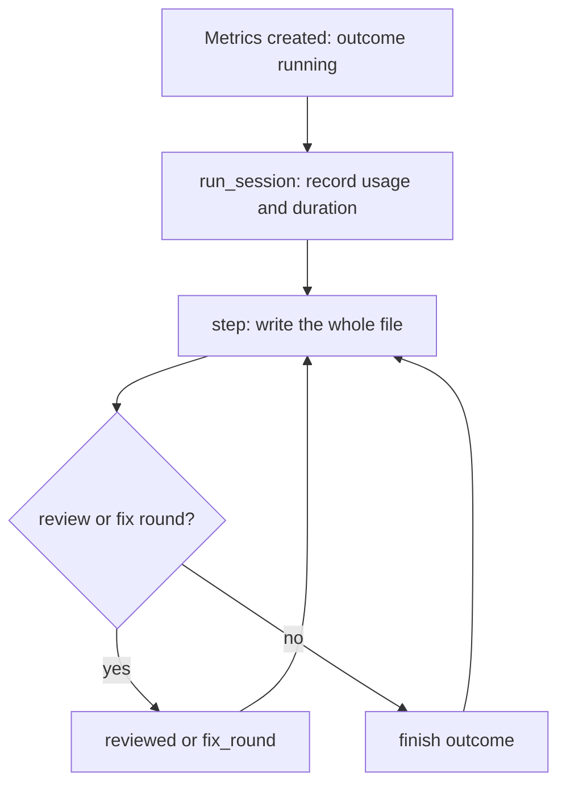
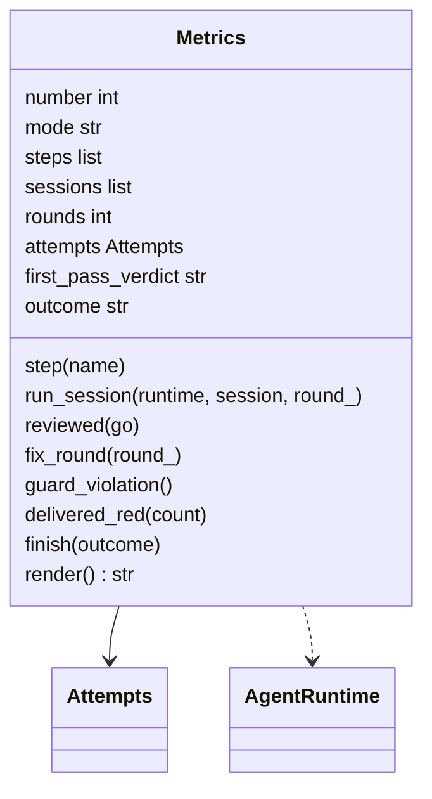
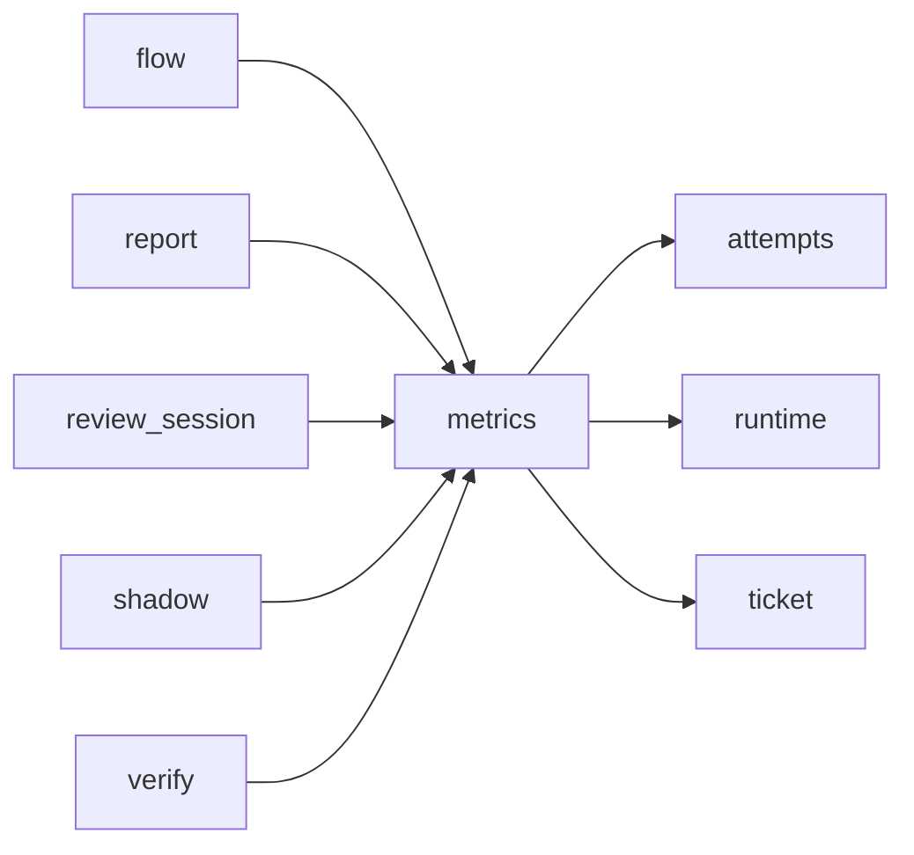

# Module `ariane.metrics`

The measurements of one ticket, `work/<n>/metrics.json` (C19, ADR 0034): UTF-8, indented JSON with sorted keys, rewritten whole after each step and committed with the other records, so it travels with the pull request. A crash leaves `outcome` at `running`.

## Public API

| Name | Kind | What it does |
| --- | --- | --- |
| `METRICS` | constant | `metrics.json`, the file name. |
| `NOT_REVIEWED` | constant | `not reviewed`, the first-pass verdict before any review. |
| `Metrics` | class | `Metrics(number, mode, write)`: ticket number, mode (`delivered`, `verify`, `shadow`), start time, steps, sessions, fix rounds, attempts, first-pass verdict and outcome; `render()` gives the file's text. |

## Behaviour and errors

- `Metrics` hands the whole text to its `write` callback after each step; it touches no file itself. `ariane verify` renders the same format with mode `verify` into `work/verify/<branch>/metrics.json`; its outcome is `delivered` when green and `stopped` otherwise.
- `step(name)` appends a named step with its time.
- `run_session(runtime, session, round_=0)` runs a session on its runtime and records role, round, runtime, model, stop reason, cost, tokens (input, output, cache read, cache write; null when not reported) and `duration_s`. Attempts (C19, ADR 0036): it sums the sessions' `SessionResult.attempts` into `"attempts": {"push", "pull_request", "guard_violations"}`; `guard_violation()` counts a post-session check that stopped the ticket.
- `delivered_red(count)`: the blocking checks red at delivery, written as `blocking_red_at_delivery` (C19, ADR 0038).
- `reviewed(go)`, `fix_round(round_)`, `finish(outcome)`: the first review's verdict (`go`, `no-go`, or `not reviewed`), the number of fix rounds, the outcome (`running`, `delivered`, `stopped`, `needs a human`).

## Workflow

## Code view (C4 level 4)

## Collaborations

Arrows go from the importing module to the imported module; a dashed arrow is an import for type checking only.

<!-- generated: collaborations -->

<!-- end generated -->

## Serves

C19; ADR 0012, ADR 0019, ADR 0030, ADR 0034. See [the component view](../3-components.md).
