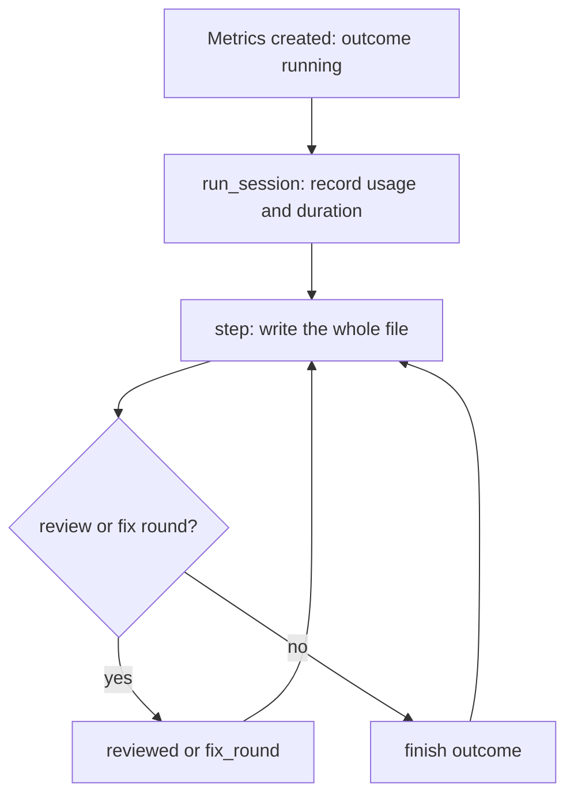
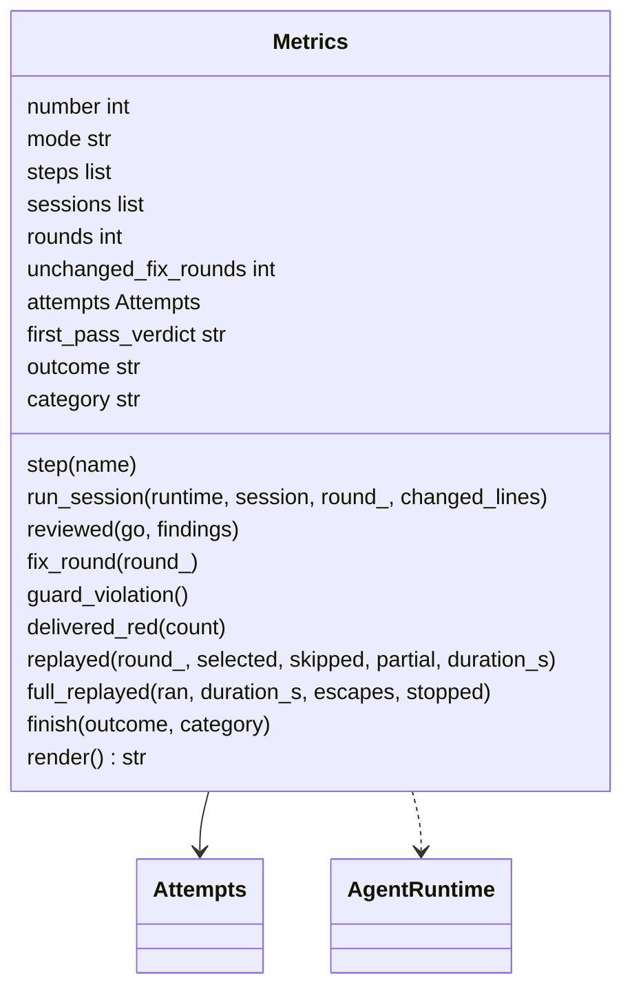
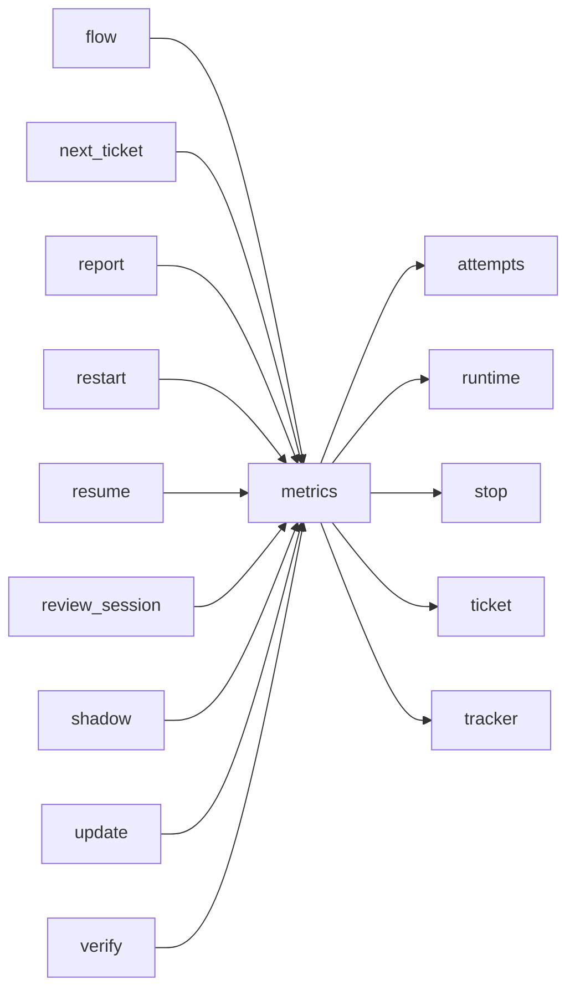

# Module `ariane.metrics`

The measurements of one ticket, `work/<n>/metrics.json` (C19, ADR 0034): UTF-8, indented JSON with sorted keys, rewritten whole after each step and committed with the other records, so it travels with the pull request. A crash leaves `outcome` at `running`.

## Public API

| Name | Kind | What it does |
| --- | --- | --- |
| `METRICS` | constant | `metrics.json`, the file name. |
| `NOT_REVIEWED` | constant | `not reviewed`, the first-pass verdict before any review. |
| `stopped_metrics_path(worktree, number)` | function | `<repo>.ariane/stopped/<n>/metrics.json`: where a ticket stopped before its folder exists (Ctrl-C or an error in the first setup) keeps its metrics, survivors included (ADR 0031). |
| `keep_refused(worktree, number, exc)` | function | A start that ended before its run began (issue gate, lock, slot, registry, preparation): its metrics, outcome `stopped` and its category, in `<repo>.ariane/stopped/<n>/refused/<time>-<random>/metrics.json` (ADR 0058). |
| `Metrics` | class | `Metrics(number, mode, write)`: ticket number, mode (`delivered`, `verify`, `shadow`), start time, steps, sessions, fix rounds, attempts, first-pass verdict, outcome, `updates` and `recurring_findings`; `recurring(count)` records the last review's recurring findings (ADR 0059); `resume(text)` continues an earlier `metrics.json` (`ariane update`, ADR 0033); `render()` gives the file's text; `replayed(round_, selected, skipped, partial, duration_s)` records a round's replay; `full_replayed(ran, duration_s=0, escapes=None, stopped="")` the full replay after delivery; `keep_stopped(path, category)` writes it, outcome `stopped` with its stop category, to a path outside the repository without the usual writer (a stop before the ticket folder exists, or a verify that commits nothing; ADR 0031). |

## Behaviour and errors

- `Metrics` hands the whole text to its `write` callback after each step; it touches no file itself. `ariane verify` renders the same format with mode `verify` into `work/verify/<branch>/metrics.json`; its outcome is `delivered` when green and `stopped` otherwise.
- `step(name)` appends a named step with its time.
- `run_session(runtime, session, round_=0, changed_lines=None)` runs a session on its runtime and records role, round, runtime, model, stop reason, cost, tokens (input, output, cache read, cache write; null when not reported), `duration_s`, for a quota stop whose runtime gave its reset time `reset_at` (UTC, ADR 0062), `turns` when the runtime reported the turns the session took and, when the runtime says so, `billing` (`plan`: covered by a subscription, cost recorded as 0; `api`), and for a reviewer session `changed_lines`, the size of the diff it reviewed (ADR 0046). Attempts (C19, ADR 0036): it sums the sessions' `SessionResult.attempts` into `"attempts": {"push", "pull_request", "guard_violations"}`; `guard_violation()` counts a post-session check that stopped the ticket.
- `surviving_processes(count)`: the processes that outlived a setup, an agent session or a check and were killed, summed as `surviving_processes` (C10, ADR 0031); written with the next step.
- `restarted_from` (ADR 0047): set by a run that started over with `ariane start --restart`, written as `"restarted_from": {"branch": <kept branch>, "stopped_at": <the previous run's last step>, "earlier_s": <seconds>}` (`stopped_at` absent when that run's `metrics.json` was unreadable, `earlier_s`, the restart time of the earlier runs of a chain, absent when zero), and `"resumed": true` when it continues that run with `ariane start --resume` (ADR 0062: a resumed run that stops on a limit again cannot be resumed); absent otherwise.
- `updates` and `resume(text)` (ADR 0033): `ariane update` reads the ticket's `metrics.json` back with `resume`: its start, steps, sessions, fix rounds, attempts, guard violations, survivors, first-pass verdict, `restarted_from`, `updates`, `recurring_findings`, `replays` and `full_replay` are continued, and the update's steps and sessions are appended; an unreadable file is left out (the measurements start empty). Each update that ran the merge adds one to `updates`, written always (0 for a ticket never updated); the outcome becomes the update's.
- `replays` (#186): one object per replayed round, `{"round", "selected", "skipped", "partial", "duration_s"}`: the checks run, skipped by `paths` and run with `ARIANE_FULL_SUITE=0`, and the replay's wall time.
- `full_replay` (#186): absent when no full replay was considered (no skipped or partial check in the last round, or a blocking failure); else `{"ran", "duration_s", "escapes"}` (the checks that failed only in the full replay), with `"stopped": <reason>` when it stopped; `full_replayed` also adds the step `full replay ran` or `full replay not sampled`.
- `delivered_red(count)`: the blocking checks red at delivery, written as `blocking_red_at_delivery` (C19, ADR 0038).
- `unchanged_fix_round()` counts a fix round that changed nothing into `unchanged_fix_rounds` (C10). `reviewed(go, findings=0)`, `fix_round(round_)`, `finish(outcome, category="", pushed=False)`: the first review's verdict (`go`, `no-go`, or `not reviewed`), the number of fix rounds, the outcome (`running`, `delivered`, `stopped`, `needs a human`). `reviewed` also writes `verdict`, `findings` (their number) and `at` (when it answered, ISO 8601 UTC: only what follows a `go` can make it an escape) into the reviewer session that answered, the last one, for the review escapes of `ariane report` (ADR 0058).
- `category` (C19, ADR 0058): every outcome other than delivered green records one of `stop.CATEGORIES` (`spec`, `guard`, `budget`, `runtime`, `checks`, `review`, `merge`, `ci`, `infra`); a delivered green ticket has no `category` key. A start that ended before its run began records its category with `keep_refused`, in a new folder per attempt (`tempfile.mkdtemp`, so neither a running ticket's metrics nor an earlier record is overwritten): `spec` for the issue gate's refusal (`tracker.IssueRefused`), else `stop.category_of` (`infra` for the lock, a slot, the registry, the preparation, the tracker or Ctrl-C); best effort, as `keep_stopped`. `finish("delivered")` marks the last review's `go`, if it is one, `"pushed": true` (the push publishes the file it is written to); a later `finish` of the same run with another outcome and `pushed` false (the stop came before the push) takes that mark back, never an earlier run's.

## Workflow

## Code view (C4 level 4)

## Collaborations

Arrows go from the importing module to the imported module; a dashed arrow is an import for type checking only.

<!-- generated: collaborations -->

<!-- end generated -->

## Serves

C19; ADR 0012, ADR 0019, ADR 0030, ADR 0034, ADR 0047, ADR 0058, ADR 0059. See [the component view](../3-components.md).
