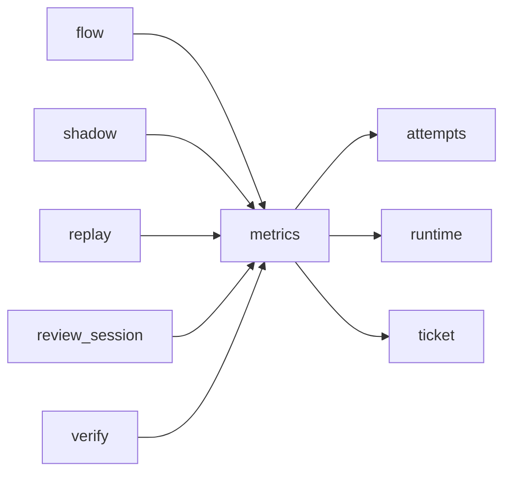

# Module `ariane.metrics`

The measurements of one ticket, `work/<n>/metrics.json` (C19, ADR 0034): UTF-8, indented JSON with sorted keys, rewritten whole after each step and committed with the other records, so it travels with the pull request. A crash leaves `outcome` at `running`.

## Main types and functions

- `Metrics`: ticket number, mode (`delivered`, `verify`, `shadow`), start time, steps, sessions, fix rounds, first-pass verdict, outcome; `render` gives the file's text.
- `Metrics.run_session`: runs a session on its runtime and records role, round, runtime, model, stop reason, cost, tokens (input, output, cache read, cache write; null when not reported) and `duration_s`.
- Attempts (C19, ADR 0036): `attempts` sums the sessions' `SessionResult.attempts` into `"attempts": {"push", "pull_request", "guard_violations"}`; `guard_violation()` counts a post-session check that stopped the ticket.
- `Metrics.reviewed`, `fix_round`, `finish`: the first review's verdict (`go`, `no-go`, or `not reviewed`), the number of fix rounds, the outcome (`running`, `delivered`, `stopped`, `needs a human`).
- `ariane verify` renders the same format with mode `verify` into `work/verify/<branch>/metrics.json`; its outcome is `delivered` when green and `stopped` otherwise.

## Collaborations

Arrows go from the caller to the callee.

## Serves

C19; ADR 0012, ADR 0019, ADR 0030, ADR 0034. See [the component view](../3-components.md).
