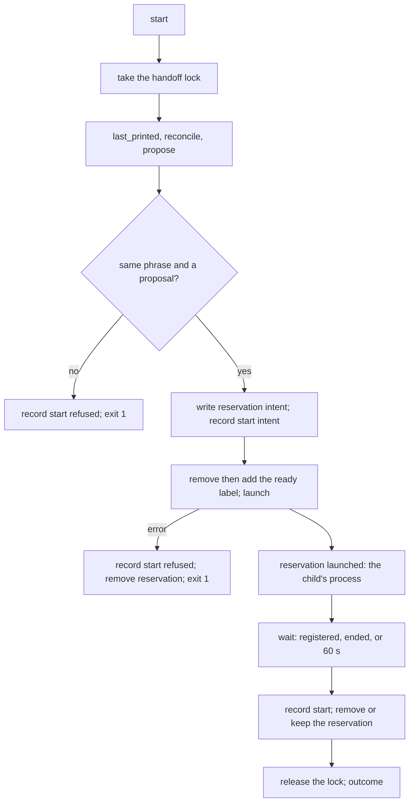
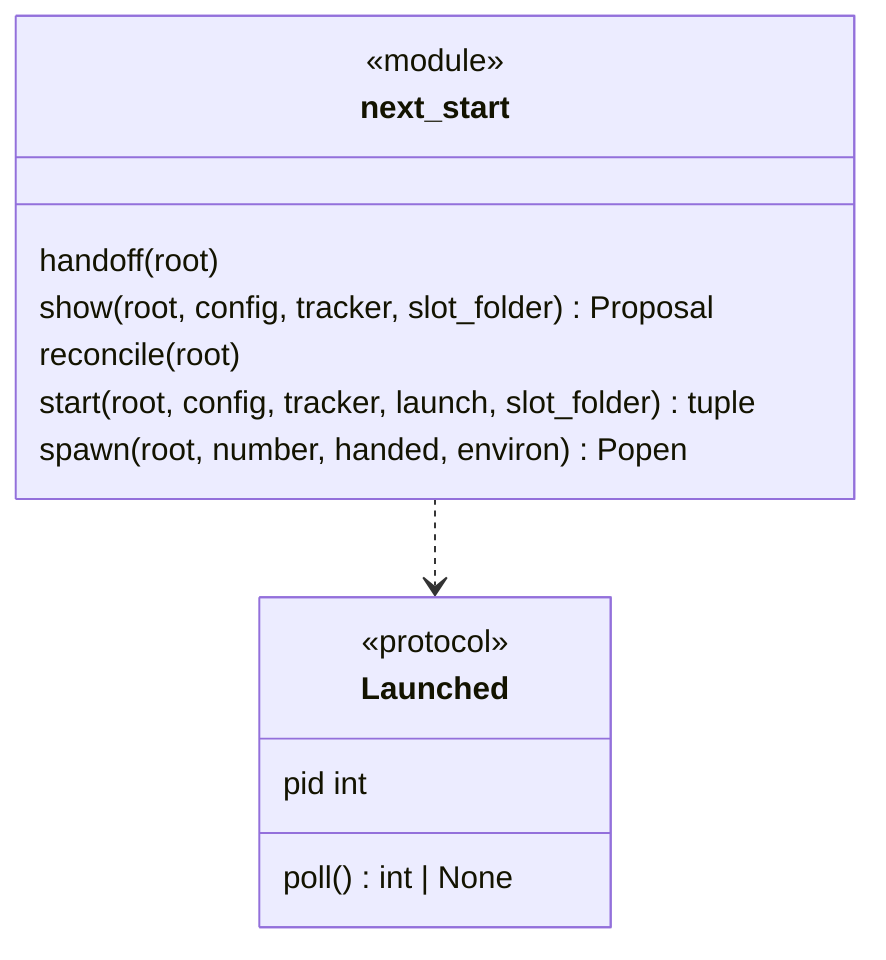
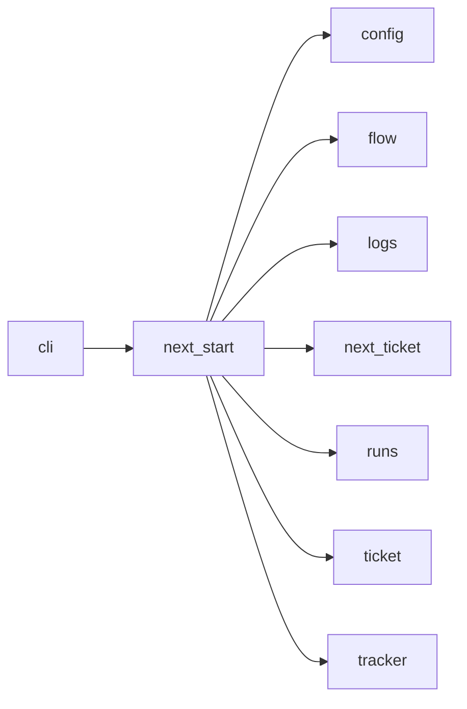

# Module `ariane.next_start`

`ariane next` and `ariane next --start` under the handoff lock (C11, C23, ADR 0059): a proposal is computed and recorded with no start in between; a confirmed proposal is reserved and its intent recorded before any external write, consumed by its start, and held until the ticket it launches registers as running. A failure after the launch says the ticket started; a start whose record is missing is reconciled by the next `ariane next`.

## Public API

| Name | Kind | What it does |
| --- | --- | --- |
| `REGISTER_SECONDS` | constant | 60: how long `start` waits for its ticket to register. |
| `POLL_SECONDS` | constant | 0.2: how often it looks. |
| `Launched` | protocol | A ticket started in the background: `pid`, and `poll()`, its exit code once it ended (a `subprocess.Popen`). |
| `Launch` | type alias | A function that starts `ariane start <n>` in the background, with the variables of its handoff (`runs.HANDOFF_ENV`, `runs.CLAIM_ENV`, `runs.ISSUE_ENV`) in its environment, and returns its `Launched`. |
| `CHANGED` | constant | The title of the entry `start refused, the issue changed`: not a printed proposal, so the next `--start` needs a new `ariane next`. |
| `handoff(root)` | function | A context manager holding `<repo>.ariane/next/.lock` (`runs.locked`); `runs.registered` takes it too, except in the ticket `start` launches. |
| `show(root, config, tracker, slot_folder=None)` | function | `ariane next`: under the lock, `reconcile`, `propose`, record a `proposal` entry; then log `next.proposed`. |
| `reconcile(root)` | function | Removes the reservations no longer pending; for one whose state is not `recorded`, appends a `start reconciled` entry (launched or maybe launched, when, its process, and whether the ticket runs, registered and ended, or did not register) and logs `next.reconciled`. |
| `start(root, config, tracker, launch, slot_folder=None)` | function | `ariane next --start`: under the lock, reads `last_printed`, reconciles, proposes again; refuses (a `start refused` entry, exit 1) when the phrase differs or nothing is proposed; otherwise hands the ticket over (below). Returns the proposal and the outcome. |
| `spawn(root, number, handed, environ)` | function | Runs `python -m ariane start <n>` in `root`, detached (its own session on POSIX, a detached process group on Windows, no input), `environ` and the handoff's variables `handed` in its environment, output appended to `output_path`; returns the `Popen`. |

## Behaviour and errors

- **Handoff**, in this order, the lock held throughout: write the reservation `<n>.json` (state `intent`, this process) and append a `start intent` entry (who confirmed): an error there removes the reservation and propagates, nothing having been written outside (`cli` says "Did nothing"). Then remove and add the `ready_label`, read the issue again (`tracker.peek_issue`) and `launch` it with `HANDOFF_ENV=<n>`, `CLAIM_ENV=<the reservation's time>` and `ISSUE_ENV=<the digest of the analysed body>`. When the body, or the labels other than the ready label, differ from the analysed issue (an edit made between the analysis and the relabel, which the fresh label would bless), it removes the ready label, appends a `CHANGED` entry (which consumes the confirmation), removes the reservation and says `Did not start #N: its body changed since ariane next analysed it; its `ariane` label was removed. Next: read the issue, then run ariane next.`; an edit after the relabel is either seen there or postdates the label, which the issue gate refuses. Otherwise a `TrackerError` or `OSError` of the relabel, the read or the launch appends a `start refused` entry (which may be confirmed again), removes the reservation and says `Did not start #N: the relabel (…) failed` or `the launch failed`.
- **After the launch** the reservation names the ticket's process (state `launched`), then `start` waits until `runs.registered_since(n, intent time)`, the process ends (`poll`), or `REGISTER_SECONDS` pass, and appends a `start` entry (`Started: #N, process P; registered as running`, `not registered yet`, or `ended (exit code C) before it registered as running`). The reservation is removed when the ticket registered or ended; otherwise it is kept as `recorded`, still pending, so no issue is proposed until the ticket registers or its process ends.
- **Outcomes.** Registered: exit 0, `Started #N in the background (process P); its journal will be …, its output …. Next: follow it with ariane status N.` Not registered in time: the same with `, not registered as running after 60 s`. Ended before registering: exit 1, `…, but it ended (exit code C) before it registered as running. Next: read its output …, then run ariane next.` A reservation or record that could not be written after the launch: exit 1, `Started #N … (process P), but <what failed>. Next: follow it with ariane status N; the next ariane next records the start.`
- **The launched ticket** is bound to the analysis (`runs.read_issue`, `runs.registered`): it refuses an issue whose body is not the analysed one (exit 2, `issue #N changed since ariane next analysed it`), and registers outside the handoff lock only while its reservation, with the time `CLAIM_ENV` names, is still there. If this process dies between the launch and the reservation naming the child, the reservation names a dead process and is dropped by a later `ariane next` once `GRACE` passed; a child registering after that stops (`the reservation of ariane next --start for #N was dropped before it registered as running`) instead of running next to a ticket proposed without it. The check and the registration hold the registry's lock, under which a reconciliation reads whether the ticket registered: either the child registers first, and the next proposal counts it as running, or the reservation is gone first, and the child stops.
- Each start logs `next.started`.

## Workflow

## Code view (C4 level 4)

## Collaborations

Arrows go from the importing module to the imported module; a dashed arrow is an import for type checking only.

<!-- generated: collaborations -->

<!-- end generated -->

## Serves

C11, C23; ADR 0059. See [the component view](../3-components.md).
