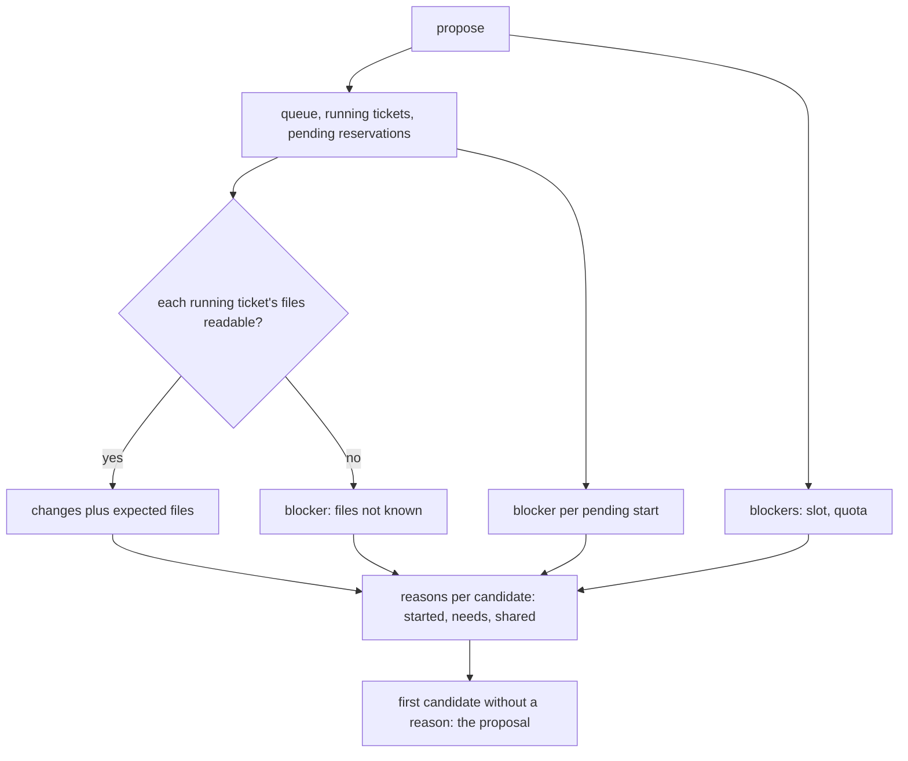
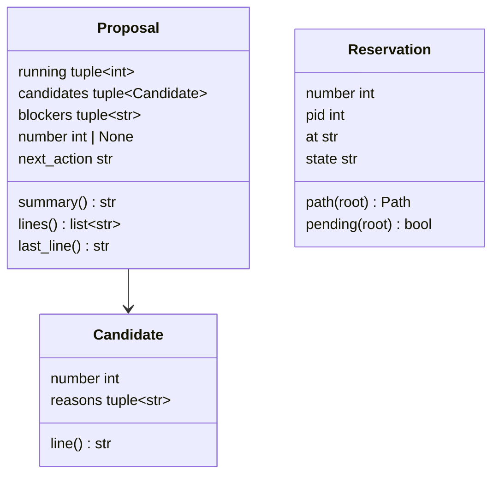
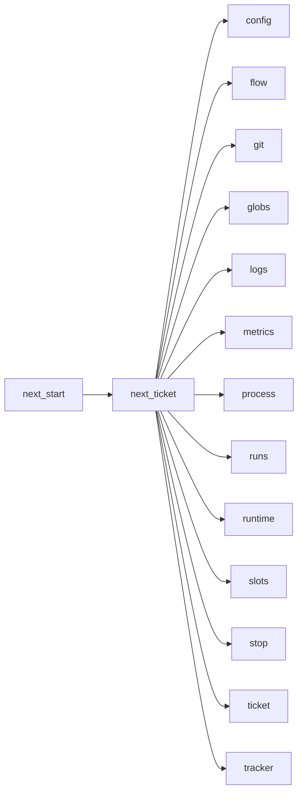

# Module `ariane.next_ticket`

`ariane next`'s analysis (C11, C22, C23, ADR 0059): reads the queue (the open issues labelled `[tracker] next_label`, in label order), their `Needs #N` lines, the files each issue is expected to touch, the running tickets and the starts still pending, the run slots and the last run, and proposes the first issue that can start safely next to the running ones. It also writes and reads the record `<repo>.ariane/next.md` and reads the reservations of `ariane next --start`; `next_start` runs the commands under the handoff lock.

## Public API

| Name | Kind | What it does |
| --- | --- | --- |
| `RECORD` | constant | `next.md`, the record's file name. |
| `MODULE_DOCS` | constant | `docs/architecture/modules/`, where a module file names a module. |
| `START` | constant | `ariane next --start`, the command named by the proposal. |
| `PROPOSAL` | constant | `Proposal: `, the line of a record entry that `--start` compares. |
| `PRINTED` | constant | `proposal`, `start refused`: the entries whose proposal `--start` may confirm. |
| `GRACE` | constant | 60 seconds: how long a reservation whose process is gone still holds. |
| `SHOWN` | constant | 3: the files named for two overlapping globs, beyond which they are counted. |
| `Candidate` | dataclass | An issue looked at and its reasons not to start (none: it can); `line()` prints `- #N: <reasons>` or `- #N: can start`. |
| `Proposal` | dataclass | The running tickets, the candidates, the blockers that hold for all (no slot, a quota, unknown running files, a pending start), the proposed number or None and the next action; `summary()` is the phrase `--start` compares (`#N (no shared file with #M)`, `#N (nothing runs)` or `nothing`), `lines()` the running tickets and one line per candidate, `last_line()` the command's last line.; `analysed`, the queue's entry of the proposed issue as it was read (never compared) |
| `needs(body)` | function | The issue numbers named by `Needs #N` lines (`Needs #N and #M`, `Needs #N, #M`; a list marker allowed), in order, each once. |
| `expected_paths(body, labels, root, settings)` | function | The paths and globs an issue is expected to touch: the paths its body names, the source file and tests of each module file it names, and the `[next] paths` globs of its labels. |
| `shared(first, second, known=())` | function | The paths both lists can name: equal, a path one list's glob matches, or two globs that `globs.overlap`, named by the `known` files both match (up to `SHOWN`), else `<a> and <b>` (with `(N files)` beyond `SHOWN`). |
| `propose(root, config, tracker, slot_folder=None)` | function | Reads everything and returns the `Proposal`; starts nothing and writes nothing. |
| `Reservation` | dataclass | A start of `--start`: `number`, `pid`, `at` (ISO 8601), `state` (`intent`, `launched`, `recorded`); `path(root)` is `<repo>.ariane/next/<n>.json`; `pending(root)` is true while its ticket has not registered since `at` (`runs.registered_since`) and its process lives or it is younger than `GRACE`. |
| `reservations_folder(root)` | function | `<repo>.ariane/next`, the folder of the handoff lock and the reservations. |
| `reservations(root)` | function | Every readable reservation. |
| `pending(root)` | function | The reservations still pending. |
| `last_quota_stop(root)` | function | The number of the last run that ended if it stopped on a quota, else None. |
| `record_path(root)` | function | `<repo>.ariane/next.md`. |
| `output_path(root, number)` | function | `<repo>.ariane/logs/<n>.out`, the output of a ticket started in the background. |
| `record(root, title, proposal, extra=())` | function | Appends an entry to `next.md`: time and title, running tickets, every candidate's line, the `extra` lines, then `Proposal: 
`. |
| `last_printed(root)` | function | The proposal phrase of the last entry of `next.md` if that entry's title is in `PRINTED`; None after a start intent, start or reconciled start (a start consumes the confirmation), or without a record. |

## Behaviour and errors

- **Queue.** `tracker.queue(next_label)`: the running tickets (live entries of `runs.running`) and the pending starts are left out, then the first `[next] look_ahead` issues are candidates.
- **Reasons**, in this order: an issue with a ticket tree or a local branch `ariane/<n>` is `already started (branch ariane/<n>); see ariane status <n>` and nothing else; `waits on #N` for each needed issue not closed as completed (`(unreadable: …)` when the tracker fails for it); `shares <paths> with running #M` for each running ticket sharing a path; then the blockers.
- **Expected paths.** The body is split into words at spaces, quotes, backticks, brackets and parentheses (so a Markdown link `[text](a/b.py)` names `a/b.py`), then trailing punctuation and a line reference (`a/b.py:65`, `a/b.py:12:4`, `a/b.py#L3-L9`) are removed and the path is normalized as git names it (`./a//b/./c.py` is `a/b/c.py`, `a/x/../b.py` is `a/b.py`; one leaving the repository, `../a`, never counts). Such a word is a path with a `/` and an extension or a wildcard in its last segment; a folder `a/b/` becomes `a/b/**`; a word without `/` counts only as a file at the root of `root` or a module file of `MODULE_DOCS`. URLs, absolute paths, paths outside the repository and placeholders never count. A module file `<m>.md` adds `src/*/<m>.py` and the tests `tests/**/test_*.py` whose name holds `<m>`'s words in a row.
- **Running files.** The branch's changes since `git merge-base origin/<base> ariane/<m>`, read in the ticket's tree when it exists (uncommitted and untracked files included), else between commits, plus the expected files of its issue's body and labels: the queue's entry, else `tracker.peek_issue` (a ticket started by hand, or no longer queued, keeps its label globs). No local branch yet (the run is preparing it), a git error, or an unreadable issue makes its files unknown: the blocker `the files of running #M are not known (<why>)` holds every issue.
- **Known files.** Two overlapping globs are named by the main checkout's files (`git ls-files --cached --others --exclude-standard`; a git error leaves none) and the running tickets' changed paths; the overlap itself is decided by the globs alone.
- **Blockers.** The unknown running files, then `#N is starting (process P)` for each pending reservation; `no free run slot (<slots.REASON>)` when `slots.held` cannot take a slot (it is released at once); `the last run, #N, stopped on a quota of its agent` when `last_quota_stop` finds one: the last line of `runs/ended.jsonl` by end time, its `metrics.json` with outcome `stopped` and a last session whose `stop_reason` is `quota`.
- **Last line.** `Next: #N (no shared file with #M). Start it with ariane next --start.`, or `Nothing to start: <blockers, or why>. Next: <action>.`: wait for the running tickets to start their branches, wait for a run to end, restart the quota-stopped ticket once the quota resets, wait for a running ticket or a needed issue, or label an issue.
- **Reservations.** A file that cannot be read or parsed is skipped; a malformed `at` counts as old.

## Workflow

## Code view (C4 level 4)

## Collaborations

Arrows go from the importing module to the imported module; a dashed arrow is an import for type checking only.

<!-- generated: collaborations -->

<!-- end generated -->

## Serves

C11, C22, C23; ADR 0059. See [the component view](../3-components.md).
