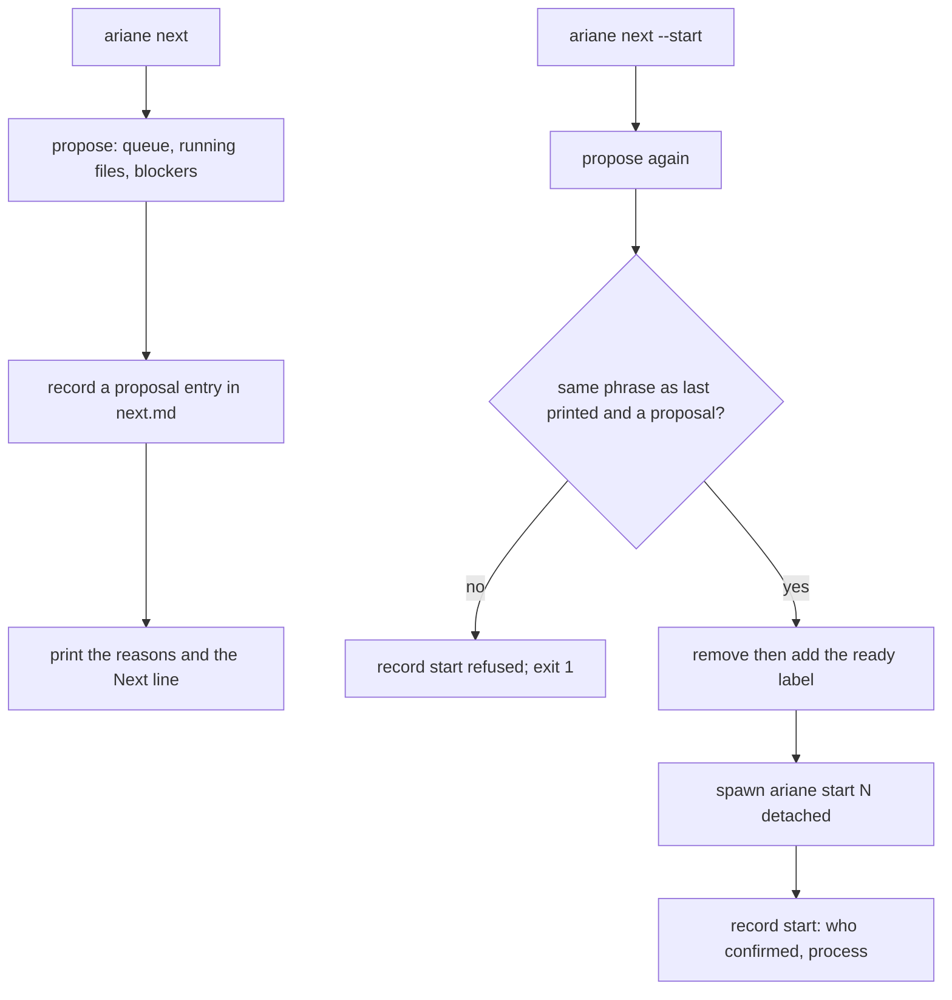
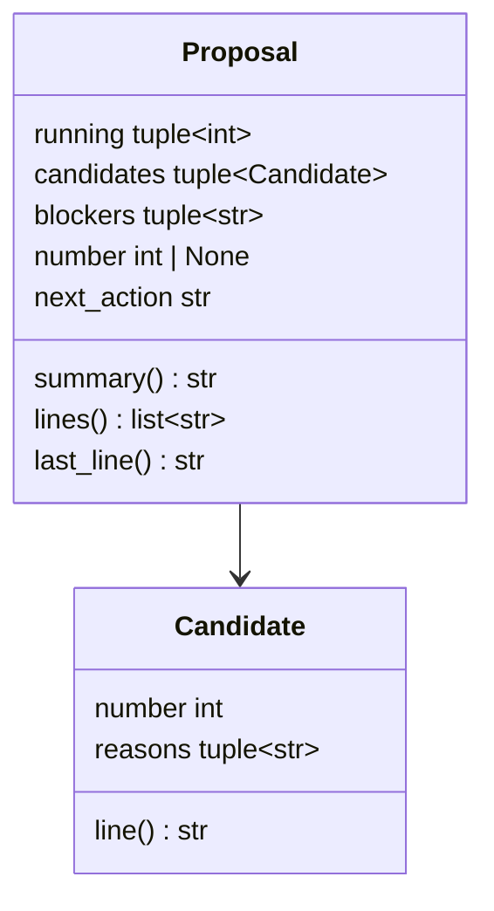
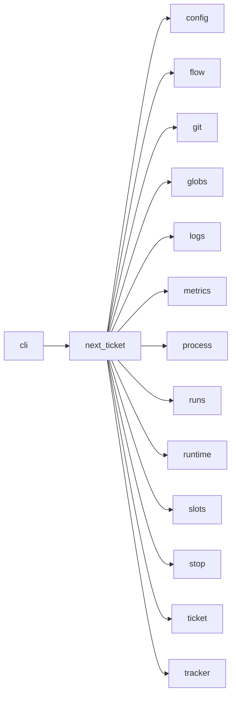

# Module `ariane.next_ticket`

`ariane next` (C11, C22, C23, ADR 0059): reads the queue (the open issues labelled `[tracker] next_label`, in label order), their `Needs #N` lines, the files each issue is expected to touch, the running tickets, the run slots and the last run, and proposes the first issue that can start safely next to the running ones. `ariane next --start` starts that proposal in the background, only if it has not changed since it was printed. Every proposal and start is appended to `<repo>.ariane/next.md`.

## Public API

| Name | Kind | What it does |
| --- | --- | --- |
| `RECORD` | constant | `next.md`, the record's file name. |
| `MODULE_DOCS` | constant | `docs/architecture/modules/`, where a module file names a module. |
| `START` | constant | `ariane next --start`, the command named by the proposal. |
| `PROPOSAL` | constant | `Proposal: `, the line of a record entry that `--start` compares. |
| `Candidate` | dataclass | An issue looked at and its reasons not to start (none: it can); `line()` prints `- #N: <reasons>` or `- #N: can start`. |
| `Proposal` | dataclass | The running tickets, the candidates, the blockers that hold for all (no slot, a quota), the proposed number or None and the next action; `summary()` is the phrase `--start` compares (`#N (no shared file with #M)`, `#N (nothing runs)` or `nothing`), `lines()` the running tickets and one line per candidate, `last_line()` the command's last line. |
| `needs(body)` | function | The issue numbers named by `Needs #N` lines (`Needs #N and #M`, `Needs #N, #M`; a list marker allowed), in order, each once. |
| `expected_paths(body, labels, root, settings)` | function | The paths and globs an issue is expected to touch: the paths its body names, the source file and tests of each module file it names, and the `[next] paths` globs of its labels. |
| `shared(first, second)` | function | The paths both lists name: equal, or a path one list's glob matches. |
| `propose(root, config, tracker, slot_folder=None)` | function | Reads everything and returns the `Proposal`; starts nothing and writes nothing. |
| `last_quota_stop(root)` | function | The number of the last run that ended if it stopped on a quota, else None. |
| `record_path(root)` | function | `<repo>.ariane/next.md`. |
| `output_path(root, number)` | function | `<repo>.ariane/logs/<n>.out`, the output of a ticket started in the background. |
| `record(root, title, proposal, extra=())` | function | Appends an entry to `next.md`: time and title, running tickets, every candidate's line, the `extra` lines, then `Proposal: 
`. |
| `last_printed(root)` | function | The proposal phrase of the last entry of `next.md`, None without one. |
| `show(root, config, tracker, slot_folder=None)` | function | `ariane next`: `propose`, record it as a `proposal` entry, log `next.proposed`. |
| `Launch` | type alias | A function that starts `ariane start <n>` in the background and returns its process id. |
| `start(root, config, tracker, launch, slot_folder=None)` | function | `ariane next --start`: proposes again; refuses (a `start refused` entry, exit 1) when the phrase differs from `last_printed` or nothing is proposed; otherwise removes and adds the issue's `ready_label`, calls `launch`, records a `start` entry (who confirmed, the process) and logs `next.started`. Returns the proposal and the outcome. |
| `spawn(root, number, environ)` | function | Runs `python -m ariane start <n>` in `root`, detached (its own session on POSIX, a detached process group on Windows, no input), output appended to `output_path`; returns its process id. |

## Behaviour and errors

- **Queue.** `tracker.queue(next_label)`: the running tickets (live entries of `runs.running`) are left out, then the first `[next] look_ahead` issues are candidates.
- **Reasons**, in this order: an issue with a ticket tree or a local branch `ariane/<n>` is `already started (branch ariane/<n>); see ariane status <n>` and nothing else; `waits on #N` for each needed issue not closed as completed (`(unreadable: …)` when the tracker fails for it); `shares <paths> with running #M` for each running ticket sharing a path; then the blockers.
- **Expected paths.** A body word, quotes, brackets and trailing punctuation removed, is a path with a `/` and an extension or a wildcard in its last segment; a folder `a/b/` becomes `a/b/**`; a word without `/` counts only as a file at the root of `root` or a module file of `MODULE_DOCS`. URLs, absolute paths, `..` and placeholders never count. A module file `<m>.md` adds `src/*/<m>.py` and the tests `tests/**/test_*.py` whose name holds `<m>`'s words in a row.
- **Running files.** The branch's changes since `git merge-base origin/<base> ariane/<m>`, read in the ticket's tree when it exists (uncommitted and untracked files included), else between commits; a git error leaves only the expected files, from the queue entry or, for an issue no longer queued, the brief in its tree.
- **Blockers.** `no free run slot (<slots.REASON>)` when `slots.held` cannot take a slot (it is released at once); `the last run, #N, stopped on a quota of its agent` when `last_quota_stop` finds one: the last line of `runs/ended.jsonl` by end time, its `metrics.json` with outcome `stopped` and a last session whose `stop_reason` is `quota`.
- **Last line.** `Next: #N (no shared file with #M). Start it with ariane next --start.`, or `Nothing to start: <blockers, or why>. Next: <action>.`: wait for a run to end, restart the quota-stopped ticket once the quota resets, wait for a running ticket or a needed issue, or label an issue.
- **Start.** A missing record, a changed phrase (another start, a closed issue, a new running ticket) or no proposal refuses without touching the tracker. A refused relabel (`TrackerError`) refuses before any launch. The new proposal is recorded on a refusal, so the next `--start` confirms what was just printed.

## Workflow

## Code view (C4 level 4)

## Collaborations

Arrows go from the importing module to the imported module; a dashed arrow is an import for type checking only.

<!-- generated: collaborations -->

<!-- end generated -->

## Serves

C11, C22, C23; ADR 0059. See [the component view](../3-components.md).
