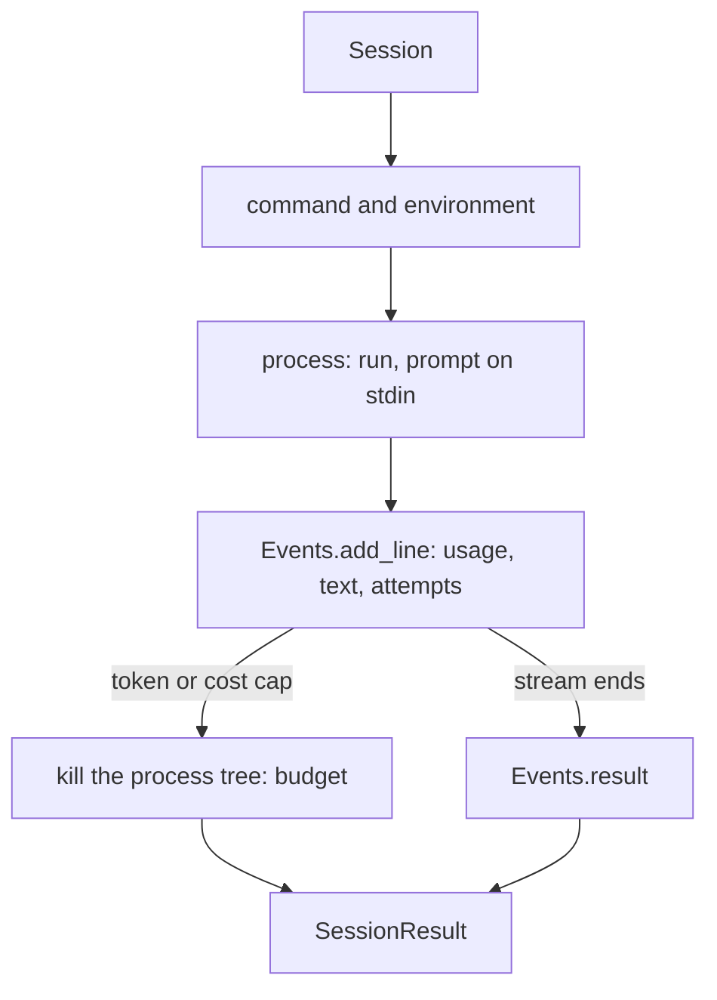
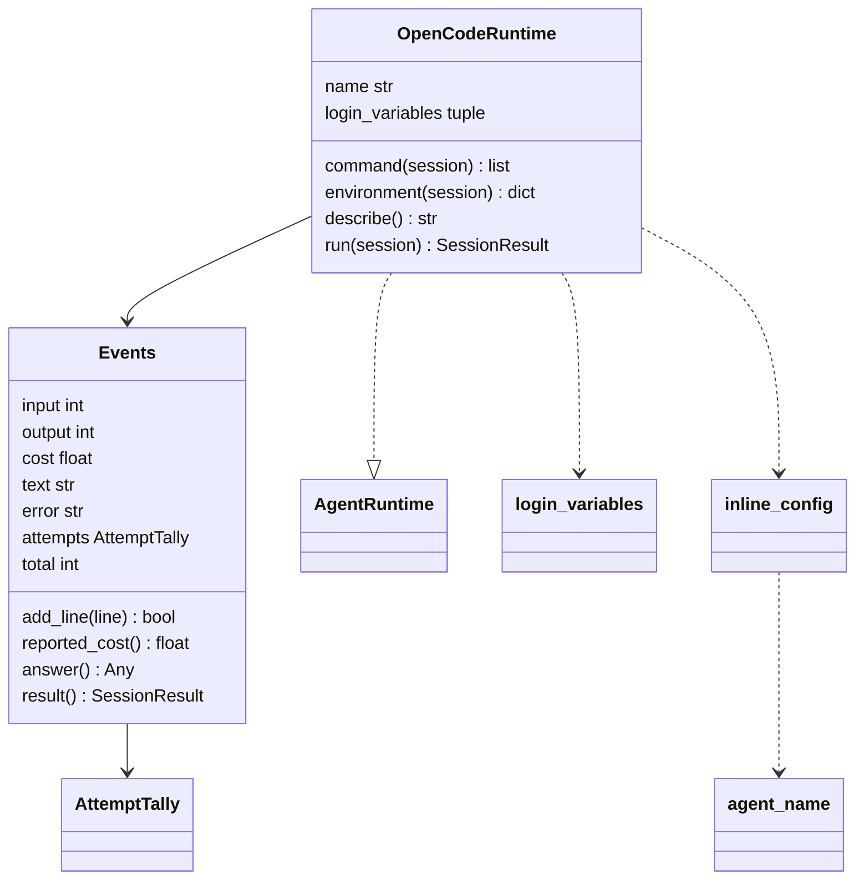
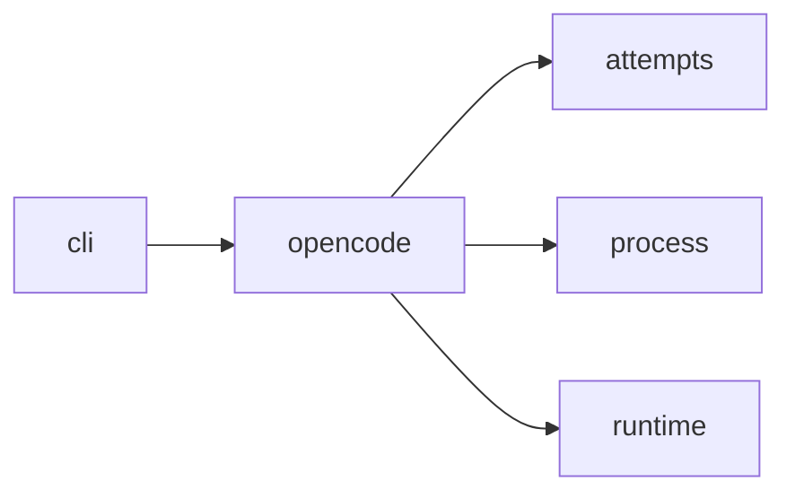

# Module `ariane.opencode`

opencode as an agent runtime, for the reviewer role: it starts `opencode run --pure --format json --model <provider/model> --agent ariane-<role> --dir <working tree>` with the prompt on standard input, in the session's working tree, and turns the event stream into a `SessionResult`.

## Public API

| Name | Kind | What it does |
| --- | --- | --- |
| `STEPS` | constant | 20: the agent's `steps`, the turn cap (opencode has no turn option on its command line). |
| `TITLE_NOTE` | constant | The note that the title call's usage is not reported by opencode. |
| `login_variables(model)` | function | The provider keys a `<provider>/<model>` needs in the agent's environment. |
| `agent_name(role)` | function | The opencode agent of a role: `ariane-<role>`. |
| `inline_config(role, tools)` | function | The `OPENCODE_CONFIG_CONTENT` text. |
| `OpenCodeRuntime` | class | `OpenCodeRuntime(executable=("opencode",), model=None)` implements `AgentRuntime`; its login variables are the provider keys of its model; `command`, `environment`, `describe` and `run(session)`. |
| `Events` | class | `Events(max_tokens, max_budget_usd)`: the running totals of a stream and the final answer; `add_line(line)` reads one event. |

## Behaviour and errors

- The prompt goes on standard input (no message argument, no length limit). The environment always sets `OPENCODE_DISABLE_PROJECT_CONFIG=1` (the replay tree's `opencode.json` is not read) next to `OPENCODE_DISABLE_CLAUDE_CODE=1`; Ariane's token cap is the only cap when the provider reports no cost.
- opencode takes its directory from `PWD`, not from the process's working directory: the command passes `--dir` with the absolute path of the session's tree and the environment sets `PWD` to the same path, so a reviewer reads the tree under review, not the directory Ariane was started from.
- The environment adds `OPENCODE_CONFIG_CONTENT` (the agent `ariane-<role>` with `permission` `"*": "deny"` and `allow` for the role's tools only, `steps` as the turn cap, autoupdate off, sharing disabled), `OPENCODE_DISABLE_PROJECT_CONFIG=1`, `OPENCODE_DISABLE_CLAUDE_CODE=1` and `OPENCODE_DISABLE_AUTOUPDATE=1`.
- opencode has no schema option: a session with a `json_schema` gets the schema in the message and must end with one fenced `json` block; the adapter parses the last block of the last text part into `structured_output` (Ariane validates it, ADR 0016).
- Events are read line by line: `step_finish` tokens (input, cache read, cache write, output) and cost are summed; the session stops (`budget`) when the token cap (`Session.max_tokens`) or the cost cap (`max_budget_usd`) is reached, killing the process tree. An `error` event or a non-zero exit is `error`; `finished` needs a `step_finish` with reason `stop`. A cost of 0 is "cost not reported".
- The title call has no `step_finish`: its usage is never reported, and `describe` says so with `opencode --version`, for the journal.
- Attempts (C19, ADR 0036): `Events` reads the `tool_use` events of the `bash` tool and counts, once per call, the commands that push or open a pull request (`attempts` module), reported on `SessionResult.attempts`.

## Workflow

## Code view (C4 level 4)

## Collaborations

Arrows go from the importing module to the imported module; a dashed arrow is an import for type checking only.

<!-- generated: collaborations -->

<!-- end generated -->

## Serves

C5; ADR 0014, ADR 0015, ADR 0016, ADR 0029, ADR 0036. See [the component view](../3-components.md).
