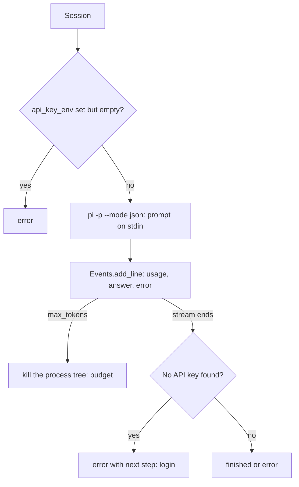
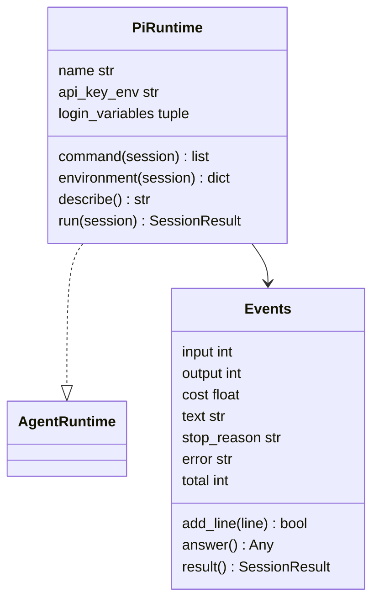
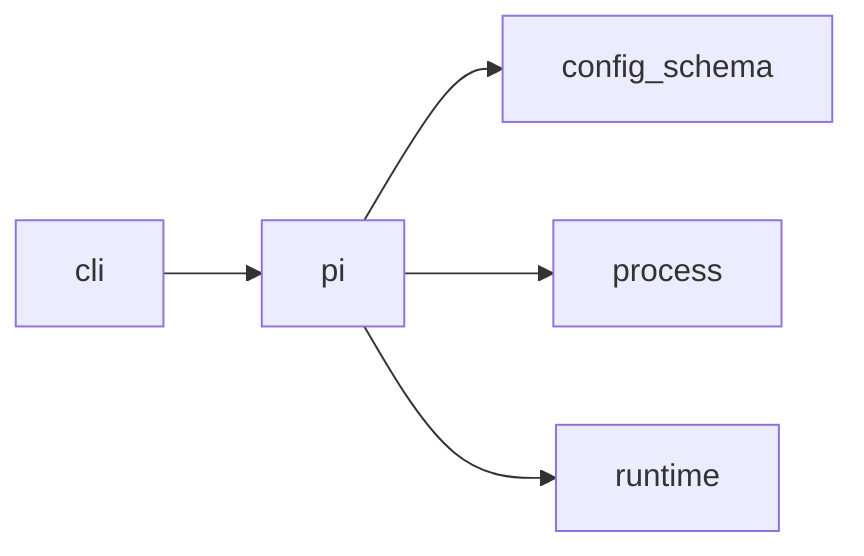

# Module `ariane.pi`

pi as an agent runtime, for the reviewer role (ADR 0051): it starts the official CLI as `pi -p --mode json --no-session --no-extensions --no-skills --no-prompt-templates --no-themes --no-context-files --offline --tools <tools> --model <provider>/<id>` in the reviewer tree, with the prompt on standard input, and turns the JSON Lines events into a `SessionResult`. Ariane never reads, copies or logs pi's `auth.json`.

## Public API

| Name | Kind | What it does |
| --- | --- | --- |
| `ISOLATION` | constant | The isolation flags of every session: no session file, extension, skill, prompt template, theme, context file or startup network operation. |
| `LOGIN_NEXT` | constant | "run pi and /login, or set agents.reviewer.api_key_env", the next step of a session without credentials. |
| `AGENT_DIR` | constant | `PI_CODING_AGENT_DIR`, the variable naming pi's own folder (default `~/.pi/agent`). |
| `provider(model)` | function | The provider part of `<provider>/<id>`, lower case. |
| `no_credentials(name)` | function | "pi has no credentials for <provider>", the summary of that session. |
| `PiRuntime` | class | `PiRuntime(executable=("pi",), api_key_env=None)` implements `AgentRuntime`; its login variables are `PI_CODING_AGENT_DIR` and `api_key_env`; `command`, `environment`, `describe` (`pi --version`) and `run(session)`. |
| `Events` | class | `Events(max_tokens)`: the running totals of a stream, the last assistant message, its stop reason and the error; `add_line(line)` reads one event. |

## Behaviour and errors

- The prompt goes on standard input (pi merges piped input into the prompt in print mode; checked on pi 0.73.1); the schema of the answer is appended to it, and the answer is the last fenced `json` block of the last assistant message of `agent_end` (else of the last `message_end`).
- `--tools` is the reviewer's `tools`, a subset of `read`, `grep`, `find`, `ls` (the config loader refuses `bash`, `edit`, `write` and any other name). `PI_TELEMETRY=0` is set for the process.
- The process environment holds no provider key of Ariane's own: the variables of pi's documented provider list (`config_schema.PI_PROVIDER_KEYS`), any `*_API_KEY`, `AWS_*` and `GOOGLE_APPLICATION_CREDENTIALS` are removed, as is `api_key_env` itself (matched case-insensitively; a name ending in `_` is a prefix, ADR 0024). With `api_key_env`, its value is passed under the model provider's own variable (`anthropic` gets `ANTHROPIC_API_KEY`) to this process only; without it pi uses its own `auth.json`.
- An `api_key_env` naming an unset variable ends the session as `error` before pi starts.
- "No API key found for <provider>" on pi's output, with no assistant message, ends the session as `error` with `no_credentials(provider)` and the next step `LOGIN_NEXT`: the session is not a review.
- Each assistant `message_end` adds its `usage` (`input`, `output`, `cacheRead`, `cacheWrite`, and `cost.total`); the session stops (`budget`, the process tree is killed) when `max_tokens` is reached. A cost above 0 is recorded as the session's cost, else it stays null (`not reported`).
- An assistant message with `stopReason` `error` or `aborted` is an `error` with its `errorMessage`, unless an `auto_retry_start` follows and a later message succeeds; a failed `auto_retry_end` is `error` with its `finalError`. A non-zero exit, or a last assistant message whose stop reason is not `stop`, is `error`.
- Time limits (C5): `Session.timeout_s` and `Session.idle_timeout_s` go to `process.stream`; a kill at the total limit is `timeout` with `timeout_summary`, a kill at the idle limit (ADR 0045) is `timeout` with `idle_summary`.

## Workflow

## Code view (C4 level 4)

## Collaborations

Arrows go from the importing module to the imported module; a dashed arrow is an import for type checking only.

<!-- generated: collaborations -->

<!-- end generated -->

## Serves

C5, C10, C19; ADR 0015, ADR 0031, ADR 0051. See [the component view](../3-components.md).
