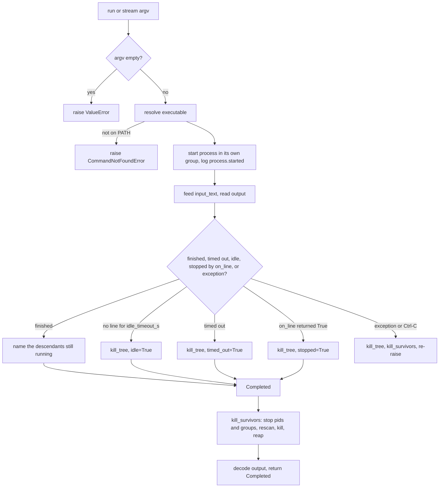
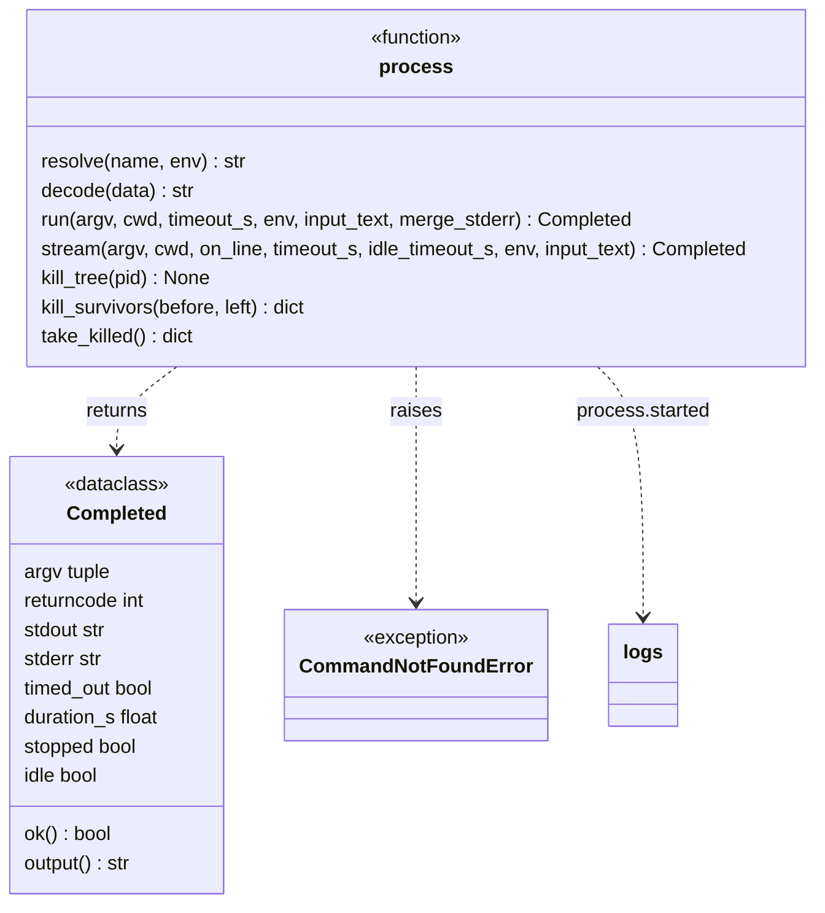
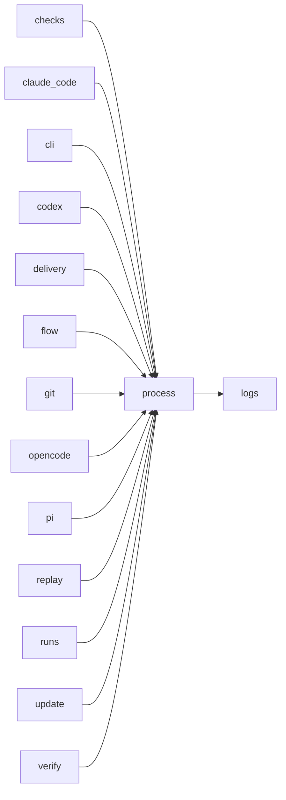

# Module `ariane.process`

Runs external commands from argument lists: PATH resolution, UTF-8 output, timeouts and cleanup of the whole process tree (C9, C5).

## Public API

| Name | Kind | What it does |
| --- | --- | --- |
| `CommandNotFoundError` | exception | Raised for an unknown command. |
| `Completed` | dataclass | The outcome of one command: `argv`, `returncode`, `stdout`, `stderr`, `timed_out`, `duration_s`, `stopped`, `idle` (killed at its idle limit); `ok()` and `output()`. |
| `resolve(name, env=None)` | function | Find an executable through the absolute PATH entries only. |
| `decode(data)` | function | Decode process output as UTF-8 whatever the system locale; invalid bytes are replaced. |
| `run(argv, *, cwd, timeout_s=None, env=None, input_text=None, merge_stderr=False)` | function | Run a command without a shell and return a `Completed`. |
| `stream(argv, *, cwd, on_line, timeout_s=None, idle_timeout_s=None, env=None, input_text=None)` | function | Like `run`, but passes each standard output line to `on_line` while the command runs; it returns True to stop the whole tree (`Completed.stopped`). When no standard output line has arrived for `idle_timeout_s`, the whole tree is killed and `Completed.idle` is set (C5, ADR 0045). |
| `make_undumpable()` | function | On Linux, `prctl(PR_SET_DUMPABLE, 0)` through `ctypes` so a same-user process cannot read Ariane's memory or environment block; a no-op elsewhere; a failure is journaled as `process.undumpable_failed`, never fatal (C21). |
| `kill_tree(pid)` | function | Stop a process and all its descendants (its process group on POSIX). |
| `set_child_subreaper(on=True)` | function | On Linux, `prctl(PR_SET_CHILD_SUBREAPER)` so that orphaned descendants are reparented to Ariane rather than to init; a no-op elsewhere; returns why it failed (logged as `process.subreaper_failed`) or `None`, and `cli.main` then refuses `start` and `verify` (C10, ADR 0031). |
| `descendants(*, exited=False)` | function | The running descendants of this process (pid to command name), read from `/proc` on Linux; empty elsewhere. Exited, unreaped processes are left out unless `exited` (the `before` of `kill_survivors` includes them, so it never reaps a child someone else waits for). |
| `kill_survivors(before, left=None)` | function | Stops (`SIGSTOP`) the running descendants not in `before`, scanning again until every one is stopped and no scan finds a new one (a stopped process cannot fork), then kills them (`SIGKILL`), reaps those reparented to Ariane, and scans until none is left. The process group and session of every new process found, running or exited (read from the scan before it is reaped), are stopped and killed as a whole too (`os.killpg`), unless Ariane or a process in `before` belongs to them (a group seen with such a process stays protected after it exits), and their members not in `before` are counted like descendants: a process that forks and exits faster than a scan cannot escape (#188). A scan that finds nothing left still sends `SIGKILL` to the groups that were only stopped before the scans end. Logs `process.survivors_killed` (and `process.survivors_remaining` if some still run after 5 seconds, once every group and pid found was sent `SIGKILL`, stopped or not); returns them by pid, with `left` (what the command left in its own group, already killed by `kill_tree`), and keeps them all for `take_killed`. |
| `take_killed()` | function | The processes `kill_survivors` killed since the last call (pid to command name), then forgets them; copying and clearing hold the lock of the survivor scans, so a record a parallel worker adds meanwhile is kept for the next call, never lost (ADR 0052). |
| `Cancelled` | exception | A command was not started: its thread was cancelled (`cancel`). |
| `cancel(threads)` | function | Kills the process trees of the commands the given threads run now and refuses (`Cancelled`) the ones they start next, until `resume`; a thread inside `shielded` keeps its command (parallel checks, ADR 0052). |
| `resume(threads)` | function | Lifts `cancel` for the given threads. |
| `shielded()` | context manager | The commands the current thread runs in the block are neither killed nor refused by `cancel` (creating or removing a replay tree is never left half done). |

## Behaviour and errors

- Never uses a shell: `argv` is a list; an empty one raises `ValueError`. `resolve` raises `CommandNotFoundError` for a name not on the PATH.
- Cleanup (C5): the process tree is killed in a `finally` around the wait, so a normal exit, a timeout, Ctrl-C (`KeyboardInterrupt`) or any other exception leaves nothing running; the exception is re-raised.
- Commands of several threads (parallel checks, ADR 0052): `run` and `stream` register each command (pid and thread) from its spawn to its reaping; a spawn and a survivor scan never overlap (one process-wide lock), and `kill_survivors`, like the descendants a command left when it ended, spares the commands other threads still wait for, their descendants and the members of their process groups and sessions, and never reaps another thread's child. With one thread, nothing changes.
- Surviving processes (C10, ADR 0031): a process that leaves the group (`setsid`, `setpgid`) outlives `kill_tree`. `cli.main` makes Ariane the subreaper, so such a process stays a descendant. Every command's own teardown (the same `finally`, so also on an error or Ctrl-C) calls `kill_survivors` with the descendants taken just before it started; when the command exited by itself (not timed out, not stopped by `on_line`), the descendants still running are named before `kill_tree`, so a background child left in the group is counted too: nothing it started still runs when `run` or `stream` returns or raises, before the caller runs anything else or removes a tree. The flow and `verify` take `descendants()` when they start, and after each setup, agent session and check call `kill_survivors` again and `take_killed` to count and report what was killed; on a stop they count what is left. On macOS and Windows `descendants()` finds nothing (a residual of ADR 0031). A process that calls `setsid()` again in every generation can still escape the scans on Linux; only an operating-system sandbox (slice 7) closes that.
- A timeout does not raise: it sets `Completed.timed_out`. The idle limit of `stream` (ADR 0045) does not raise either: it sets `Completed.idle` (`returncode` is `None`, `ok()` is False); the wait wakes at whichever of the two limits comes first, and the time of the last line is reset by every standard output line (standard error does not count). Output is decoded with `decode`.
- Logs `process.started` (each argument cut to 200 characters) and `process.exited` through `logs`; reads and writes no file.

## Workflow

## Code view (C4 level 4)

## Collaborations

Arrows go from the importing module to the imported module; a dashed arrow is an import for type checking only.

<!-- generated: collaborations -->

<!-- end generated -->

## Serves

C9, C5; ADR 0001. See [the component view](../3-components.md).
