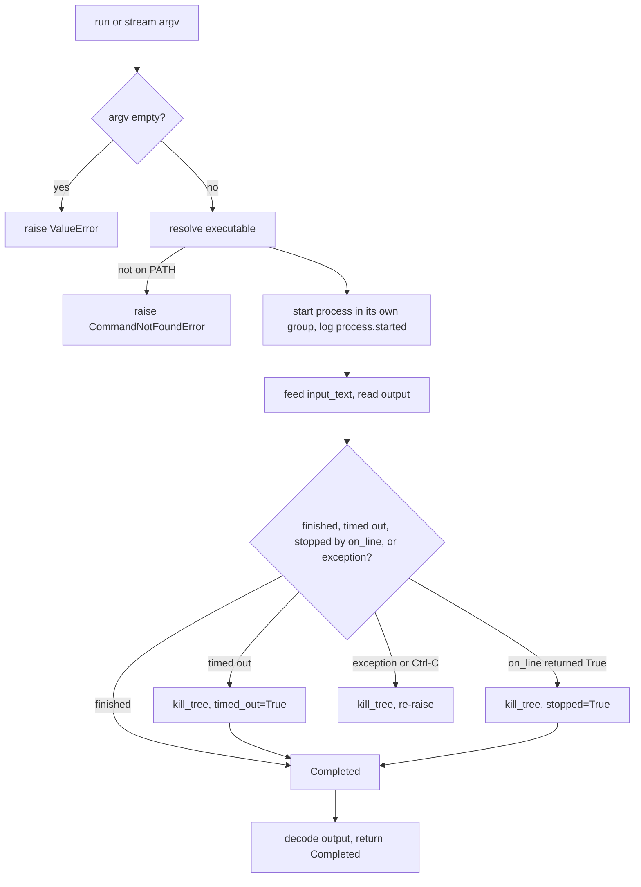
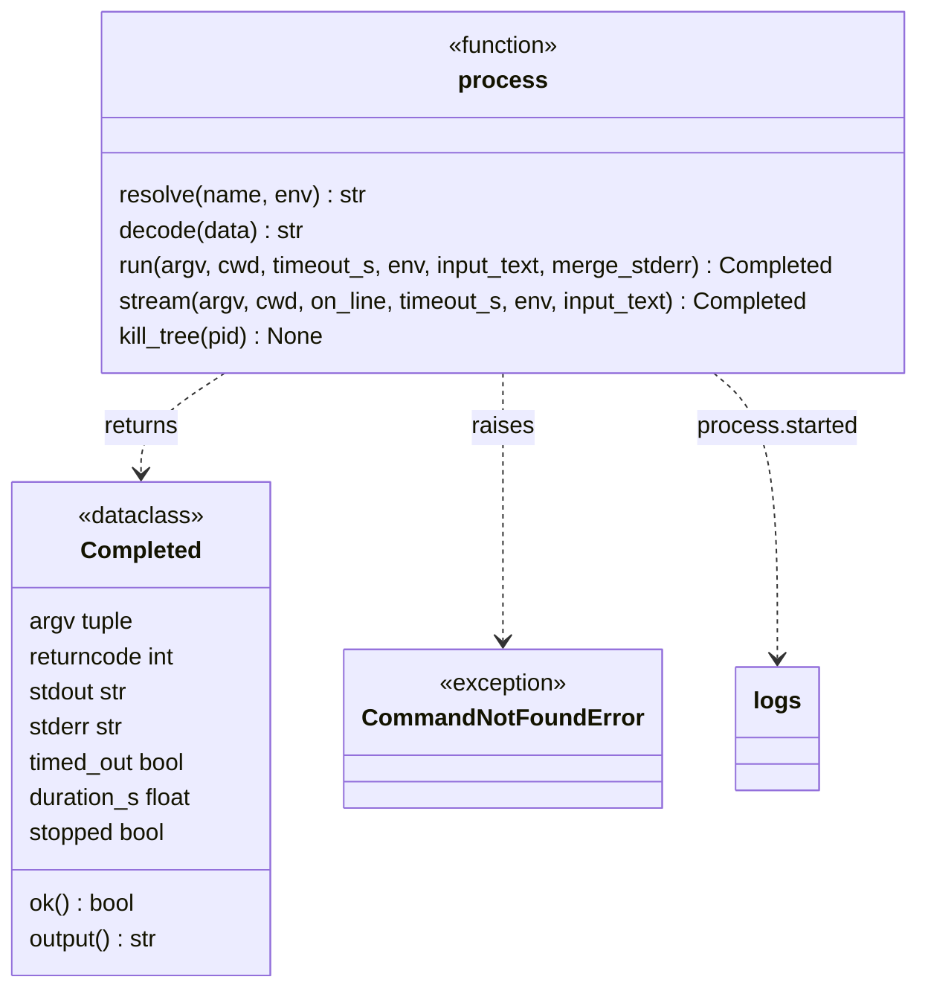
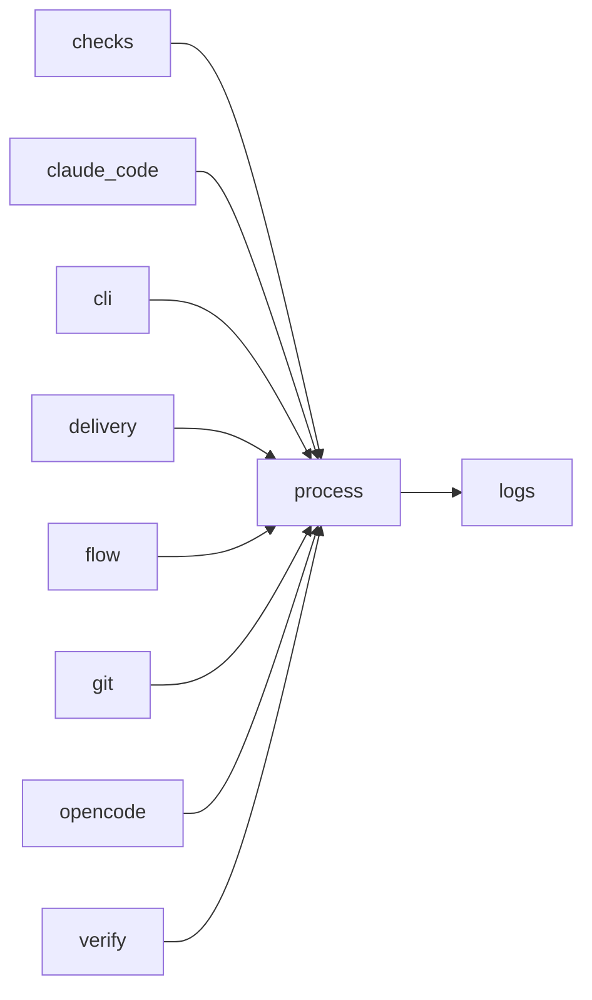

# Module `ariane.process`

Runs external commands from argument lists: PATH resolution, UTF-8 output, timeouts and cleanup of the whole process tree (C9, C5).

## Public API

| Name | Kind | What it does |
| --- | --- | --- |
| `CommandNotFoundError` | exception | Raised for an unknown command. |
| `Completed` | dataclass | The outcome of one command: `argv`, `returncode`, `stdout`, `stderr`, `timed_out`, `duration_s`, `stopped`; `ok()` and `output()`. |
| `resolve(name, env=None)` | function | Find an executable through the absolute PATH entries only. |
| `decode(data)` | function | Decode process output as UTF-8 whatever the system locale; invalid bytes are replaced. |
| `run(argv, *, cwd, timeout_s=None, env=None, input_text=None, merge_stderr=False)` | function | Run a command without a shell and return a `Completed`. |
| `stream(argv, *, cwd, on_line, timeout_s=None, env=None, input_text=None)` | function | Like `run`, but passes each standard output line to `on_line` while the command runs; it returns True to stop the whole tree (`Completed.stopped`). |
| `kill_tree(pid)` | function | Stop a process and all its descendants (its process group on POSIX). |

## Behaviour and errors

- Never uses a shell: `argv` is a list; an empty one raises `ValueError`. `resolve` raises `CommandNotFoundError` for a name not on the PATH.
- Cleanup (C5): the process tree is killed in a `finally` around the wait, so a normal exit, a timeout, Ctrl-C (`KeyboardInterrupt`) or any other exception leaves nothing running; the exception is re-raised.
- A timeout does not raise: it sets `Completed.timed_out`. Output is decoded with `decode`.
- Logs `process.started` (each argument cut to 200 characters) and `process.exited` through `logs`; reads and writes no file.

## Workflow

## Code view (C4 level 4)

## Collaborations

Arrows go from the importing module to the imported module; a dashed arrow is an import for type checking only.

<!-- generated: collaborations -->

<!-- end generated -->

## Serves

C9, C5; ADR 0001. See [the component view](../3-components.md).
