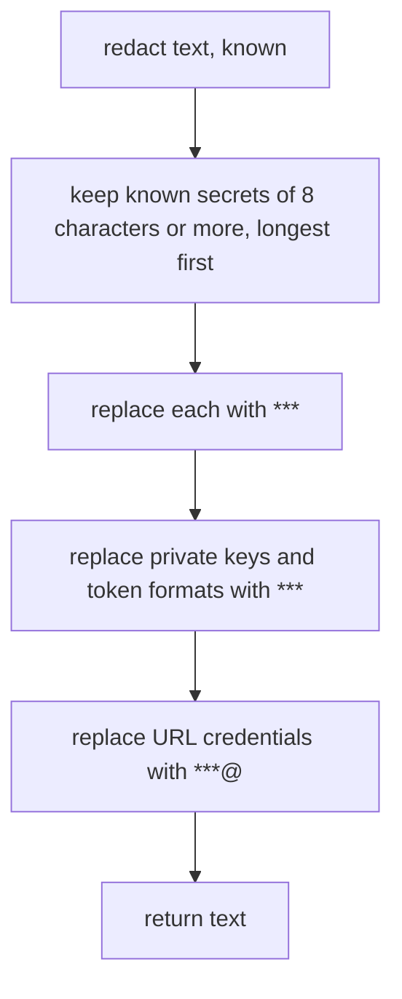
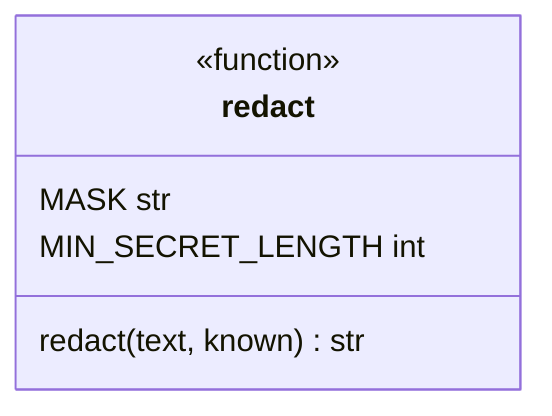
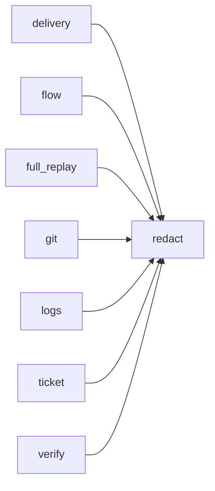

# Module `ariane.redact`

Masks known secrets and common token formats in any text that leaves Ariane (C21).

## Public API

| Name | Kind | What it does |
| --- | --- | --- |
| `MASK` | constant | The replacement text, `***`. |
| `MIN_SECRET_LENGTH` | constant | The shortest known secret that is masked (8), since shorter values would mask common words. |
| `redact(text, known=())` | function | `text` with the known secrets, common token formats and URL credentials replaced. |

## Behaviour and errors

- Masks, in this order: the known secrets of at least `MIN_SECRET_LENGTH` characters (longest first), whole private key blocks, GitHub tokens (`ghp_`…, `github_pat_`), `sk-ant-` and `sk-` keys, AWS `AKIA` keys, Slack tokens, then the credentials of URLs (`scheme://user:pass@`).
- Reads and writes no file and raises nothing.

## Workflow

## Code view (C4 level 4)

## Collaborations

Arrows go from the importing module to the imported module; a dashed arrow is an import for type checking only.

<!-- generated: collaborations -->

<!-- end generated -->

## Serves

C21; ADR 0013. See [the component view](../3-components.md).
