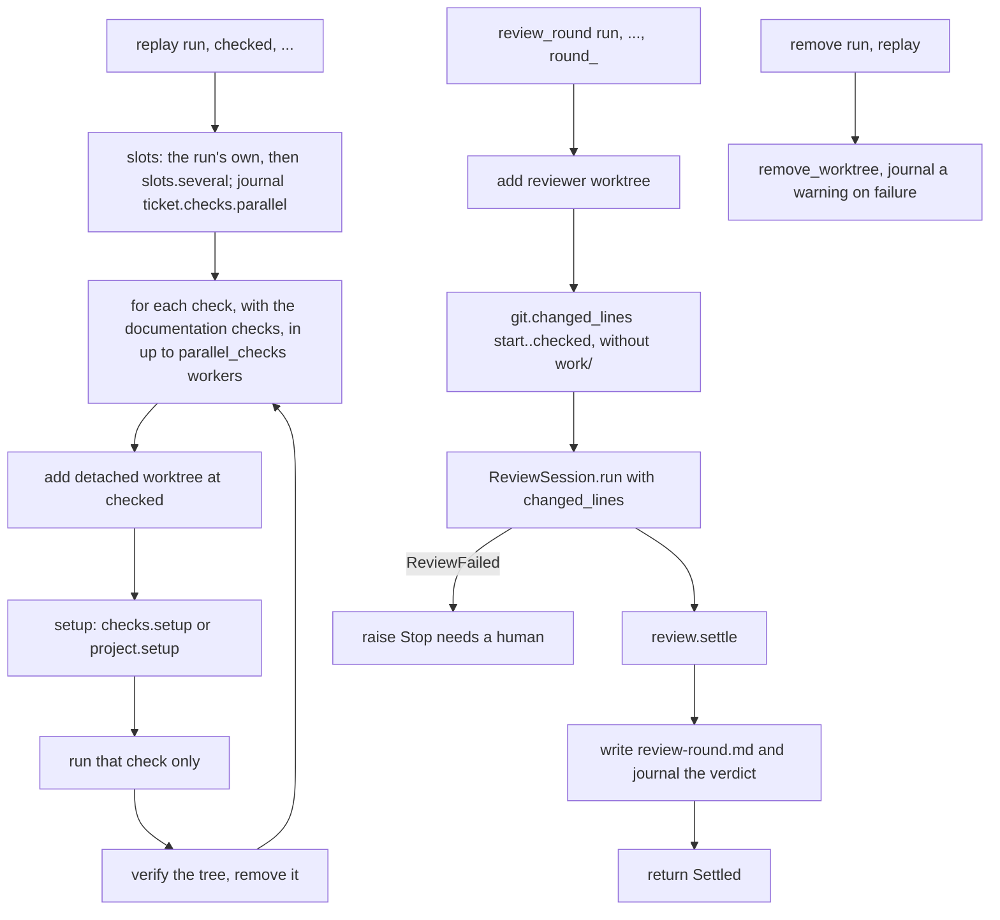
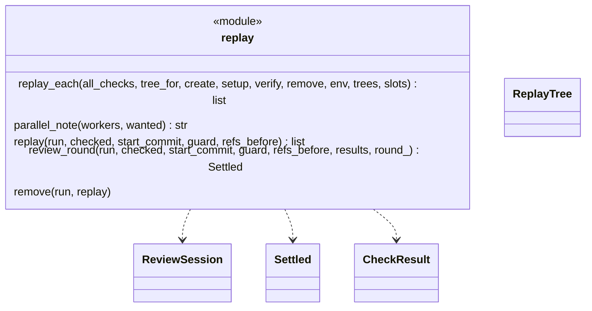
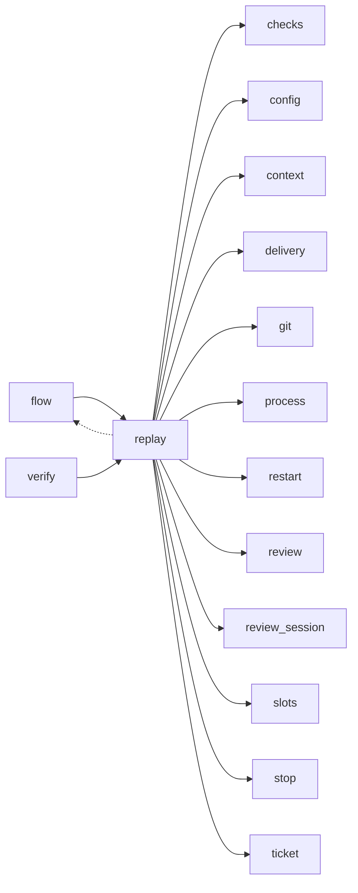

# Module `ariane.replay`

One round of replay and review of a ticket, moved out of `flow` unchanged (ADR 0034): each check in its own clean working tree (C9, ADR 0041), several at the same time with `project.parallel_checks` (ADR 0052), then the read-only reviewer on a separate tree (C10, C26).

## Public API

| Name | Kind | What it does |
| --- | --- | --- |
| `ReplayTree` | dataclass | One check's tree: `check`, `path`, `setup_s` (the setup's duration), `slot` (the worker's slot in a parallel replay, else `None`). |
| `replay_each(all_checks, tree_for, create=, setup=, verify=, remove=, env=, trees=, slots=())` | function | The loop shared by `start` and `verify`: per check, a fresh tree, its setup (`setup(check, tree, env)`), that check only, a verification, then removal (also on a stop or Ctrl-C); with several `slots`, one worker thread per slot (ADR 0052). |
| `parallel_note(workers, wanted)` | function | The journal text of a parallel replay: how many checks ran at once, in which slots, and that fewer slots than `wanted` were free when it is so. |
| `replay(run, checked, start_commit, guard, refs_before)` | function | Replays every check in its own clean tree at the delivered commit; returns the results. |
| `review_round(run, checked, start_commit, guard, refs_before, results, round_)` | function | Runs review `round_` on the reviewer tree and returns the settled review. |
| `remove(run, replay)` | function | Removes a replay or reviewer tree, journaling a warning if it cannot. |
| `truncation_note(diff)` | function | Where the reviewer's diff was cut and the files whose hunks it lacks, or `""` when it is whole (ADR 0031). |
| `record_truncation(folder, diff)` | function | Journals `ticket.review.diff_truncated` with the files whose hunks the reviewer's diff lacks; returns them (empty when the diff is not cut). |

## Behaviour and errors

- `replay_each`: for each check in order creates a fresh detached tree (`<n>-replay-<k>`, `verify-<slug>-<k>`), runs the setup (`checks[].setup`, else `project.setup`), runs that check only, verifies, removes the tree. A leftover tree of that name refuses; for a ticket (not a shadow run, `run.restartable`) the next action is "run `ariane start <n> --restart`" (ADR 0047), for the reviewer tree too. The setup duration is not part of the check's duration.
- Parallel replay (ADR 0052): with more than one slot, `replay_each` starts one thread per slot; each takes the next check in declared order and replays it in its own tree, with its slot as `ARIANE_SLOT` for its setup and check. Creating and removing a tree are done one worker at a time; setups, checks and verifications run concurrently. The results, and `trees`, are in the declared order whatever the finishing order. The first stop in a worker (a setup failure, a guard failure, any error), or Ctrl-C in the calling thread, stops the others: no new check is taken, `process.cancel` kills their running commands and refuses their next ones except tree creation and removal (`process.shielded`), every tree is removed, then that first stop is raised. With one slot or none, the checks run one by one in the calling thread, as before.
- `replay`: `replay_each` for a ticket, with `min(project.parallel_checks, number of checks)` workers wanted: the run's own slot and as many more as `slots.several` gets; when more than one is wanted it journals `ticket.checks.parallel` (`parallel_note`) before the first check; each setup is followed, before its check runs, by the comparison of git and the reviewer's instruction files with the guard's snapshot (`run.setup(tree, command, guard)`); a setup stop names the check whose tree it was; journals `ticket.checks.worktree`, one line per check (with its slot in a parallel replay); returns the results (no tree is kept, the reviewer has its own).
- `review_round`: review `round_` on the reviewer tree, with the diff and its untruncated `git diff --name-status`; before the round it counts the changed lines of the reviewed range (`git.changed_lines` from the start commit to the checked commit, without `work/`), recomputed each round since a fix round changes the diff, and passes the count and the small reviewer's environment (`run.agent_envs["reviewer.small"]`) to `ReviewSession`, which chooses the reviewer settings (`[agents.reviewer.small]` when the count is at most `max_lines`, ADR 0046) and records `changed_lines` in the metrics; `review-<round>.md` names the model of the selected reviewer; when the diff is cut, `record_truncation` journals the missing files and `run.truncated` keeps them for the pull request body (ADR 0031); writes `review-<round>.md`, journals the verdict and tells the metrics the first-pass verdict.
- `remove`: removes a replay or reviewer tree, journaling a warning if it cannot.

## Workflow

## Code view (C4 level 4)

## Collaborations

Arrows go from the importing module to the imported module; a dashed arrow is an import for type checking only.

<!-- generated: collaborations -->

<!-- end generated -->

## Serves

C9, C10, C26; ADR 0018, ADR 0027, ADR 0031, ADR 0034, ADR 0046, ADR 0047, ADR 0052. See [the component view](../3-components.md).
