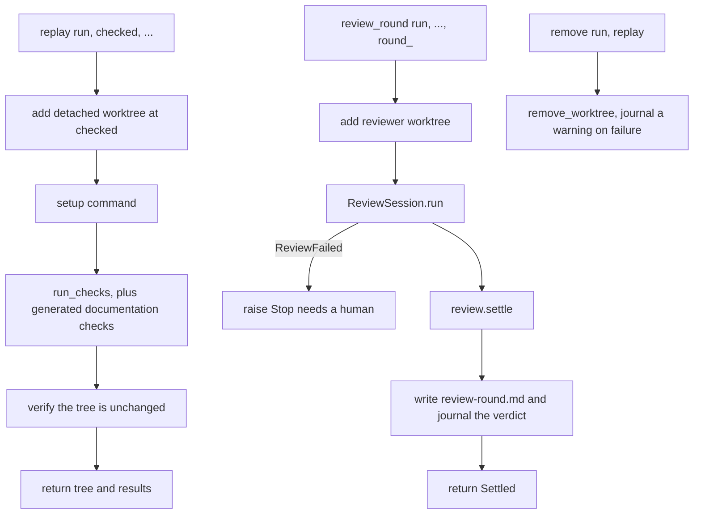
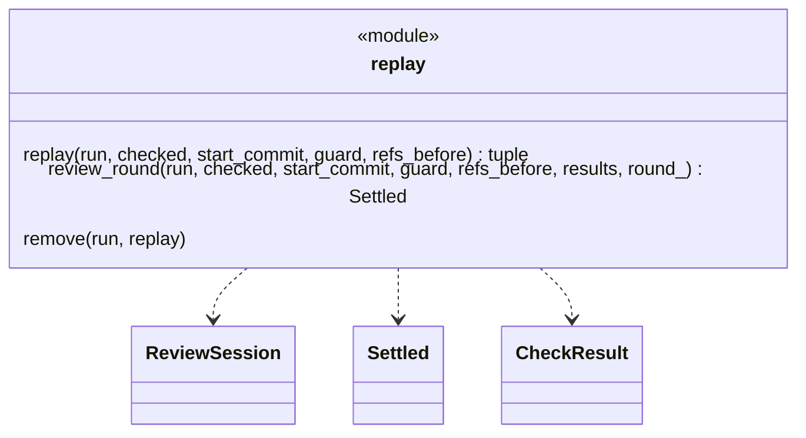
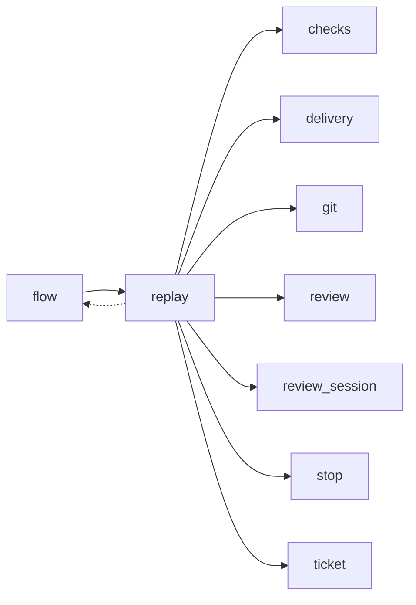

# Module `ariane.replay`

One round of replay and review of a ticket, moved out of `flow` unchanged (ADR 0034): the checks in a clean working tree (C9), then the read-only reviewer on a separate tree (C10, C26).

## Public API

| Name | Kind | What it does |
| --- | --- | --- |
| `replay(run, checked, start_commit, guard, refs_before)` | function | Runs every check in a clean tree at the delivered commit; returns the tree and the results. |
| `review_round(run, checked, start_commit, guard, refs_before, results, round_)` | function | Runs review `round_` on the reviewer tree and returns the settled review. |
| `remove(run, replay)` | function | Removes a replay or reviewer tree, journaling a warning if it cannot. |

## Behaviour and errors

- `replay`: sets up and runs every check in a clean working tree at the delivered commit and returns the tree, kept for the reviewer.
- `review_round`: review `round_` on the reviewer tree; writes `review-<round>.md`, journals the verdict and tells the metrics the first-pass verdict.
- `remove`: removes a replay or reviewer tree, journaling a warning if it cannot.

## Workflow

## Code view (C4 level 4)

## Collaborations

Arrows go from the importing module to the imported module; a dashed arrow is an import for type checking only.

<!-- generated: collaborations -->

<!-- end generated -->

## Serves

C9, C10, C26; ADR 0018, ADR 0027, ADR 0031, ADR 0034. See [the component view](../3-components.md).
